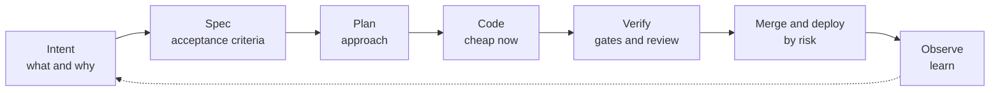
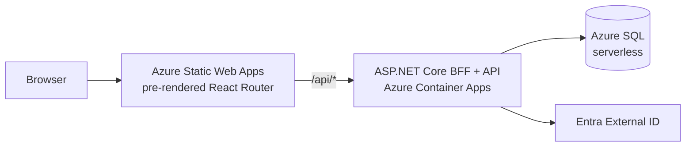

# Chapter 1: The shift: from writing code to designing the line

> ⏱ About 20 min · You'll learn: what a software factory is and isn't, why the bottleneck moves from writing code to checking it, which decisions stay human, and the route this course takes through BusyHamster.

---

## 📖 Story: The evening the agent was faster than you

It's a Saturday morning in November. BusyHamster has been live at busyhamster.app for three weeks. It's a focus timer for people who do deep work: you type what you're working on, press Enter, and the pomodoro belongs to that line. When you come back after a break, the line you were on is the first thing you see, and one key resumes.

You built most of it with Claude Code in the evenings, after your day job. The last big feature, the spec in `docs/spec-tasks-and-lines.md`, went from idea to production in two evenings. The agent wrote most of the code. You wrote the spec, answered its questions, read every diff and pressed merge at half past midnight.

Looking back at those two evenings, you notice where the time actually went:

| Activity | Time |
|---|---|
| Writing the spec and answering the agent's questions | 1.5 hours |
| Watching the agent work, approving commands, nudging it back on track | 2 hours |
| Reading diffs line by line | 2.5 hours |
| Running the tests and the build yourself, because nothing else does | 30 minutes |
| Fixing a regression in the resume card that you spotted the next morning, in production | 45 minutes |

The agent wrote the code in about forty minutes of machine time. Everything else was you. You were the scheduler, the CI server, the code reviewer, the QA team and the release manager, and you did all of it at the end of a long day.

Now you want three bigger things: a new frontend framework, accounts so your history syncs between laptop and phone, and a .NET API behind it. If every change still has to go through you at midnight, that's months.

You open a new note and call it **Factory log**. The first entry says: *"The agent isn't the slow part. I am. Build the line, not just the product."*

---

## 🏚️ Old way → 🚀 New way

| What you do now | What you do in a factory | Why it changes |
|---|---|---|
| Prompt the agent and watch it work | Label an issue; the agent works in CI and opens a PR | Your attention is the scarcest resource; spend it on decisions, not on watching |
| Read every line of every diff | Read the spec and the plan carefully; let gates and an independent reviewer read the diff first | Catching a wrong approach in a 20-line plan is cheaper than in an 800-line diff |
| "It built on Vercel" is the only check | Lint, types, tests, build, review and a preview on every PR | Agents produce more changes than you can check by hand |
| Agent instructions live in chat history | Instructions, rules and decisions live in the repo | A fresh agent starts from the repo, not from your memory |
| You decide case by case what to look at | Risk tiers decide: docs can auto-merge, auth always waits for you | Consistent rules beat late-night judgement |
| You notice problems the next morning | Every run is logged, every failure becomes a rule | The factory improves instead of repeating mistakes |

---

## 🧠 What a software factory is

> 💡 A software factory is a repeatable system in which agents do defined work and pass it through checks and approvals that the agents don't control.

The term is old. In the 1970s and 1980s, Japanese companies such as Hitachi and Toshiba ran "software factories" built on standard processes and reusable components. In the 2010s and 2020s, defence and enterprise teams used it for shared DevSecOps platforms: the same CI/CD, scanning and hosting for every team. In 2026 the word came back with a new meaning: a delivery system where **coding agents** do most of the writing, and the humans design the system around them.

Three things make a factory different from "using an AI coding tool":

| Property | Using an agent | Running a factory |
|---|---|---|
| **Unit of work** | A prompt | An issue with acceptance criteria, which becomes a PR |
| **Where it runs** | Your editor, while you watch | Somewhere else (CI, a cloud sandbox), while you do something else |
| **Who decides it's done** | You, by reading the code | Gates you designed: tests, checks, an independent reviewer, a risk policy, and you where the policy says so |

### Levels of autonomy

It helps to name where you are. This is the course's own scale, not an industry standard:

| Level | Name | What it looks like | Who checks the work |
|---|---|---|---|
| 0 | Autocomplete | Suggestions as you type | You, keystroke by keystroke |
| 1 | Pair | An agent in your editor or terminal does a task while you watch | You, live |
| 2 | Delegate | You hand a task to an agent and come back to a PR | You, by reading the PR |
| 3 | **Factory** | Issues flow through spec, plan, build, verify and merge stages with gates | Gates first, then you by risk tier |
| 4 | Lights-out | No human in the loop for most changes | Gates only |

BusyHamster is at level 1, sometimes 2. This course takes it to level 3. Level 4 exists in some companies for some kinds of change, and you'll see in chapter 9 that BusyHamster gets a small slice of it: documentation and test-only changes can merge without you. Everything else keeps a human in the loop, on purpose.

---

## 🧠 The bottleneck moves

> 💡 When writing code gets cheap, checking code becomes the expensive part. A factory is mostly a checking system.

Before agents, writing code was the slow, expensive step. Review, testing and deployment were sized for the rate at which humans wrote code. An agent can open more pull requests in an evening than you can review in a week. If you only speed up the writing, you get a pile of unreviewed PRs and a growing fear of merging them.

So most of the work in a factory goes into the parts around the code:

| Stage | Before agents | With agents |
|---|---|---|
| Intent and spec | Often skipped ("we'll figure it out in the code") | Essential: a vague issue produces confident nonsense |
| Plan | In the developer's head | Written down, so you can review it in two minutes |
| Code | The slow part | The fast part |
| Verify | One human reviewer | Deterministic gates, an independent AI reviewer, a preview, then a human for risky changes |
| Merge and deploy | Manual | Policy-driven |
| Observe | Dashboards nobody reads | A loop: failures become tickets, repeated mistakes become rules |

### Your job changes too

You don't stop being a developer. You spend your time differently:

| Less of | More of |
|---|---|
| Typing code | Writing specs with clear acceptance criteria |
| Reading diffs line by line | Reviewing plans, and the risky parts of diffs |
| Running tests by hand | Designing tests and gates the agent can't talk its way past |
| Explaining the same rule again | Writing the rule down once, in the right place |
| Remembering what you decided | Recording decisions as ADRs |

The New Stack described this in November 2026 as engineers becoming **process engineers**: people who design the automated pipelines and the human gates. For a solo developer, it's simpler than that sounds. You're building the team you can't afford to hire, out of agents and checks.

---

## 🧠 What stays human

> 💡 Agents do work. Humans own intent, irreversible decisions and the boundaries the agents work inside.

Some decisions don't belong to any agent, however good it gets. In BusyHamster:

| Decision | Why it stays with you |
|---|---|
| What BusyHamster is for, and what it will never do | `PRODUCT.md` says "your data stays yours: no account, nothing leaves the browser". Changing that is a product decision, not a coding task (chapter 11) |
| Anything irreversible: deleting user data, changing a domain, a database migration that drops a column | No retry fixes it |
| Security boundaries: who can sign in, what an agent may touch, which credentials exist | An agent that can widen its own permissions has no permissions |
| Taste: what "feels right" for a focus tool | You're the product designer |
| Whether a risky change ships | Risk tiers route it to you; you say yes or no |

The factory makes these decisions **visible and rare** instead of scattered through every evening.

---

## 🗺️ Where this course takes BusyHamster

Today, and after chapter 11:

| | Today (the `sample/` snapshot) | After the course |
|---|---|---|
| Frontend | Next.js 16 on Vercel | React Router 8, pre-rendered to static HTML on Azure Static Web Apps |
| Backend | None; data stays in `localStorage` | ASP.NET Core (.NET 10) on Azure Container Apps, scaling to zero |
| Login | None | Optional account through Microsoft Entra External ID, handled by the .NET backend (BFF) |
| Data | Browser only | Browser first, optional sync to Azure SQL Database (serverless, free offer) |
| Repository | One Next.js app | Monorepo: `web/`, `api/`, `infra/` |
| Checks | Vercel's build | CI gates, an independent AI reviewer, previews, risk tiers |
| Agents | Claude Code in your terminal | Claude Code in your terminal **and** in GitHub Actions, with hooks, subagents and a sandbox |

The rule that shapes the whole design fits on one line, and it goes in the root AGENTS.md in chapter 3: **React shows things, .NET does things.** The frontend never holds business rules or tokens; the backend owns data, login and logic.

The course runs in three parts:

| Part | Chapters | What you build |
|---|---|---|
| The line | 1 to 9 | The factory itself, proven on one small feature: CSV export on the History page |
| Arc 1 | 10 | The factory rewrites the frontend from Next.js to React Router |
| Arc 2 | 11 | The factory adds login, sync and the .NET API |
| Run it | 12 and 13 | Measure, improve, and scale beyond one person |

---

## ⚠️ Common traps

| Trap | What happens | Instead |
|---|---|---|
| **Automating chaos** | Agents run against vague issues and an untested codebase, and produce plausible changes nobody can verify | Gates and specs first (chapters 4 and 5), automation second |
| **Measuring output** | "The agents opened 40 PRs this week!" while 30 of them got closed or reverted | Measure cycle time, acceptance rate and escaped defects (chapter 2) |
| **Full autonomy on day one** | One bad merge to production and you stop trusting the whole system | Grow autonomy by risk tier, one tier at a time |
| **Giving the agent the keys** | The agent's environment holds a production connection string "to run migrations" | Agents hold no cloud credentials, ever (chapter 9) |
| **Skipping the human decisions** | An agent "adds login" and quietly breaks a product principle | Product and security decisions are written down by a human before an agent starts |
| **Treating the factory as finished** | The same mistakes repeat for months | A weekly review turns failures into rules (chapter 12) |

---

## 🧰 Helpers

- [Toolkit overview](../toolkit/README.md): every file the course gives you, and where each one goes in your repository.
- [Factory setup checklist](../toolkit/factory-setup-checklist.md): the whole course as a checklist you can tick off in your own repository.

---

## 🧪 Try it yourself

Start your own factory log. It's a plain Markdown file, outside the repository or in a private notes app.

1. List the last 10 changes you shipped (look at `git log --oneline -20` in your project).
2. For each one, write down roughly how long it took and where the time went: writing, watching, reviewing, testing, fixing afterwards.
3. Mark which changes an agent could have done alone with a good spec, which needed you for a decision, and which needed you because nothing else would have caught the problem.
4. Write one sentence at the top: what is the slowest part of your delivery today?

Keep the log open. Every chapter adds to it.

---

## ✅ Recap

- A software factory is a repeatable system where agents do defined work and pass it through checks they don't control.
- When code gets cheap, checking becomes the expensive part, so most factory work is specs, plans, gates and review.
- Humans keep intent, irreversible decisions, security boundaries and taste. The factory makes those decisions visible and rare.
