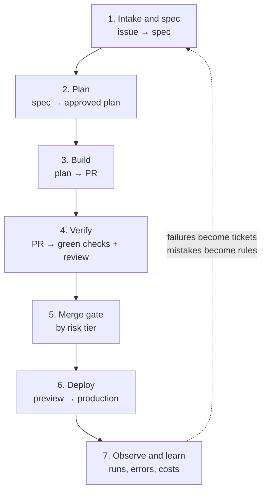
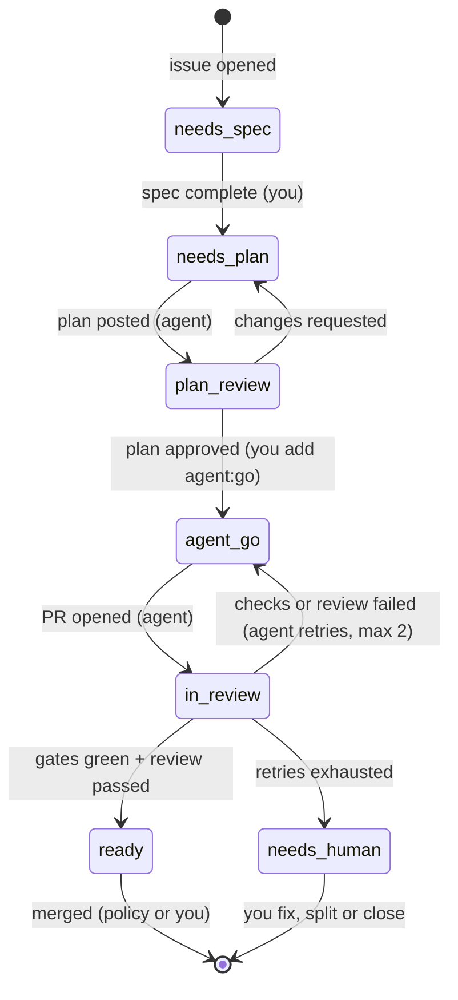
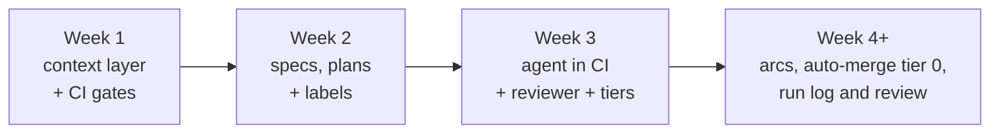

# Chapter 2: Anatomy of a factory

> ⏱ About 25 min · You'll learn: the seven stages of a factory and who owns each one, how a unit of work moves through them as labels on a GitHub issue, why the checker must be independent of the builder, how to size the line for one person, and which numbers tell you whether it works.

---

## 📖 Story: A whiteboard with seven boxes

On Sunday you draw the factory on a sheet of paper before you touch any configuration. You start with what you already do by hand for every feature, in order:

1. Decide what to build and write it down (sometimes).
2. Work out how to build it (in your head).
3. Build it (the agent, with you watching).
4. Check it (you read the diff, run `npm test`, run `npm run build`).
5. Decide whether to ship it (you, at midnight).
6. Ship it (Vercel, on push to `main`).
7. Notice whether it broke something (the next morning, by accident).

Seven steps. You did all of them, every time, and only one of them was written down: the spec. You draw seven boxes and, under each one, write two names: **who does it today** and **who should do it**.

Under "Check it" you write "me" and "me" and stop. Then you cross out the second "me". You can't be the only checker, because you're also the one who wanted the feature, wrote the spec and is tired. And the agent can't check its own work either: it will always think it did what you asked.

You write in your factory log: *"Every stage needs an owner. The checker can't be the builder."*

---

## 🏚️ Old way → 🚀 New way

| What you do now | What you do in a factory | Why it changes |
|---|---|---|
| Steps live in your head, done in whatever order | Seven named stages, each with an owner and an exit condition | You can only automate a step you can name |
| Work is "in progress" or "done" | An issue moves through labelled states: `spec`, `plan`, `agent:go`, `review`, `ready` | You see at a glance what's waiting and for whom |
| The builder checks its own work | Verification is independent: other tools, other prompts, other eyes | A builder always believes it succeeded |
| As many parallel tasks as you can start | A work-in-progress limit set by your review capacity | Unreviewed PRs are inventory, not progress |
| "It feels faster" | Cycle time, acceptance rate, rework and escaped defects, tracked weekly | Feelings don't tell you which stage is the bottleneck |

---

## 🧠 The seven stages

> 💡 Each stage turns one artifact into the next, and has an exit condition you could check without asking anyone.



| # | Stage | Input → output | Exit condition | Owner at BusyHamster | Chapter |
|---|---|---|---|---|---|
| 1 | **Intake and spec** | An idea → an issue with a spec | Problem, goals, non-goals and testable acceptance criteria written down | You, helped by a spec agent | 5 |
| 2 | **Plan** | Spec → plan | A plan listing files, steps, tests and risks, approved by you | Planning agent drafts, you approve | 6 |
| 3 | **Build** | Approved plan → pull request | A PR with code and tests, from a sandbox, on its own branch | Coding agent in GitHub Actions or a worktree | 7 |
| 4 | **Verify** | PR → evidence | Lint, types, tests and build green; independent review verdict; preview works | CI, a reviewer agent, a browser check | 4, 8 |
| 5 | **Merge gate** | Evidence → merge decision | Risk tier computed; required approvals present | Policy, plus you for tiers 1 and 2 | 9 |
| 6 | **Deploy** | Merged commit → running software | Production updated, smoke check passed, rollback path ready | Deploy workflow (no agent) | 9 |
| 7 | **Observe and learn** | Runs and production signals → improvements | Weekly review done; new rules, tests or tickets created | Triage agent drafts, you decide | 12 |

### Who owns what

The word "owner" matters. An owner is the one who says the stage is finished. The table shows BusyHamster's target split:

| Stage | Human | Agent | Automated (no AI) |
|---|---|---|---|
| Intake and spec | **Owns**: decides what and why | Interviews you, drafts the spec | Issue form enforces required fields |
| Plan | **Approves** | **Drafts** | |
| Build | | **Does** | Sandbox, permissions, hooks |
| Verify | Looks at the preview for UI work | **Independent review** | **Gates**: lint, types, tests, build, what-if |
| Merge gate | **Approves** tiers 1 and 2 | | **Computes** the tier; auto-merges tier 0 |
| Deploy | Approves infrastructure changes | Never | **Does** |
| Observe and learn | **Decides** what to change | Drafts triage tickets | Collects logs, costs, metrics |

Two rules follow from this table, and the rest of the course enforces them:

1. **No agent owns a gate.** Agents produce work and opinions. A deterministic check or a human decides.
2. **No agent deploys.** Deployment is a plain workflow with credentials, triggered by a merge. Agents never see those credentials (chapter 9).

---

## 🧠 The unit of work: one issue, one PR

> 💡 Size every unit of work so a human can review its plan in two minutes and its diff in fifteen.

A factory needs a standard unit, like a pallet in a warehouse. In BusyHamster the unit is **a GitHub issue that becomes exactly one pull request**. If a feature needs more than one PR, it becomes more than one issue, linked to a parent.

| Good unit | Too big | Too small |
|---|---|---|
| "Export History as CSV" | "Add accounts and sync" | "Rename a variable" (just do it) |
| "Port `/about` to React Router" | "Rewrite the frontend" | "Fix a typo in a comment" |
| "Add `GET /api/me` endpoint with tests" | "Build the API" | |

A unit is the right size when:

- its acceptance criteria fit on one screen,
- its plan touches roughly 10 files or fewer,
- one reviewer can check it in one sitting,
- reverting it doesn't revert anything else.

### Issue states as labels

GitHub labels are a cheap, visible state machine. They're also a **security control**: on a public repository, only people with at least triage permission can add labels, so a stranger can't start an agent by opening an issue (chapter 12 explains why that matters).



| Label | Meaning | Who sets it |
|---|---|---|
| `needs-spec` | Idea captured, spec incomplete | Issue form default |
| `needs-plan` | Spec ready, waiting for a plan | You |
| `plan-review` | Plan posted as a comment, waiting for you | Planning agent |
| `agent:go` | Plan approved; the coding agent may start | **Only you** |
| `needs-human` | The agent gave up or the gates keep failing | Workflow |
| `tier:0`, `tier:1`, `tier:2` | Risk tier of the PR | CI, from changed files |

The toolkit's workflows react to these labels. Chapters 5 to 9 build them one at a time.

---

## 🧠 The checker must be independent

> 💡 If the thing that wrote the code also decides the code is fine, you have no check.

An agent that wrote a change has every reason to believe it works: it was trying to make it work. Asking the same session "is this correct?" gets you a confident yes. Real verification needs independence on at least one of these axes:

| Axis | Independent check | Not independent |
|---|---|---|
| **Mechanism** | `npm test` and `tsc` run in CI on a fresh machine | The agent saying "tests pass" in its summary |
| **Context** | A reviewer agent that sees only the spec and the diff, with a different prompt | The builder session reviewing itself |
| **Control** | Gates the builder can't edit in the same PR (protected paths) | A PR that changes a failing test to make it pass |
| **Perspective** | A browser check against the deployed preview | Reading the JSX and imagining the page |
| **Authority** | You, for risky changes | |

Qodo summed it up in October 2026: the factory that works is the one whose quality layer the generator doesn't control. You'll build that layer in chapters 4 and 8, and protect it with hooks in chapter 7.

---

## 🧠 Sizing the line for one person

> 💡 The capacity of a solo factory is your review capacity, not the agents' speed.

You can start ten agents in parallel. You can't review ten plans and ten PRs every evening. Anything an agent produces that you can't review yet is **inventory**: it goes stale as `main` moves, and conflicts pile up.

Set a **work-in-progress (WIP) limit**:

| Situation | WIP limit for `agent:go` | Why |
|---|---|---|
| Starting out (chapters 7 to 9) | 1 | Learn what the agent gets wrong |
| Normal evenings | 2 to 3 | About what you can review in an hour |
| A big arc with independent tickets (chapter 10) | 3 to 4, only if each ticket touches different files | Parallel agents in the same files create merge conflicts |

The toolkit's `agent-implement.yml` workflow enforces the limit with a `concurrency` group, so a fourth `agent:go` label waits instead of starting.

---

## 🧠 Four numbers that tell you it works

> 💡 Measure the flow of finished, accepted work, not the amount of generated work.

| Metric | Definition | Healthy direction | What a bad value tells you |
|---|---|---|---|
| **Cycle time** | From `agent:go` to merged | Down | A stage is waiting: usually review, sometimes flaky CI |
| **Acceptance rate** | Agent PRs merged without a human rewrite ÷ agent PRs opened | Up, towards 70–80% | Specs or context are weak (chapters 3 and 5) |
| **Rework rate** | Merged changes reverted or fixed within 14 days ÷ merged changes | Down | Gates miss things (chapters 4 and 8) |
| **Cost per merged PR** | Agent spend ÷ merged PRs | Stable or down | Loops, retries or oversized tasks (chapter 12) |

Plus one count that doesn't need a formula: **escaped defects**, bugs that reached production. Each one gets a short note in your factory log: which gate should have caught it?

What not to measure: lines of code, number of PRs opened, number of agent runs. All three go up when the factory gets worse.

The [factory metrics worksheet](../toolkit/factory-metrics.md) has a table you fill in once a week.

---

## 💻 In BusyHamster: the paper version

Before any automation, write the factory down. This is the "paper factory" for BusyHamster: the same seven stages, done by hand, for the first small feature. It's how you find out which stage hurts before you automate it.

| Stage | Paper version for "Export History as CSV" |
|---|---|
| Intake and spec | Open an issue; write problem, goals, non-goals, acceptance criteria (chapter 5) |
| Plan | Ask Claude Code in plan mode for a plan; paste it into the issue; approve it |
| Build | Run Claude Code in a separate worktree with the plan as the prompt |
| Verify | Run lint, types, tests, build; ask a **fresh** Claude Code session to review the diff against the spec |
| Merge gate | Decide the tier by hand: UI change, no data or auth → tier 1, you review |
| Deploy | Merge; Vercel deploys |
| Observe | Note the time each stage took in the factory log |

Chapters 3 to 9 replace each manual step with a part of the toolkit.

---

## 🗺️ The rollout, stage by stage

Don't build everything at once. Follow the bottleneck:



| Phase | What's automated | What's still you |
|---|---|---|
| Week 1 | Gates run on every PR | Everything else |
| Week 2 | Issue form, spec template, plan drafts | Approving plans, building, reviewing |
| Week 3 | The coding agent, the reviewer agent, tier labels | Approving tier 1 and 2, looking at previews |
| Week 4 and later | Tier 0 auto-merge, run logging, triage drafts | Product decisions, tier 2, the weekly review |

---

## ⚠️ Common traps

| Trap | What happens | Instead |
|---|---|---|
| **Stages without exit conditions** | "Plan" means "the agent thought about it"; nobody can tell when it's done | Write each exit condition so a script or a stranger could check it |
| **Self-review** | The builder session says "looks good" | Verification on an independent axis: mechanism, context, control, perspective |
| **No WIP limit** | Ten open agent PRs, all conflicting with each other | Limit `agent:go` to your review capacity |
| **Units that are too big** | A 2,000-line PR you approve without reading | One issue, one PR, about 10 files |
| **Vanity metrics** | PR count goes up; quality goes down | Cycle time, acceptance, rework, cost per merged PR |
| **Anyone can trigger the agent** | A stranger's issue starts a run with your API key | Only a human with triage permission adds `agent:go` |

---

## 🧰 Helpers

- [Factory metrics worksheet](../toolkit/factory-metrics.md): the weekly table and how to compute each number.
- [Risk tiers](../toolkit/risk-tiers.md): a preview of chapter 9's merge policy.
- [Factory setup checklist](../toolkit/factory-setup-checklist.md): the rollout as checkboxes.

---

## 🧪 Try it yourself

1. Draw your own seven boxes. Under each, write who does it today and who should do it.
2. Create the labels in your repository:

   ```bash
   gh label create needs-spec  --color FBCA04 --description "Idea captured, spec incomplete"
   gh label create needs-plan  --color FBCA04 --description "Spec ready, needs a plan"
   gh label create plan-review --color 0E8A16 --description "Plan posted, waiting for approval"
   gh label create agent:go    --color 5319E7 --description "Approved: the coding agent may start"
   gh label create needs-human --color D93F0B --description "The agent needs a human"
   gh label create tier:0 --color C2E0C6; gh label create tier:1 --color FEF2C0; gh label create tier:2 --color F9D0C4
   ```

3. Run the paper factory once, on any small change, and time every stage in your factory log.

---

## ✅ Recap

- Seven stages, each turning one artifact into the next, each with an owner and an exit condition.
- One issue becomes one PR; labels move it through the stages, and only you can add `agent:go`.
- The checker must be independent of the builder, and your review capacity sets the line's speed.
