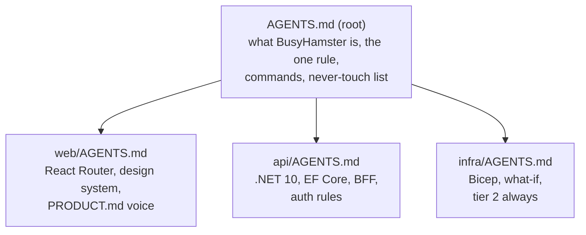

# Chapter 3: The context layer

> ⏱ About 25 min · You'll learn: what an agent needs to know before it touches your code, where each kind of knowledge lives (AGENTS.md, DESIGN.md, PRODUCT.md, specs, ADRs, skills, subagents), how Claude Code finds those files, how to layer them in a monorepo, and how to test the whole layer with a cold start.

---

## 📖 Story: The agent that didn't know about Principle 3

You run a small experiment. You open a fresh Claude Code session in the BusyHamster repository and type:

> Add a way to back up my history to the cloud.

The agent reads the code, finds `src/lib/storage.ts` and `backup-actions.ts`, and comes back with a plan: add a small server route, store backups in a hosted key-value store, generate an anonymous user ID in the browser. It's a reasonable plan. It's also against the product.

`PRODUCT.md` says, under Product Principles: *"Your data stays yours: no account, nothing leaves the browser, export is always available."* The agent never opened `PRODUCT.md`. The root `AGENTS.md` mentions it, but only in a sentence about product copy. Nothing told the agent that `PRODUCT.md` holds rules about **data**, not just words.

The knowledge was in the repository. It just wasn't where an agent would look, or it wasn't said in a way an agent would act on. You write in your factory log: *"Context isn't what I know. It's what a fresh agent finds in the first minute."*

---

## 🏚️ Old way → 🚀 New way

| What you do now | What you do in a factory | Why it changes |
|---|---|---|
| Re-explain the project at the start of each session | The repository explains itself: AGENTS.md is read automatically | A CI agent has no chat history, only the repo |
| One file with everything in it | A short root AGENTS.md that points to focused files | Agents follow short, specific instructions better than long, vague ones |
| Decisions live in old chat threads | Decisions live in ADRs next to the code | "Why is it like this?" has an answer an agent can read |
| Repeated procedures explained each time ("to add a timer page, you…") | Procedures as skills an agent loads when relevant | Written once, used every time |
| You trust that the agent understood | You test the context with a cold start | Context is code: it has bugs, and you can test for them |

---

## 🧠 What an agent needs to know

> 💡 Write down what a skilled new colleague would need on their first day: how to build, what's off limits, where the truth lives, and what words mean.

Think of the agent as an excellent contractor on their first day, who will never remember yesterday. They need:

| Need | Example in BusyHamster | Where it lives |
|---|---|---|
| **How to build, test and run** | `npm run lint`, `npm run build`, `npm test` | Root `AGENTS.md` (and `README.md`) |
| **The architecture in one paragraph** | Next.js app router; pure logic in `src/lib`; UI primitives in `src/components/ui` | Root `AGENTS.md` |
| **Hard rules** | Never hard-code a hex colour; data never leaves the browser (until chapter 11) | `AGENTS.md`, pointing to `DESIGN.md` and `PRODUCT.md` |
| **Where the truth lives** | Design tokens in `globals.css`; voice in `PRODUCT.md`; behaviour in specs | `AGENTS.md`, a "Sources of truth" table |
| **Domain language** | Task, Line, Pomodoro, Resume card, Focus screen | A glossary section |
| **Why things are the way they are** | "Why localStorage and not IndexedDB?" | ADRs in `docs/adr/` |
| **How to do common jobs** | Add a timer preset page; add a blog post | Skills in `.claude/skills/` |
| **What done looks like** | Tests added, `/design-system` page updated, no lint warnings | `AGENTS.md`, "Definition of done" |

### What BusyHamster already has

You're not starting from zero, which is the advantage of having used agents carefully for months:

| File | What it does well | What's missing for a factory |
|---|---|---|
| `AGENTS.md` (18 lines) | Clear UI rules: use primitives, never hard-code hex values, read `DESIGN.md` first | Build commands, architecture, hard product rules, definition of done, what an agent must never touch |
| `DESIGN.md` (142 lines) | Tokens, primitives, themes | Fine as it is |
| `PRODUCT.md` (62 lines) | Users, purpose, five product principles | Nothing points agents to the principles as **rules** |
| `docs/spec-tasks-and-lines.md` | A model spec: problem, goals, non-goals, data model | Becomes the template in chapter 5 |
| `README.md` | Commands and folder map | Agents read it, but it's written for humans |

The top of the existing AGENTS.md is a block that Next.js writes and re-adds itself:

📄 [`sample/AGENTS.md`](https://github.com/vygantas-meskauskis/learning-library/blob/main/courses/agentic-software-factory/sample/AGENTS.md)
```markdown
<!-- BEGIN:nextjs-agent-rules -->

## This is NOT the Next.js you know

This version has breaking changes — APIs, conventions, and file structure may all differ
from your training data. Read the relevant guide in `node_modules/next/dist/docs/` …
<!-- END:nextjs-agent-rules -->
```

That block is a good idea from the framework, and a warning sign. It exists because agents keep writing old Next.js code from their training data. Chapter 10 removes the need for it by moving to a framework with a simpler model, but the lesson stays: **when the tools change faster than the agents' training, the context layer must say so.**

---

## 🧠 How Claude Code finds context

> 💡 Instructions load automatically from files with known names. Everything else loads only if something points to it.

Claude Code reads a project instruction file at the start of every session. Since version 2.1.277 (18 September 2026), it reads `AGENTS.md` when there's no `CLAUDE.md` in the same place 🔧. Before that, you needed a `CLAUDE.md` that imported `AGENTS.md`. GitHub Copilot, OpenAI Codex and Cursor all read `AGENTS.md` too, so one file serves every tool.

| File | Loaded | Use it for |
|---|---|---|
| `AGENTS.md` in the repo root | Every session, automatically (if no `CLAUDE.md`) | The short, always-true rules |
| `AGENTS.md` in a subfolder (`web/`, `api/`) | When the agent works in that folder | Rules for that part of the monorepo |
| `CLAUDE.md` | Instead of `AGENTS.md`, if present | Only if you need Claude-specific instructions; otherwise skip it |
| `.claude/skills/<name>/SKILL.md` | When the task matches the skill's description, or on `/name` | Procedures: how to add a page, how to write a migration |
| `.claude/agents/<name>.md` | When delegated to, or by name | Specialised subagents: spec writer, planner, reviewer |
| Anything else (`DESIGN.md`, specs, ADRs) | Only when AGENTS.md or a skill points to it | Detail |

Two details from the 2026 release notes are worth knowing 🔧:

- If both `CLAUDE.md` and `AGENTS.md` exist in a folder, Claude Code reads only `CLAUDE.md`. Keep one.
- Claude Code doesn't read files under an `.agents/` directory. Skills go in `.claude/skills/`.

### Layering in a monorepo

After chapter 10, BusyHamster is a monorepo. Each layer adds detail without repeating the one above:



---

## 💻 In BusyHamster: the new root AGENTS.md

This is the toolkit's root file, written for the monorepo. Keep it under about 120 lines: every line is read in every session, so every line costs attention.

📄 [`toolkit/agents-root.md`](../toolkit/agents-root.md) (excerpt)
```markdown
# BusyHamster

A focus timer that remembers where your head was. Read PRODUCT.md before
changing behaviour, DESIGN.md before changing UI.

## The one rule

React shows things, .NET does things. The frontend (web/) renders pages and
calls /api. It never stores secrets or tokens, never talks to the database,
and holds no business rules beyond input validation. The backend (api/) owns
login, data and logic.

## Product rules that are not negotiable

These come from PRODUCT.md "Product Principles". If a task would break one,
stop and say so in the PR or issue instead of working around it.
1. Resuming must stay one key. Never add steps to the resume path.
2. Local first: every feature works signed out, with data in the browser.
   Sync is optional and additive (see docs/adr/0002-accounts-and-sync.md).
3. Export is always available, signed in or not.
4. Keyboard first: every new action gets a shortcut and a command-menu entry.

## Commands
| Task | Command | Folder |
|---|---|---|
| Install | npm ci | web/ |
| Lint, types, tests | npm run check | web/ |
| Build | npm run build | web/ |
| API build and tests | dotnet test | api/ |

## Never touch without a human
- .github/**, .claude/**, scripts/**
- infra/** (tier 2: a human reviews every change)
- PRODUCT.md and docs/adr/** (decisions are made by a human)
- Any existing test: fix the code, not the test. If a test is wrong,
  say why in the PR description and leave it failing.
```

A few choices in that file are deliberate:

| Choice | Why |
|---|---|
| Product rules repeated in AGENTS.md, with a pointer to the source | The Principle 3 story: an agent must meet the rule without opening another file |
| Rules phrased as actions ("stop and say so") | Agents follow instructions better than descriptions |
| A "never touch" list | Paired with a hook in chapter 7 that enforces it. The text explains; the hook enforces |
| "Fix the code, not the test" | The single most common way an agent "passes" CI |
| Commands as a table | Easy to scan, hard to misread |

The folder files ([`agents-web.md`](../toolkit/agents-web.md), [`agents-api.md`](../toolkit/agents-api.md)) follow the same shape for their part of the code.

> 🧰 The toolkit names these files `agents-root.md`, `agents-web.md` and `agents-api.md` so that an agent working inside the library doesn't mistake them for instructions. Rename each to `AGENTS.md` when you copy it into your repository.

---

## 🧠 Decisions as ADRs

> 💡 An Architecture Decision Record answers "why is it like this?" in one page, so nobody (human or agent) has to guess or re-argue it.

An ADR is a short Markdown file: context, decision, consequences, status. Agents use ADRs in two ways: they follow them, and they write drafts of new ones when a plan needs a decision.

BusyHamster's first three ADRs come from the decisions you made before starting this course:

| ADR | Decision | Chapter |
|---|---|---|
| `0001-frontend-framework.md` | Move from Next.js to React Router 8 pre-rendered to static files; .NET is the only server | 10 |
| `0002-accounts-and-sync.md` | Accounts are optional; local-first stays; sign-in through Entra External ID via a .NET BFF | 11 |
| `0003-database.md` | Azure SQL Database serverless on the free offer, with auto-pause | 11 |

The [ADR template](../toolkit/templates/adr-template.md) has the format. Keep ADRs in `docs/adr/`, numbered, and never edit an accepted one: write a new one that supersedes it.

---

## 🧠 Skills: procedures an agent loads when it needs them

> 💡 A skill is a folder with a `SKILL.md` that teaches one repeatable job. It costs nothing until it's used.

Some knowledge is only needed for one kind of task. Putting it in AGENTS.md makes every session longer. A **skill** is loaded only when the task matches its description, or when you call it by name (`/new-tool`).

BusyHamster adds a new tool every few weeks (the timer, the History page, the Tired games). Adding one always touches the same places: a route, the command menu, the sitemap, the design-system page, a test. That's a skill:

📄 [`toolkit/claude/skills/new-tool/SKILL.md`](../toolkit/claude/skills/new-tool/SKILL.md) (excerpt)
```markdown
---
name: new-tool
description: Add a new BusyHamster tool or page (a new route with its own UI).
  Use when an issue asks for a new page, game or tool.
---

# Add a BusyHamster tool

Every BusyHamster tool touches the same places. Do them all in one PR.

1. Read PRODUCT.md "Product Principles" and DESIGN.md "Primitives" first.
2. Put pure logic in web/app/lib/<tool>.ts with a Vitest file next to it
   (web/app/lib/<tool>.test.ts). No browser APIs in lib/: pass storage, time
   and randomness in as arguments so tests are deterministic.
3. Add the route in web/app/routes.ts and the page in
   web/app/routes/<tool>.tsx. Build the UI only from web/app/components/ui.
4. Add a command-menu entry with a keyboard shortcut in
   web/app/components/command-menu.tsx …
…
```

| Use a skill for | Use AGENTS.md for |
|---|---|
| Procedures used in some tasks (add a page, write a migration, add an endpoint) | Rules true in every task |
| Detail that would bloat every session | The one rule, commands, never-touch list |
| Steps with a script or template attached | Pointers to sources of truth |

---

## 🧠 Subagents: specialists with their own context

> 💡 A subagent runs in its own context window with its own instructions and tools, and returns a summary. Use one when a job needs a different point of view.

Claude Code subagents are Markdown files with YAML frontmatter in `.claude/agents/` 🔧. The frontmatter sets the name, a description (used to decide when to delegate), the tools it may use, and optionally the model. The body is its system prompt.

The toolkit defines three, and you'll meet each in its own chapter:

| Subagent | Tools | Job | Chapter |
|---|---|---|---|
| [`spec-writer`](../toolkit/claude/agents/spec-writer.md) | Read-only | Interviews you and drafts a spec with acceptance criteria | 5 |
| [`planner`](../toolkit/claude/agents/planner.md) | Read-only | Turns a spec into a plan: files, steps, tests, risks | 6 |
| [`reviewer`](../toolkit/claude/agents/reviewer.md) | Read-only | Reviews a diff against the spec, independent of the builder | 8 |

All three are read-only on purpose. A specialist that can't edit files can't "fix" its way out of disagreeing with you.

---

## 🧠 Testing the context layer: the cold start

> 💡 If a fresh agent can't answer basic questions about the project from the repo alone, your context layer has a bug.

You test code. Test context the same way. The **cold-start test** is a fixed set of questions you ask a brand-new session with no help:

```bash
claude -p "Answer from this repository only, in one line each:
1. What is the one architectural rule?
2. Which commands must pass before a PR is ready?
3. Which folders may you never change without a human?
4. If a feature would send user data to a server, what do you do?
5. Where do colour values come from?
6. What is a 'Line' in BusyHamster?" --output-format text
```

Score it: one point per correct answer. Anything below 6 out of 6 is a context bug. Fix the file, not the question, and run it again. Re-run the test after every big change to AGENTS.md, and in chapter 12 you'll schedule it.

The toolkit's [cold-start questions](../toolkit/cold-start-test.md) include an answer key.

---

## ⚠️ Common traps

| Trap | What happens | Instead |
|---|---|---|
| **The 600-line AGENTS.md** | Important rules drown; agents follow the first and last parts | Under ~120 lines; push detail into skills, DESIGN.md, ADRs |
| **Descriptions instead of instructions** | "We value accessibility" changes nothing | "Every interactive element gets a visible focus style and a label" |
| **Two instruction files that drift** | `CLAUDE.md` says one thing, `AGENTS.md` another; Claude reads only `CLAUDE.md` | Keep one `AGENTS.md`; add `CLAUDE.md` only for Claude-specific extras |
| **Rules nobody enforces** | "Never edit workflows" in text, and an agent edits one anyway | Pair every hard rule with a hook or a gate (chapters 4 and 7) |
| **Stale context** | AGENTS.md describes the Next.js app after the rewrite | Updating AGENTS.md is part of the definition of done for structural changes |
| **Secrets in context** | An example connection string in a skill | Context files are code: no secrets, ever |

---

## 🧰 Helpers

- [Root AGENTS.md](../toolkit/agents-root.md), [web](../toolkit/agents-web.md) and [api](../toolkit/agents-api.md) templates.
- [ADR template](../toolkit/templates/adr-template.md).
- [`new-tool` skill](../toolkit/claude/skills/new-tool/SKILL.md).
- Subagents: [spec writer](../toolkit/claude/agents/spec-writer.md), [planner](../toolkit/claude/agents/planner.md), [reviewer](../toolkit/claude/agents/reviewer.md).
- [Cold-start test](../toolkit/cold-start-test.md) with an answer key.

---

## 🧪 Try it yourself

1. Run the cold-start test against your repository as it is today. Write down the score in your factory log.
2. Merge the toolkit's `agents-root.md` into your existing AGENTS.md. Keep your own rules (BusyHamster keeps the design-system section word for word); add the one rule, product rules, commands, never-touch list and definition of done.
3. Write ADR 0001 for a decision you've already made and never written down.
4. Run the cold-start test again. You should get 6 out of 6.

---

## ✅ Recap

- Context is what a fresh agent finds in the repository in the first minute, not what you know.
- A short root AGENTS.md states the rules and points to focused files: DESIGN.md, PRODUCT.md, ADRs, skills and subagents.
- Test the context layer with a cold start, and pair every hard rule with something that enforces it.
