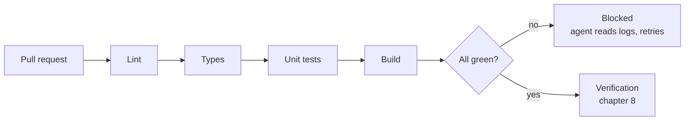

# Chapter 4: Tests and CI gates

> ⏱ About 20 min · You'll learn: why gates come before agents, which gates BusyHamster needs and in what order, how to make them fast and deterministic, how branch rulesets turn them into a wall, which tests an agent can and can't be trusted with, and how a hidden network dependency can break a build in a sandbox.

---

## 📖 Story: The build that only worked on Vercel

To prepare for the course, you copy the BusyHamster repository into a clean Linux container, the kind an agent works in, and run the commands from the README:

```text
$ npm ci          ✓
$ npm run lint    ✓
$ npm test        ✓  109 passed
$ npm run build
Error: next/font: error:
Failed to fetch Schibsted Grotesk from Google Fonts.
If you are offline or behind a proxy, self-host the font with next/font/local …
```

The code is fine. The container just can't reach `fonts.googleapis.com`. On your laptop and on Vercel, the build quietly downloads a font from Google every time. Nobody ever wrote that down, because nothing ever failed.

Two things become clear. First, an agent in a sandbox (chapter 7) can't build BusyHamster today: the build depends on the network in a way nobody knew. Second, BusyHamster has **no CI at all**. There's no `.github/workflows` folder. The only automated check is Vercel's build, which runs after you've already pushed, and doesn't run lint or tests.

You write in your factory log: *"Gates first. An agent without gates is just a faster way to break main."*

---

## 🏚️ Old way → 🚀 New way

| What you do now | What you do in a factory | Why it changes |
|---|---|---|
| Run `npm test` yourself, when you remember | Every PR runs lint, types, tests and build on a fresh machine | Agents won't remember either, and you won't be watching |
| Vercel's build is the only check, after the push | Required status checks block the merge | A check that runs after the merge is a notification, not a gate |
| Push straight to `main` | A ruleset: PRs only, required checks, no force push | One accidental push by an agent can't skip the gates |
| A build that silently downloads fonts | Builds that work offline, or declare their network needs | Sandboxes have no network by default |
| "Tests pass" means 109 green dots | Tests are protected; an agent may add tests, not weaken them | The cheapest way to make CI green is to edit the test |

---

## 🧠 Why gates come before agents

> 💡 A gate is a check that blocks a merge. Without gates, the factory has no way to say no.

Every later chapter depends on this one. The coding agent (chapter 7) needs a clear, mechanical definition of "done". The reviewer (chapter 8) needs the boring checks already passed so it can focus on meaning. Auto-merge (chapter 9) is only safe when gates are strong.

Good gates have four properties:

| Property | Means | BusyHamster example |
|---|---|---|
| **Deterministic** | Same code, same result, every time | Vitest unit tests on pure functions in `src/lib` |
| **Fast** | Minutes, not tens of minutes | The full web gate runs in under 3 minutes |
| **Local first** | You and the agent can run the exact same command | `npm run check` locally and in CI |
| **Explained** | A failure says what to fix | ESLint and `tsc` errors point to a file and line |

A flaky test, one that fails sometimes for no reason, is worse than no test in a factory. An agent will "fix" it by changing unrelated code, or learn that red builds don't mean anything. Quarantine a flaky test the day you see it.

---

## 🧠 The gates, in order

> 💡 Cheap gates first: fail in seconds on a typo, not in minutes after a full build.

| Order | Gate | Command | Catches | Today |
|---|---|---|---|---|
| 1 | Install from the lockfile | `npm ci` | Missing or mismatched dependencies | Works |
| 2 | Lint | `npm run lint` | Hooks misuse, unused code, unsafe patterns | Works (`eslint`) |
| 3 | Type check | `npm run typecheck` | Wrong props, missing fields, bad imports | **Missing**: Next.js type-checks during build, but there's no standalone script |
| 4 | Unit tests | `npm test` | Logic regressions in `src/lib` | Works: 109 tests in 8 files |
| 5 | Build | `npm run build` | Anything that only breaks when bundling; missing env vars | Works only with network access to Google Fonts |
| 6 | Smoke test | `npm run test:smoke` | The app loads, the key paths respond | **Missing**: added in chapter 8 |
| 7 (later) | .NET build and tests | `dotnet build`, `dotnet test` | API regressions, analyzer warnings | Chapter 11 |
| 8 (later) | Infrastructure preview | `az deployment group what-if` | Unintended Azure changes | Chapter 9 |

### Add the missing scripts

📄 `package.json` (scripts, after the change)
```json
{
  "scripts": {
    "dev": "next dev",
    "build": "next build",
    "start": "next start",
    "lint": "eslint",
    "typecheck": "tsc --noEmit",
    "test": "vitest run",
    "test:watch": "vitest",
    "check": "npm run lint && npm run typecheck && npm test"
  }
}
```

`check` is the one command the root AGENTS.md tells every agent to run (chapter 3). The agent runs it locally before it opens a PR; CI runs the same steps as separate jobs so you see which one failed.

### Remove the hidden network dependency

The build downloads fonts because `src/app/layout.tsx` uses `next/font/google`. The fix the error message suggests is the right one: self-host the font files with `next/font/local`, so the build needs no network. Chapter 10 replaces Next.js anyway, and the React Router version self-hosts fonts from the start. Until then, either self-host, or allow `fonts.googleapis.com` and `fonts.gstatic.com` in the agent sandbox (chapter 7) and write that down in AGENTS.md.

> 💡 A build should need the network only to install packages. Anything else is a hidden dependency that will break in a sandbox, in CI or on a plane.

---

## 💻 In BusyHamster: the CI workflow

The toolkit's `ci.yml` is written for the monorepo (`web/` and `api/`). Until chapter 10 creates the `web/` folder, change `working-directory: web` to `.` and leave the `api` job out.

📄 [`toolkit/github/workflows/ci.yml`](https://github.com/vygantas-meskauskis/learning-library/blob/main/courses/agentic-software-factory/toolkit/github/workflows/ci.yml) (web job)
```yaml
name: ci

on:
  pull_request:
  push:
    branches: [main]
  merge_group:

permissions:
  contents: read

concurrency:
  group: ci-${{ github.ref }}
  cancel-in-progress: true

jobs:
  web:
    runs-on: ubuntu-latest
    timeout-minutes: 15
    defaults:
      run:
        working-directory: web
    steps:
      - uses: actions/checkout@v5
      - uses: actions/setup-node@v5
        with:
          node-version-file: web/.nvmrc
          cache: npm
          cache-dependency-path: web/package-lock.json
      - run: npm ci
      - run: npm run lint
      - run: npm run typecheck
      - run: npm test
      - run: npm run build
```

Line by line:

- **`on:`** Every pull request, every push to `main`, and `merge_group` so the workflow also works with a merge queue later (chapter 13).
- **`permissions: contents: read`** The workflow's token can read the repository and nothing else. A compromised dependency can't push code or change settings.
- **`concurrency`** A new push to the same branch cancels the outdated run. Agents push often; this keeps runners free.
- **`timeout-minutes: 15`** A hung test fails after 15 minutes instead of burning six hours of runner time.
- **Separate steps for lint, types, tests and build** so the PR shows exactly which gate failed. The agent reads that output when it retries (chapter 7).

Action versions change; pin to the current major version, and let Dependabot update them 🔧.

---

## 🧠 Turning checks into a wall: rulesets

> 💡 A check is advice until the repository refuses to merge without it.

GitHub **rulesets** (Settings → Rules → Rulesets) protect branches 🔧. For BusyHamster's `main`:

| Rule | Setting | Why |
|---|---|---|
| Restrict deletions | On | Nobody deletes `main` |
| Require a pull request before merging | On, 0 required approvals for now | Every change goes through checks; chapter 9 adds approvals by tier |
| Require status checks to pass | `web` (later also `api`, `review`, `risk-tier`) | The gates become mandatory |
| Require branches to be up to date | On | The checks ran against the code that will actually land |
| Block force pushes | On | History can't be rewritten under the gates |
| Bypass list | Empty, or only you for emergencies | If an agent's identity can bypass, the wall has a door |

Solo developers often skip rulesets because "it's just me". It isn't just you any more. From chapter 7, a bot account and a GitHub Actions identity push branches too.

---

## 🧠 Which tests to trust an agent with

> 💡 Agents are good at writing tests for the code they write. They're bad at deciding which existing tests are wrong.

| Kind of test | Agent writes it? | Agent may change it? | Why |
|---|---|---|---|
| New unit tests for new code | Yes, required | Yes, in the same PR | Part of the definition of done |
| Existing unit tests | No | **No**: flag it in the PR instead | Changing an expectation is a behaviour decision |
| Snapshot tests | Rarely | No | "Update snapshots" is how regressions get approved |
| Smoke and end-to-end tests | Drafts only | No | These are the factory's acceptance check |
| Contract tests for the API (chapter 11) | Yes, from the OpenAPI spec | No | The contract is a human decision |

BusyHamster's code makes this easier than most. The README states a design rule that pays off now: pure functions in `src/lib` with no browser APIs, so they're testable. 109 tests over those functions are a strong net. The weakest spot is UI behaviour: there's no test that the resume card appears, which is exactly the regression from chapter 1's story. Chapter 8 adds a smoke test for it.

### Protecting the tests

Three layers stop an agent from weakening a test, from soft to hard:

1. **AGENTS.md**: "Fix the code, not the test. If a test is wrong, say why in the PR and leave it failing." (chapter 3)
2. **A hook** that blocks the agent from editing test files it didn't create in this session (chapter 7).
3. **The reviewer and the risk tier**: any PR that changes an existing test file is tier 2, so a human sees it (chapters 8 and 9).

### Coverage: a trend, not a target

Collect coverage, and watch the trend per PR. Don't set "80% or fail": agents are very good at writing tests that execute lines without checking anything. A useful rule instead: **a PR that adds code in `lib/` must add tests in `lib/`**, which the reviewer checks.

---

## 🗺️ Gates in the flow



---

## ⚠️ Common traps

| Trap | What happens | Instead |
|---|---|---|
| **Agents before gates** | Plausible PRs, no way to know if they work | Week 1 of the rollout is gates, not agents |
| **Checks that aren't required** | Red checks, merged anyway at midnight | Rulesets with required status checks |
| **Flaky tests** | Agents "fix" unrelated code; red stops meaning anything | Quarantine within a day; fix or delete within a week |
| **Hidden network dependencies** | Builds break in sandboxes and CI for reasons nobody understands | Builds need the network only for package installs |
| **Coverage targets** | Tests that run code without asserting anything | Watch the trend; require tests for new `lib/` code |
| **CI differs from local** | "Works in CI, not for the agent" or the reverse | One `check` script, used in both places |

---

## 🧰 Helpers

- [`ci.yml`](https://github.com/vygantas-meskauskis/learning-library/blob/main/courses/agentic-software-factory/toolkit/github/workflows/ci.yml): web and api gates, plus the risk-tier job used in chapter 9.
- [Factory setup checklist](../toolkit/factory-setup-checklist.md), section "Gates".

---

## 🧪 Try it yourself

1. Add the `typecheck` and `check` scripts. Run `npm run check` and fix anything it finds.
2. Copy `ci.yml` into `.github/workflows/`, set `working-directory: .`, remove the `api` and `risk-tier` jobs for now, and open a PR. Watch it go green.
3. Create a ruleset for `main` with the settings in the table above, and `web` as a required check.
4. Prove the wall works: open a PR that breaks a test on purpose, and try to merge it.
5. Run the build with the network off (`npm run build` in a container started with `--network none`, after `npm ci`) and write down every hidden dependency you find.

---

## ✅ Recap

- Gates come before agents: without a mechanical "no", the factory can't stop anything.
- Good gates are deterministic, fast, local first and explained; rulesets make them required.
- Agents write tests for their own code; they don't change existing tests, and hidden network dependencies must go.
