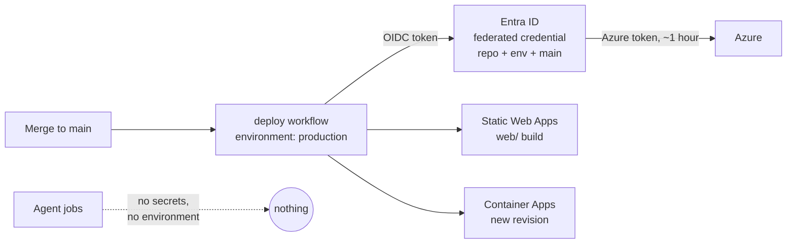

# Chapter 9: Merge and deploy

> ⏱ About 25 min · You'll learn: how risk tiers decide which PRs need you, how CI computes a tier from the files a PR touches, how tier 0 merges itself, why agents never hold deploy credentials, how GitHub's OIDC lets the deploy workflow reach Azure with no stored secrets, how Bicep what-if previews infrastructure changes, and how flags and rollbacks make shipping boring.

---

## 📖 Story: Twelve PRs on a Friday

By the end of week three, the factory works. On Friday evening there are twelve open agent PRs: a dependency bump, two README fixes, three new blog-tag pages, CSV export, a typo in the About page, a test for the Tired games, a change to the sitemap script, and two refactors in `src/lib/timer.ts`.

You start at the top, opening each one and reading it with the same care. Ninety minutes in, you're on PR number six and you've stopped reading properly. The README fix and the timer refactor got exactly the same attention, which means the timer refactor got too little.

You sort them on paper instead: three that couldn't hurt anyone, seven that change what users see, two that touch the core of the product. The first three didn't need you. The last two needed you at your best, not at the end of a list.

You write in your factory log: *"Attention is the budget. Spend it by risk, not by arrival order."*

---

## 🏚️ Old way → 🚀 New way

| What you do now | What you do in a factory | Why it changes |
|---|---|---|
| Every PR gets the same review | Risk tiers: tier 0 merges itself, tier 1 gets a quick look, tier 2 gets your full attention | Equal attention means too little where it matters |
| You decide the risk by feel | CI computes the tier from the changed files | Consistent, and visible on the PR |
| Vercel deploys on push | A deploy workflow on merge, with OIDC to Azure and no stored cloud secrets | Nobody, human or agent, holds long-lived cloud keys |
| Infrastructure changes in the portal | Bicep in the repo, with what-if on every infra PR | You see what will change before it changes |
| New features go live for everyone at once | Risky features ship dark, behind a flag | Deploying and releasing become separate decisions |
| Rollback means "fix forward, fast" | Rollback is one command per component | Shipping is only boring when undoing is easy |

---

## 🧠 Risk tiers

> 💡 A risk tier is a promise about how much human attention a change gets, decided by what it can break.

📄 [`toolkit/risk-tiers.md`](../toolkit/risk-tiers.md) (summary)

| Tier | What can break | BusyHamster paths and changes | Merge rule |
|---|---|---|---|
| **0** | Nothing users depend on | `*.md` outside `docs/adr/` and `docs/specs/`, new test files only, `content/blog/**` | **Auto-merge** when all checks pass |
| **1** | What users see, recoverable in one revert | `web/app/**` UI and routes, `web/app/lib/**` logic with tests, new API endpoints that don't touch auth or storage | You approve after the evidence review (chapter 8): 5 to 10 minutes |
| **2** | Data, trust, money, or the factory itself | `api/**/Auth*`, `api/**/Migrations/**`, storage keys and formats (`lib/storage.ts`, `lib/history.ts` backup format), `infra/**`, `.github/**`, `.claude/**`, existing test changes, dependency changes (`package.json`, lockfiles, `*.csproj`), wide-blast-radius files (`globals.css`, `routes.ts`), `PRODUCT.md`, `docs/adr/**` | You read the full diff; infrastructure also needs a deploy approval |

The highest tier wins: a PR that touches one tier 2 file is tier 2.

Two entries are worth a second look:

- **Dependency changes are tier 2.** A new package is new code from a stranger, running in your build and your users' browsers, and an upgrade is new code too. Agents add packages readily. For Dependabot's patch updates, the full-diff review is short: the lockfile diff, the changelog link and green CI.
- **The factory's own files are tier 2.** `.github/` and `.claude/` are where the gates live. A change that weakens a gate must be the most visible change of all.

---

## 💻 In BusyHamster: computing the tier

The `risk-tier` job in `ci.yml` looks at the changed files, applies the rules, and labels the PR.

📄 [`toolkit/github/workflows/ci.yml`](https://github.com/vygantas-meskauskis/learning-library/blob/main/courses/agentic-software-factory/toolkit/github/workflows/ci.yml) (risk-tier job, excerpt)
```yaml
  risk-tier:
    if: github.event_name == 'pull_request'
    runs-on: ubuntu-latest
    permissions:
      contents: read
      pull-requests: write
    steps:
      - uses: actions/checkout@v5
        with:
          fetch-depth: 0
      - name: Compute tier
        id: tier
        run: |
          base=${{ github.event.pull_request.base.sha }}
          tier=$(git diff --name-status "$base"...HEAD | ./scripts/risk-tier.sh)
          echo "tier=$tier" >> "$GITHUB_OUTPUT"
      - name: Label
        env:
          GH_TOKEN: ${{ github.token }}
        run: |
          pr=${{ github.event.pull_request.number }}
          gh pr edit "$pr" --remove-label tier:0 --remove-label tier:1 --remove-label tier:2 || true
          gh pr edit "$pr" --add-label "tier:${{ steps.tier.outputs.tier }}"
```

[`scripts/risk-tier.sh`](../toolkit/scripts/risk-tier.sh) reads `git diff --name-status` lines and prints 0, 1 or 2. It's plain Bash with a list of patterns, so you can test it with a fixed input and review changes to it like any other code. It's also tier 2 itself: it lives in `scripts/`, which the script's own rules mark as factory code.

### The tier gate

Labels are information. A **gate** makes them binding. The `tier-gate` job is a required check that passes only when the tier's rule is met:

| Tier | `tier-gate` passes when |
|---|---|
| 0 | Always (the other required checks still apply) |
| 1 | The PR has an approving review from a maintainer |
| 2 | The PR has an approving review from a maintainer **and** a `tier-2-reviewed` label that only a maintainer adds after reading the full diff |

The job runs on `pull_request` and `pull_request_review` events, so an approval re-runs it.

Why not just use the ruleset's "require 1 approval"? Because on a solo project, GitHub doesn't let you approve your own PRs, so a plain approval rule blocks the PRs you write yourself. Agent PRs are authored by the Claude GitHub app or `github-actions[bot]`, so you can approve those. The tier gate applies the approval rule to agent PRs, and you keep a bypass for your own small fixes.

### Auto-merge for tier 0

With **Allow auto-merge** enabled in the repository settings 🔧, the last step of `risk-tier` turns it on for tier 0 PRs from the agent:

```bash
if [ "$tier" = "0" ] && [ "$author" = "claude[bot]" ]; then
  gh pr merge "$pr" --auto --squash
fi
```

GitHub then merges the PR when every required check is green. If any check fails, nothing merges. This is the "lights-out" slice from chapter 1: small, safe and fully gated.

---

## 🧠 Deploying: agents never hold the keys

> 💡 Deployment is a plain workflow triggered by a merge. The only thing with cloud credentials is a job that no agent can start or edit.

| Credential | Who has it | Who doesn't |
|---|---|---|
| Static Web Apps deployment token | The `deploy` workflow's `production` environment | Agent jobs, the reviewer, PR workflows |
| Azure write access (Container Apps, SQL, Bicep) | The `deploy` workflow, through OIDC, in the `production` environment | Everyone else |
| Azure read access (for what-if) | The `infra-whatif` job, through OIDC, read-only role | Agent jobs |
| Production database credentials | Nobody: the API uses a managed identity | Everyone, including you day to day |

Three mechanisms make that table true:

1. **GitHub environments** 🔧. The `production` environment holds the deploy secrets and is restricted to the `main` branch. A job only gets those secrets if it declares `environment: production`, and only when it runs from `main`. A PR from an agent branch can't reach them, even if it edits a workflow.
2. **Protected paths and tier 2** (chapters 7 and 8). Editing a workflow is blocked for agents and needs your full review when anyone does it.
3. **OIDC instead of stored secrets.** The deploy job asks GitHub for a short-lived token and exchanges it with Microsoft Entra ID for an Azure token, through a **federated credential** that trusts only this repository, this environment and this branch. There's no Azure secret to leak. Cloud-Native .NET's [chapter 12](../../cloud-native-dotnet/chapters/12-cd-to-azure-with-oidc.md) sets this up in detail.



---

## 💻 In BusyHamster: the deploy workflow

📄 [`toolkit/github/workflows/deploy.yml`](https://github.com/vygantas-meskauskis/learning-library/blob/main/courses/agentic-software-factory/toolkit/github/workflows/deploy.yml) (web job, excerpt) 🧪 Not run by the author
```yaml
name: deploy

on:
  push:
    branches: [main]
  workflow_dispatch:
    inputs:
      ref:
        description: Commit to deploy (for rollback)
        required: false

permissions:
  contents: read
  id-token: write

concurrency:
  group: deploy-production
  cancel-in-progress: false

jobs:
  web:
    runs-on: ubuntu-latest
    environment: production
    steps:
      - uses: actions/checkout@v5
        with:
          ref: ${{ inputs.ref || github.sha }}
      - uses: actions/setup-node@v5
        with:
          node-version: 22
      - run: npm ci && npm run build
        working-directory: web
      - uses: Azure/static-web-apps-deploy@v1
        with:
          azure_static_web_apps_api_token: ${{ secrets.SWA_DEPLOYMENT_TOKEN }}
          action: upload
          app_location: web/build/client
          skip_app_build: true
```

| Detail | Why |
|---|---|
| `environment: production` | The only way to get `SWA_DEPLOYMENT_TOKEN`; restricted to `main` |
| `concurrency: deploy-production`, never cancelled | Two deploys queue; a deploy is never cancelled halfway |
| `workflow_dispatch` with a `ref` | Rollback: deploy any earlier commit with one click |
| `skip_app_build: true` | The workflow builds with the same `npm run build` as CI; the deploy action only uploads |

The `api` job (added in chapter 11) does `azure/login` with OIDC, publishes the container image, and creates a new Container Apps revision. The `infra` job deploys Bicep and needs a second approval: its environment, `production-infra`, has you as a required reviewer.

---

## 🧠 Infrastructure: what-if on every infra PR

> 💡 Before an infrastructure change merges, the PR shows exactly which Azure resources it would create, change or delete.

`az deployment group what-if` compares a Bicep template with what's running and lists the differences without changing anything 🔧. The `infra-whatif.yml` workflow runs it on every PR that touches `infra/**`, with a **read-only** identity (the Reader role on the resource group), and posts the result as a comment.

```text
Resource changes: 1 to modify, 0 to create, 0 to delete.

  ~ Microsoft.App/containerApps/busyhamster-api
    ~ properties.template.scale.minReplicas: 0 => 1
```

That one line would cost money every hour from now on 💰. In a what-if comment, you see it in five seconds; in a 200-line Bicep diff, you might not. The workflow also fails if the what-if shows any **delete**, so deletions always need you to look twice.

The federated credential for this job trusts `pull_request` events, which is why its role must be read-only: anyone who can open a PR on the repository can trigger it.

---

## 🧠 Feature flags: deploy is not release

> 💡 Ship risky code turned off. Turning it on is a separate, small, reversible decision.

BusyHamster's flags are deliberately simple: a JSON file served with the site, read once at startup.

📄 `web/public/flags.json`
```json
{ "csvExport": true, "sync": false }
```

| Need | How |
|---|---|
| Ship a feature dark | Merge with the flag `false` |
| Try it in production yourself | `localStorage.setItem("nextline:flags", '{"sync":true}')` overrides the file in your browser only |
| Turn it on for everyone | A one-line tier 1 PR; live in a few minutes |
| Turn it off fast | Revert that PR, or redeploy the previous commit |
| Server-side features | The API reads the same flags from configuration (chapter 11) |

That's enough for one person and one product. When you need percentages or per-user targeting, a hosted flag service or Azure App Configuration does it 🔧. Don't start there.

Rules for flags in a factory:

- Every flag has an owner and a removal date in its issue. Old flags are dead code paths no test exercises.
- Removing a flag is its own PR, tier 1, created by the agent from a cleanup issue.

---

## 🧠 Rollback, component by component

> 💡 Decide how to undo each part before you need to.

| Component | Rollback | Time |
|---|---|---|
| Frontend (Static Web Apps) | Run `deploy` with `ref` set to the last good commit | ~3 min |
| A feature behind a flag | Set the flag to `false` | ~3 min |
| API (Container Apps) | Send traffic back to the previous revision: `az containerapp ingress traffic set --revision-weight <previous>=100` 🔧 | ~1 min |
| Database schema | **No rollback.** Migrations only add (expand); removing columns happens weeks later in a separate migration (contract) | n/a |
| Infrastructure | Revert the Bicep PR and redeploy; what-if shows the reversal | ~10 min |

The database row is why migrations are tier 2 (chapter 11 explains expand and contract). Everything else can be undone in minutes, which is what makes it safe to let the factory ship often.

---

## ⚠️ Common traps

| Trap | What happens | Instead |
|---|---|---|
| **Same review for every PR** | Too much attention on README fixes, too little on auth | Tiers computed by CI |
| **Tier rules nobody reviews** | An agent quietly moves a path from tier 2 to tier 0 | The tier script is tier 2 itself |
| **Deploy secrets in repository secrets** | Every workflow, including agent jobs, can read them | Environment secrets, restricted to `main` |
| **Long-lived Azure keys** | One leak, full access, until you notice | OIDC federated credentials, scoped to repo, environment and branch |
| **A writable what-if identity** | A PR can change production | Reader role only for PR-triggered jobs |
| **Flags that never die** | Untested code paths pile up | Owner and removal date on every flag |
| **Rollback you've never tried** | It doesn't work when you need it | Roll back on purpose once a month, on a quiet evening |

---

## 🧰 Helpers

- [Risk tiers](../toolkit/risk-tiers.md) and [`risk-tier.sh`](../toolkit/scripts/risk-tier.sh).
- [`ci.yml`](https://github.com/vygantas-meskauskis/learning-library/blob/main/courses/agentic-software-factory/toolkit/github/workflows/ci.yml) (risk-tier and tier-gate jobs).
- [`deploy.yml`](https://github.com/vygantas-meskauskis/learning-library/blob/main/courses/agentic-software-factory/toolkit/github/workflows/deploy.yml) and [`infra-whatif.yml`](https://github.com/vygantas-meskauskis/learning-library/blob/main/courses/agentic-software-factory/toolkit/github/workflows/infra-whatif.yml).
- [Rollout checklist](../toolkit/rollout-checklist.md): before turning a flag on.

---

## 🧪 Try it yourself

1. Test the tier script with fixed inputs:

   ```bash
   printf 'M\tREADME.md\n' | ./scripts/risk-tier.sh                 # 0
   printf 'M\tweb/app/routes/about.tsx\n' | ./scripts/risk-tier.sh  # 1
   printf 'M\tweb/app/lib/storage.ts\n' | ./scripts/risk-tier.sh    # 2
   ```

2. Add `risk-tier` and `tier-gate` to `ci.yml`, enable auto-merge in the repository settings, and make `tier-gate` a required check.
3. Ask the agent for a README fix with `agent:go` and watch it merge itself.
4. Create a `production` environment restricted to `main`. Move any deploy secret you have from repository secrets into it.
5. Do a rollback drill: deploy an older commit with `workflow_dispatch`, check the site, deploy `main` again. Time it.

---

## ✅ Recap

- Risk tiers spend your attention by what a change can break; CI computes the tier, and a required check enforces it.
- Agents never hold deploy credentials: environment secrets restricted to `main`, OIDC to Azure, read-only what-if on PRs.
- Flags separate deploying from releasing, and every component has a rollback you've tried.
