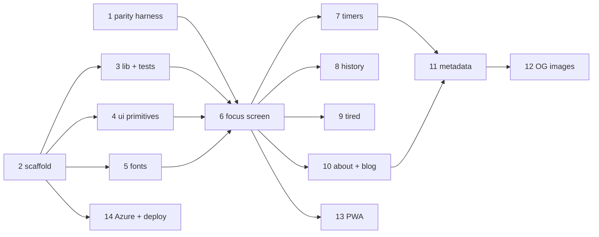

# Chapter 10: Arc 1: the factory rewrites the frontend

> ⏱ About 30 min · You'll learn: how to run a big change through the factory as many small units, how to spec a rewrite whose main requirement is "nothing changes", how to break it into tickets that agents can do in parallel, what moves from Next.js to React Router 8 and what has to be replaced, how to prove parity with tests instead of hope, and how to cut over with a way back.

---

## 📖 Story: The biggest PR you'll never open

The decision is made and written down as ADR 0001: BusyHamster moves from Next.js to React Router 8, pre-rendered to static files, hosted on Azure Static Web Apps. .NET will be the only server.

A year ago, a rewrite like this meant a long-lived branch, three weekends of work and a final PR with 9,000 changed lines that you'd merge with your eyes half closed. This time, you open a parent issue and write one sentence in it: *"There will be no big PR."*

The rewrite is the factory's first real exam. It's large but well specified: the target behaviour is "exactly what's live today". It has a strong test suite to keep green (109 unit tests over pure functions). And it has a perfect reference implementation: the current site, running at busyhamster.app, which every new page can be compared with.

You write in your factory log: *"A rewrite is just a lot of small, boring units with one clear test: does it match?"*

---

## 🏚️ Old way → 🚀 New way

| What you'd do before | What the factory does | Why it changes |
|---|---|---|
| A rewrite branch that lives for weeks | The new app grows in `web/` next to the old one, merged to `main` in small PRs | Nothing goes stale; every step is reviewed and reversible |
| "We'll test it at the end" | Parity tests written first, from the live site | The definition of done exists before the first line of new code |
| You port pages one by one, in order | Independent tickets run in parallel, up to the WIP limit | The plan's file lists show which can run together |
| A big-bang cutover | DNS moves when parity is proven; Vercel stays up for two weeks | A way back that's one DNS change |
| Framework knowledge from memory | A skill and AGENTS.md for the new framework, written before the agents start | Agents' training data lags behind framework releases |

---

## 🧠 Why this move, in one table

ADR 0001 records the reasoning. The short version:

| Question | Next.js on Vercel | React Router 8, static, on Static Web Apps |
|---|---|---|
| Who's the server? | Next.js has its own server layer, which overlaps with a .NET API | .NET only; the frontend is static files |
| SEO pages | Static generation | **Pre-rendered** at build time: full HTML for `/`, `/timer/*`, `/blog/*`, `/about` |
| App pages (History, account) | Client components | The SPA fallback: one HTML file that hydrates any other route 🔧 |
| Mental model for agents | Server and client components, caching rules, frequent breaking changes (the AGENTS.md warning) | Route modules, loaders, Vite; no server components in static mode |
| Hosting | Vercel | Azure, next to the API, with PR previews |
| Build | Turbopack; fonts downloaded at build time | Vite; fonts self-hosted |

React Router 8 is the continuation of Remix and React Router 7. In **framework mode**, with `ssr: false` and a `prerender` list, `react-router build` writes complete HTML files for the listed routes and a `__spa-fallback.html` that can hydrate every other route, all of it deployable to any static host 🔧.

---

## 🧠 The spec for a rewrite

> 💡 The main requirement of a rewrite is that users can't tell. Write that down as tests.

The rewrite spec is unusual: almost all of its goals are about things **not** changing.

📝 Illustrative

```markdown
# Spec: Frontend on React Router 8 (parent issue #60)

**In one line:** the same BusyHamster, served as static files from Azure,
built with React Router 8 instead of Next.js.

## Goals
1. Parity: every page, shortcut and stored value works as today.
2. URLs: every URL in today's sitemap returns 200 with the same <title>,
   <meta name="description">, canonical link and Open Graph tags.
3. SEO pages are pre-rendered HTML (no client-only rendering for them).
4. Existing user data survives: same localStorage keys (nextline:*), same formats.
5. The build needs no network beyond npm install.
6. Lighthouse performance on / and /timer/25-5 is no worse than today.

## Non-goals
- Any new feature, design change or copy change. Bugs found during the port
  get their own issues and are fixed after the cutover.
- Server-side rendering at request time.
- Changing storage keys, even though "nextline" is an old name.

## Acceptance criteria (excerpt)
- Given the URL list from today's /sitemap.xml, when the parity test runs
  against the preview, then every URL returns 200 and its title, description,
  canonical and og:image match production.
- Given a browser with today's localStorage (fixture from a real export),
  when it opens the new build, then the resume card shows the same task and line.
- Given `npm run build` in a container with network disabled after
  `npm ci`, then the build succeeds.
- Given all 109 existing unit tests, then they pass unchanged in web/.
```

Goal 4 is the one that would hurt most to get wrong. Users' history lives only in their browsers (until chapter 11). Rename a storage key and you've deleted everyone's data, with no server-side copy to restore from.

---

## 🧠 Breaking it into units

> 💡 Split a rewrite so that each ticket is one route or one replaced capability, and the old app keeps working until the last ticket lands.

The planner proposes a split instead of a plan (chapter 6's rule: too big for one PR). After your edits, the parent issue has 14 children:

| # | Ticket | Depends on | Tier | Parallel group |
|---|---|---|---|---|
| 1 | Parity test harness: URL list from the sitemap, metadata comparison, localStorage fixture | | 1 | A |
| 2 | Scaffold `web/`: React Router 8 framework mode, `ssr: false`, Vite, Tailwind 4, Vitest | | 2 (new deps) | A |
| 3 | Move `src/lib/**` and its 109 tests to `web/app/lib/` unchanged | 2 | 1 | B |
| 4 | Move `src/components/ui/**` (the design system primitives) and `globals.css` tokens | 2 | 1 | B |
| 5 | Self-hosted fonts (replaces `next/font/google`) | 2 | 1 | B |
| 6 | Route: `/` (focus screen, resume card, command menu) | 3, 4, 5 | 1 | C |
| 7 | Routes: `/timer/:preset` (three pre-rendered pages) | 6 | 1 | D |
| 8 | Route: `/history` (client-only, via SPA fallback) | 6 | 1 | D |
| 9 | Routes: `/tired` and its games | 6 | 1 | D |
| 10 | Routes: `/about`, `/blog`, `/blog/:slug` (pre-rendered) | 6 | 1 | D |
| 11 | Metadata: `meta` exports, canonical URLs, `sitemap.xml` and `robots.txt` at build | 7, 10 | 1 | E |
| 12 | Open Graph images as static files | 11 | 1 | E |
| 13 | PWA: manifest, service worker, `staticwebapp.config.json` headers | 6 | 2 (caching) | E |
| 14 | Static Web Apps resource (Bicep), deploy workflow, preview environments | 2 | 2 (infra) | A |



Things to notice:

- **Ticket 1 comes first and runs in parallel with the scaffold.** The parity tests exist before any page is ported, so every later PR is checked against them from its first run.
- **Group D is the parallel burst.** Four route tickets that touch four different folders. With a WIP limit of 3 to 4, they run together.
- **Ticket 6 is the bottleneck, and it's yours to review closely.** The focus screen is the product. It's tier 1 by the path rules, but you review it like tier 2.
- **Tickets 2, 13 and 14 are tier 2.** New dependencies, caching behaviour and infrastructure.
- **The old app stays in `src/` until the cutover.** Vercel keeps deploying it from `main`; Static Web Apps deploys `web/`. Both live side by side for a few weeks.

---

## 🧠 Prepare the context before the agents start

> 💡 Agents know older versions of every framework better than the current one. Tell them what's different before they guess.

Before you add `agent:go` to any child ticket, two context files land first, in their own small PR:

1. **`web/AGENTS.md`** ([template](../toolkit/agents-web.md)): React Router 8 framework mode, `ssr: false`, where routes live (`app/routes.ts`), "no server code in web/", the design-system rules carried over word for word, and: *"Read the React Router docs in node_modules/react-router/docs or reactrouter.com before using an API you haven't seen in this repo."*
2. **A `port-route` skill**: the checklist for moving one Next.js route to React Router, with the mapping table below.

| Next.js (today) | React Router 8 (target) |
|---|---|
| `src/app/about/page.tsx` | `web/app/routes/about.tsx`, registered in `web/app/routes.ts` |
| `export const metadata = { title, description }` | `export const meta = () => [{ title }, { name: "description", content }]` |
| `export default function Page()` | `export default function Component()` (route module default export) |
| `"use client"` | Remove: in static mode everything hydrates in the browser |
| `import Link from "next/link"` | `import { Link } from "react-router"` |
| `useRouter().push("/x")` | `useNavigate()("/x")` |
| `usePathname()` | `useLocation().pathname` |
| `sitemap.ts`, `robots.ts` | A build script that writes `sitemap.xml` and `robots.txt` into `build/client` |
| `opengraph-image.tsx` | Static PNGs in `public/og/`, referenced from `meta` |
| `next/font/google` | `@font-face` with font files in `public/fonts/` |
| `next.config.ts` `headers()` | `staticwebapp.config.json` `globalHeaders` and `routes` |

The mapping table is the most valuable thing in the skill. Without it, each of four parallel agents would solve "where does metadata go" in its own way.

---

## 💻 In BusyHamster: the React Router configuration

📄 [`toolkit/web/react-router.config.ts`](../toolkit/web/react-router.config.ts) 🔧
```ts
import type { Config } from "@react-router/dev/config";
import { readdir } from "node:fs/promises";

// The same list feeds scripts/write-sitemap.ts, so the sitemap and the
// pre-rendered pages can't drift apart.
export async function publicPaths(): Promise<string[]> {
  const posts = (await readdir("content/blog").catch(() => [] as string[]))
    .filter((f) => f.endsWith(".md"))
    .map((f) => `/blog/${f.replace(/\.md$/, "")}`);
  return ["/", "/about", "/tired", "/timer/25-5", "/timer/50-10", "/timer/90-minute", "/blog", ...posts];
}

export default {
  // Static files only: .NET is the only server.
  ssr: false,
  // Pages Google should see as full HTML. History, account and anything with
  // the user's data are rendered in the browser through the SPA fallback.
  prerender: publicPaths,
} satisfies Config;
```

With a `prerender` list and `ssr: false`, the build writes each listed route as an HTML file plus `__spa-fallback.html` for the rest 🔧. Static Web Apps needs to know about that fallback:

📄 [`toolkit/web/staticwebapp.config.json`](../toolkit/web/staticwebapp.config.json) (excerpt) 🔧
```json
{
  "navigationFallback": {
    "rewrite": "/__spa-fallback.html",
    "exclude": ["/api/*", "/assets/*", "/fonts/*", "/og/*", "*.{js,css,png,svg,webp,ico,json,xml,txt,webmanifest}"]
  },
  "routes": [
    { "route": "/sw.js", "headers": { "Cache-Control": "no-cache, no-store, must-revalidate" } }
  ],
  "globalHeaders": {
    "X-Content-Type-Options": "nosniff",
    "X-Frame-Options": "DENY",
    "Referrer-Policy": "strict-origin-when-cross-origin"
  }
}
```

The headers are the same three that `next.config.ts` sets today. Moving them is part of parity: the reviewer's checklist for ticket 13 compares the two files.

---

## 🧠 Proving parity

> 💡 Parity is a test you run against two URLs: production and the preview.

The harness from ticket 1 does three things, all against both the live site and the PR's preview:

| Check | How | Catches |
|---|---|---|
| **URL and metadata parity** | Fetch every URL in production's `sitemap.xml`; compare status, `<title>`, description, canonical, `og:*` | Missing routes, lost SEO metadata, wrong canonical domain |
| **Storage parity** | Load a fixture of real `nextline:*` localStorage data, open `/`, expect the resume card with the fixture's task and line | Renamed keys or changed formats: the data-loss bug |
| **Behaviour smoke** | Chapter 8's smoke test (add a line, reload, resume with R; command menu opens with ⌘K) | Broken key paths |

The metadata check is a few dozen lines of TypeScript with an HTML parser; agents write it well because the spec is precise. Its output on a PR looks like:

```text
parity: 14/16 URLs match
  ✗ /timer/90-minute   og:image  prod=/timer/90-minute/opengraph-image  preview=(missing)
  ✗ /blog              canonical prod=https://busyhamster.app/blog  preview=https://busyhamster.app/blog/
```

Both are real classes of bug in framework moves: OG images that only existed through a framework convention, and trailing-slash changes that split your search ranking across two URLs. Static Web Apps has a `trailingSlash` setting for the second 🔧.

### The build-without-network check

Spec criterion: `npm run build` succeeds with the network off after `npm ci`. CI checks it in the `web` job with one extra step that runs the build inside `sudo unshare -n` (a network namespace with no interfaces) 🔧. That's chapter 4's font story, closed for good.

---

## 🗺️ Running the arc

How the two weeks of the arc look from your side:

| Day | You | The factory |
|---|---|---|
| 1 | Approve the split; write and merge `web/AGENTS.md` and the `port-route` skill | Planner drafts plans for tickets 1, 2, 14 |
| 2 | Approve three plans; `agent:go` on 1, 2, 14 | Three builds; reviewer; previews (none yet for `web/`) |
| 3 | Review the scaffold closely (tier 2: new dependencies); merge | Plans for 3, 4, 5 |
| 4–5 | `agent:go` on 3, 4, 5; review and merge | Builds; parity harness now runs on every `web/` PR |
| 6 | Ticket 6, the focus screen: review the preview carefully, test by hand | Retries after your comments |
| 7–9 | `agent:go` on 7, 8, 9, 10 in parallel | Four builds; parity results on each |
| 10–11 | 11, 12, 13 | Metadata, OG images, PWA |
| 12 | Parity 16/16, Lighthouse checked; cutover | |

📝 Illustrative numbers from a run like this: 14 tickets, 16 PRs (two tickets needed a second PR after review), 3 hours of your review time in total, 2 escaped defects found after cutover, both CSS and both fixed by tier 1 PRs.

---

## 🧠 Cutover with a way back

> 💡 Move traffic when the tests say so, and keep the old path open until the new one has proved itself.

| Step | What | Undo |
|---|---|---|
| 1 | Lower the DNS TTL for `busyhamster.app` to 5 minutes, a day before | |
| 2 | Add the custom domain to Static Web Apps; it validates and issues a certificate 🔧 | Remove the domain |
| 3 | Point DNS to Static Web Apps | Point DNS back to Vercel: ~5 minutes |
| 4 | Run the parity harness against the new production | |
| 5 | Watch for a week: Search Console coverage, error reports, your own use | |
| 6 | After two weeks: delete `src/`, the Next.js config and the Vercel project, in one tier 2 PR; update the root AGENTS.md | `git revert` |

Step 6 is also a context-layer change: AGENTS.md loses the Next.js warning block, and the cold-start test (chapter 3) gets run again.

---

## ⚠️ Common traps

| Trap | What happens | Instead |
|---|---|---|
| **The long-lived rewrite branch** | Weeks of drift, one giant unreviewable PR | Build side by side in `web/`, merge small PRs to `main` |
| **"While we're at it" improvements** | New features mixed with the port; parity tests can't tell bug from change | Non-goal: no new features; found bugs get their own issues |
| **Renamed storage keys** | Every user's local history is gone | Storage parity test with a real fixture; storage files are tier 2 |
| **Agents using last year's API** | Code that compiles against nothing, or against an older major version | `web/AGENTS.md` and a skill, merged before the first port |
| **Parallel tickets in shared files** | Four agents all edit `routes.ts` | One ticket owns `routes.ts` changes, or each adds one line and the conflicts are trivial; check plan file lists first |
| **Trailing slashes and canonicals** | Search traffic split or lost | Metadata parity test on every URL in the sitemap |
| **No way back** | A bad cutover becomes a weekend of fixes | Low TTL, old host kept for two weeks |

---

## 🧰 Helpers

- [`agents-web.md`](../toolkit/agents-web.md): the `web/AGENTS.md` for React Router 8.
- [`react-router.config.ts`](../toolkit/web/react-router.config.ts) and [`staticwebapp.config.json`](../toolkit/web/staticwebapp.config.json).
- [Smoke test](../toolkit/web/smoke.spec.ts), reused as part of the parity harness.
- [ADR template](../toolkit/templates/adr-template.md) for ADR 0001.

---

## 🧪 Try it yourself

1. Write ADR 0001 for your own framework decision (or for a decision you'd make if you moved).
2. Write the rewrite spec with parity goals, and run the planner on it. Compare its split with the table above.
3. Build the URL and metadata parity check first, and run it against your production site with itself as the "preview": every URL should match.
4. Do one ticket end to end through the factory: the scaffold, or one simple route.
5. In your factory log, record the arc's numbers: tickets, PRs, your review hours, escaped defects.

---

## ✅ Recap

- A rewrite runs through the factory as many small units, built next to the old app and merged to `main` continuously.
- Its spec is mostly "nothing changes", written as parity tests for URLs, metadata, storage and key paths, which run before any page is ported.
- Prepare the framework context first, run independent routes in parallel, and cut over with a way back.
