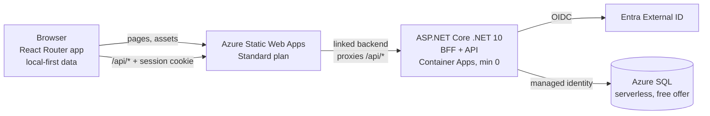
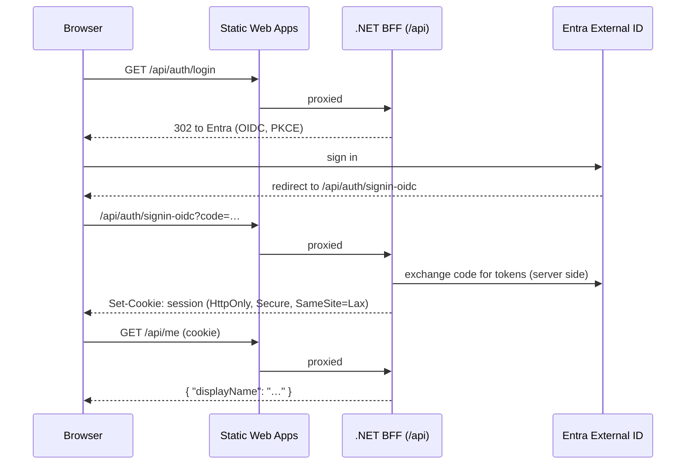
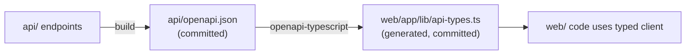

# Chapter 11: Arc 2: login, data and the .NET API

> ⏱ About 30 min · You'll learn: why the first step of a login feature is a product decision only a human can make, how the backend-for-frontend (BFF) pattern keeps tokens out of the browser, how Static Web Apps, Container Apps, Azure SQL and Entra External ID fit together, how to design sync so a cold, paused backend never slows the app down, how an API contract becomes a gate, and how to split a security-sensitive feature into vertical slices the factory can ship.

---

## 📖 Story: The PR only you can write

Users ask for the same thing in different words: *"I use BusyHamster on my laptop at work and my phone at home. Can my history follow me?"*

You open an issue and start the spec writer. Its first question stops you:

> PRODUCT.md Principle 3 says: "Your data stays yours: no account, nothing leaves the browser, export is always available." Sync requires an account and sends data to a server. Should this feature change the principle, or should it be rejected?

This is the decision from chapter 1's table: what BusyHamster is for. No agent should make it, and the factory is built so none can: `PRODUCT.md` is tier 2 and protected.

You decide. Sync is worth it, if the principle's spirit survives: the app must still work completely without an account, nothing leaves the browser unless you sign in and turn sync on, export always works, and deleting your account deletes everything. You write the change to Principle 3 yourself, in a PR with nothing else in it, and merge it after a night's sleep.

You write in your factory log: *"The first PR of a big feature is sometimes a paragraph, and it's always mine."*

---

## 🏚️ Old way → 🚀 New way

| What you'd do before | What the factory does | Why it changes |
|---|---|---|
| "Add login" as one big task | A product decision, two ADRs, then five vertical slices | Each slice ships and can be checked on its own |
| Tokens in `localStorage` for the SPA to call the API | The .NET backend holds the session; the browser gets an HttpOnly cookie | A script injected into the page can't steal what it can't read |
| An agent "sets up auth" | Agents use a hosted identity provider through a standard library; they never write crypto, token parsing or password handling | Security code you didn't write is the code you shouldn't let an agent improvise |
| The frontend and API drift apart | An OpenAPI contract, generated from the API, checked in CI | A breaking change fails a gate instead of failing in a user's browser |
| Sync that waits for the server | Local first: the server catches up in the background | A paused database or a cold container never blocks a pomodoro |

---

## 🧠 The decisions before the code

> 💡 Product decisions, then architecture decisions, then specs. Agents start after all three are written down.

| Decision | Made by | Recorded in | Tier |
|---|---|---|---|
| Accounts are optional; local-first stays; sync is opt-in; account deletion deletes all server data | You | `PRODUCT.md`, Principle 3 rewritten | 2 |
| Sign-in through Microsoft Entra External ID, handled by an ASP.NET Core BFF on the same origin | You, with the planner's draft | `docs/adr/0002-accounts-and-sync.md` | 2 |
| Azure SQL Database, serverless, on the free offer with auto-pause | You | `docs/adr/0003-database.md` | 2 |
| What "sync" means exactly: conflicts, deletes, first sign-in | You, interviewed by the spec writer | `docs/specs/sync.md` | 2 |

The new Principle 3:

📄 `PRODUCT.md` (Principle 3, after the change)
```markdown
3. Your data stays yours: everything works without an account, and nothing
   leaves the browser unless you sign in and turn on sync. Export is always
   available. Deleting your account deletes everything on the server.
```

Every slice spec in this chapter lists Principle 3 under "Product principles touched", and the reviewer (chapter 8) checks each PR against it.

---

## 🧠 The architecture

> 💡 One origin for the browser, one server that does everything, one database, and an identity provider you didn't build.



| Part | Role | Why this one | Cost notes 💰 🔧 |
|---|---|---|---|
| **Static Web Apps** | Serves the pre-rendered site; proxies `/api/*` to the API | Same origin for pages and API: no CORS, cookies just work | Linking a Container App as the API backend requires the **Standard** plan, a fixed monthly fee |
| **Container Apps** | Runs the .NET BFF and API | Scales to zero when nobody's syncing | Monthly free grant of 180,000 vCPU-seconds, 360,000 GiB-seconds and 2 million requests per subscription; no charge while scaled to zero |
| **Azure SQL Database** | Stores accounts' synced tasks | The database you know from .NET work; EF Core | Free offer: 100,000 vCore-seconds and 32 GB per database per month; can auto-pause until next month when exhausted |
| **Entra External ID** | Sign-up, sign-in, email verification, password reset, social logins | Hosted customer identity: no passwords in your database | First 50,000 monthly active users free on the core tier |

How the linked backend works 🔧: Static Web Apps forwards every request whose path starts with `/api` to the same path on the linked Container App, and by default the Container App then accepts only traffic that comes through the static web app. So the API's routes all start with `/api`, including the sign-in callback.

> ⚠️ Linked backends aren't supported on Static Web Apps pull request environments 🔧. PR previews run without the API. The "Testing" section below covers what replaces them.

---

## 🧠 The BFF: why the browser never sees a token

> 💡 In the BFF pattern, the server does the OpenID Connect sign-in and keeps the tokens. The browser holds only an HttpOnly session cookie it can't read.

The usual SPA approach puts an access token in browser storage and sends it to the API. Any script running on the page (a compromised npm package, an injection bug) can read it. The **backend-for-frontend** pattern moves the whole protocol to the server:



| Property | How |
|---|---|
| Tokens stay on the server | ASP.NET Core's OpenID Connect handler (through `Microsoft.Identity.Web`) does the code exchange; the cookie handler holds the session 🔧 |
| The cookie can't be read by scripts | `HttpOnly`, `Secure`, `SameSite=Lax` |
| Cross-site request forgery | `SameSite` plus a required custom header (`X-BusyHamster: 1`) on every state-changing request; browsers won't send custom headers cross-site without a CORS preflight the API never approves |
| Calls from the frontend | Plain `fetch("/api/...", { credentials: "include" })`: same origin, no tokens, no CORS |

📄 [`toolkit/api/BffProgram.cs`](https://github.com/vygantas-meskauskis/learning-library/blob/main/courses/agentic-software-factory/toolkit/api/BffProgram.cs) (excerpt) 🧪 Not run by the author
```csharp
builder.Services
    .AddAuthentication(OpenIdConnectDefaults.AuthenticationScheme)
    .AddMicrosoftIdentityWebApp(options =>
    {
        builder.Configuration.Bind("EntraExternalId", options);
        // Static Web Apps only forwards /api/*, so the callback must live there.
        options.CallbackPath = "/api/auth/signin-oidc";
        options.SignedOutCallbackPath = "/api/auth/signout-callback-oidc";
    });

builder.Services.Configure<CookieAuthenticationOptions>(
    CookieAuthenticationDefaults.AuthenticationScheme, cookie =>
    {
        cookie.Cookie.Name = "__Host-bh";
        cookie.Cookie.HttpOnly = true;
        cookie.Cookie.SecurePolicy = CookieSecurePolicy.Always;
        cookie.Cookie.SameSite = SameSiteMode.Lax;
        // An API never redirects to a login page: it answers 401.
        cookie.Events.OnRedirectToLogin = ctx => { ctx.Response.StatusCode = 401; return Task.CompletedTask; };
    });
```

This is the part of the API an agent must not improvise, which is why `api/AGENTS.md` says: *"Authentication and cookie configuration live in `Auth/` and are tier 2. Don't change them to make a test pass; use the test authentication handler in `tests/`."* The library does the protocol. Your code only configures it.

Cloud-Native .NET's [chapter 13](../../cloud-native-dotnet/chapters/13-identity-and-secrets.md) covers managed identities, which the API uses to reach Azure SQL with no connection-string password.

---

## 🧠 Sync that never waits

> 💡 The browser is the source of truth while you work. The server is a copy that catches up when it can.

Two facts about the infrastructure shape the sync design:

- A Container App scaled to zero takes a few seconds to start on the first request.
- A serverless Azure SQL database that has auto-paused takes up to about a minute to resume 🔧.

If starting a pomodoro waited for the server, the app would sometimes freeze for a minute. That breaks Principle 1 (resuming must stay one key) and Principle 4 (stay out of the way). So sync is built around the local data that already exists:

| Rule | Detail |
|---|---|
| Writes go to `localStorage` first, always | Exactly as today; nothing in the timer path touches the network |
| A background sync loop pushes and pulls | On sign-in, on tab focus, every few minutes, and after finishing a task; with backoff when the server is slow or paused |
| Unit of sync: one task | Each finished task has an `id` (its creation time) and gets an `updatedAt` |
| Conflicts: last writer wins, per task | Two devices editing the same finished task is rare; the newer edit wins and the older is kept in a `conflicts` list for 30 days |
| Deletes: tombstones | A deleted task syncs as `{ id, deletedAt }` so it doesn't come back from another device |
| First sign-in | Local history uploads and merges with anything already on the server for that account |
| Signing out | Local data stays; sync stops; nothing is deleted |

Every rule is an acceptance criterion in `docs/specs/sync.md`, and the sync logic itself is a pure function (`mergeTasks(local, remote, now)`) in `web/app/lib/sync.ts`, so it gets the same kind of fast unit tests as the rest of `lib/`. The network loop around it is thin.

---

## 🧠 The contract is a gate

> 💡 Generate the OpenAPI document from the API, commit it, generate the TypeScript client from it, and fail CI when they disagree.

ASP.NET Core in .NET 10 generates an OpenAPI document from the endpoints 🔧. The factory treats that document as the contract between `web/` and `api/`:



The `contract` job in `ci.yml`:

1. Builds the API and regenerates `openapi.json`. If it differs from the committed file, CI fails: *"The API contract changed. Commit api/openapi.json."*
2. Regenerates `api-types.ts` from it. If that differs, CI fails the same way.
3. Runs the web type check, so frontend code using a changed endpoint fails to compile.

The risk-tier script adds two rules:

| Change to `openapi.json` | Tier |
|---|---|
| Only additions (new paths, new optional fields) | 1 |
| Anything removed, renamed or made required | 2 |

That's a breaking-change detector made of `git diff` and a few lines of `jq`. It's crude and it's enough for one developer and one client.

It also makes parallel work safe. Once a slice's contract PR is merged, the API ticket and the web ticket for that slice can run at the same time: both build against the same committed contract.

---

## 🧠 Five vertical slices

> 💡 Split a security feature so that the riskiest part ships first, alone, behind a flag.

Chapter 5's rule: slices that each work, not layers that only work together. Each slice is a parent issue with child tickets.

| Slice | Users (with the `sync` flag on) can… | Child tickets | Tier |
|---|---|---|---|
| **S1 Sign in** | Sign in and out; see their name in the header | Bicep: Container App, linked backend, Entra app registration notes · API: BFF auth, `/api/me` · Web: sign-in button, header, `useMe()` | 2 |
| **S2 Upload** | Have finished tasks copied to the server | Migration: `Tasks` table · API: `PUT /api/tasks` · Web: background push loop | 2 (migration), 1 (web) |
| **S3 Two-way sync** | See tasks from their other devices | API: `GET /api/tasks?since=` · Web: `mergeTasks` + pull loop · Spec tests for conflicts and tombstones | 1 |
| **S4 Delete and export** | Delete their account and all server data; download a server export | API: `DELETE /api/account`, `GET /api/export` · Web: account page | 2 |
| **S5 Release** | Everyone sees "Sign in to sync" | Flag `sync: true` · Smoke tests updated · PRODUCT.md and About page copy | 1 |

S1 is the riskiest slice and the most boring one to look at: a button and a name. That's on purpose. If authentication has a problem, it's found when the only thing behind it is a display name. S4 ships **before** S5: users get the right to delete their data before anyone can create any.

### What an agent does in S1, and what it doesn't

| Agent does | You do |
|---|---|
| Writes `Program.cs` configuration from the BFF template and the ADR | Create the Entra External ID tenant and app registration (portal or CLI): it involves a client secret or certificate, which no agent touches 🔧 |
| Writes `/api/me` and its integration tests with the test auth handler | Put the client secret in Key Vault; grant the Container App's managed identity access |
| Writes the Bicep for the Container App and the linked backend | Approve the infra deploy (`production-infra` environment) |
| Writes the web sign-in button and header, behind the flag | Sign in on production with the flag overridden in your browser; sign out; check the cookie in DevTools |

---

## 🧠 Testing without a full-stack preview

> 💡 When previews can't run the whole system, test each half against the contract, and the whole system in CI with real dependencies.

| Layer | Where | What |
|---|---|---|
| Sync logic | `web/` unit tests | `mergeTasks` with every conflict and tombstone case from the spec |
| API | `api/` integration tests: `WebApplicationFactory` plus Testcontainers SQL Server | Every endpoint, with a test authentication handler that signs in fake users; migrations applied to a real database |
| Contract | `contract` CI job | API and web agree |
| Web against the API | Mock Service Worker in the smoke tests, responses typed from `api-types.ts` | Signed-in UI states on previews, with a fake `/api` |
| Whole system | Your laptop: `dotnet run` for the API and `npm run dev` for the web app, with Vite proxying `/api` | You, before approving S1 and S4 |
| Production | After each slice merges, with the flag overridden in your browser only | You, signed in, on the real thing |

Integration tests with a real SQL Server in a container are the same technique as Cloud-Native .NET's [chapter 17](../../cloud-native-dotnet/chapters/17-testing-strategy.md); Docker is available on GitHub-hosted Linux runners.

---

## 🧠 Migrations agents write but never run

> 💡 Agents write migrations. The deploy workflow runs them. Schema changes only add, until a later, separate change removes.

| Rule | Why |
|---|---|
| Every migration is tier 2 | A schema change can't be rolled back like code (chapter 9) |
| **Expand, then contract**: add the new column, ship code that uses it, remove the old column weeks later in its own PR | Old and new code can run at the same time during a deploy, and rollback stays possible |
| No data-destroying operation (`DROP`, `DELETE` without `WHERE`, column type narrowing) in an agent PR | The reviewer blocks it; `guard-bash.sh` blocks running SQL from the agent at all |
| Migrations run in the `deploy` workflow as an EF Core migration bundle, as the deploy identity | Agents never have a connection to any database except the throwaway test container |

---

## 🧠 The security review for tier 2 slices

> 💡 For auth and data PRs, read the full diff with a checklist. Your attention is the last gate, so give it structure.

📄 From [`toolkit/risk-tiers.md`](../toolkit/risk-tiers.md), tier 2 checklist for auth and data

| Check | Look for |
|---|---|
| Every endpoint is authorised | `RequireAuthorization()` on the `/api` group; explicit `AllowAnonymous` only on `/api/auth/*` and `/api/flags` |
| Users only see their own rows | Every query filters by the signed-in user's ID from the claims, never from the request body |
| State-changing requests need the custom header | The antiforgery middleware runs for `POST`, `PUT`, `DELETE` |
| No tokens or personal data in logs | Log user IDs, not emails; no request bodies |
| Deletion really deletes | `DELETE /api/account` removes tasks, conflicts and the user row; test proves it |
| Nothing new leaves the server | No new outbound calls; no third-party scripts in `web/` |
| Cookie settings unchanged | `HttpOnly`, `Secure`, `SameSite`, `__Host-` prefix |

The reviewer agent runs the same list. You run it again. For the five auth-and-data PRs in this arc, that's about two hours of careful reading in total, and it's the best-spent two hours of the whole course.

---

## ⚠️ Common traps

| Trap | What happens | Instead |
|---|---|---|
| **An agent decides the product change** | Accounts appear and a principle quietly dies | PRODUCT.md change first, by you, alone in its PR |
| **Tokens in the browser** | One XSS away from account takeover | BFF: HttpOnly cookie, tokens on the server |
| **An agent "implements auth"** | Hand-rolled token validation with a subtle hole | A hosted provider and a standard library; auth config is tier 2 and protected |
| **Sync in the timer path** | The app freezes while the database resumes | Local first; sync in the background with backoff |
| **Layer-shaped slices** | Nothing works until everything lands | Five vertical slices, riskiest first, deletion before release |
| **Contract drift** | The web app calls an endpoint that changed shape | Generated contract, committed, checked in CI |
| **Agents near production data** | A migration run "to check something" | Agents only ever touch the test container; the deploy job runs migrations |
| **Assuming previews test the API** | Green previews, broken sign-in in production | Previews are frontend-only; integration tests and your manual check cover the rest |

---

## 🧰 Helpers

- [`agents-api.md`](../toolkit/agents-api.md): the `api/AGENTS.md` with the auth and data rules.
- [`BffProgram.cs`](https://github.com/vygantas-meskauskis/learning-library/blob/main/courses/agentic-software-factory/toolkit/api/BffProgram.cs): BFF starting point.
- [`main.bicep`](../toolkit/infra/main.bicep): Static Web Apps, Container Apps, Azure SQL (free offer) and the linked backend.
- [Risk tiers](../toolkit/risk-tiers.md), including the tier 2 security checklist.
- [Rollout checklist](../toolkit/rollout-checklist.md) for S5.

---

## 🧪 Try it yourself

1. Find the product principle your next big feature touches. Write the change to it yourself, in a PR on its own.
2. Write ADR 0002 for your sign-in approach, including what an agent may and may not do.
3. Write `mergeTasks` tests first: two devices, a conflict, a tombstone, a first sign-in. Let the agent write the function.
4. Add the `contract` job to CI and break the contract on purpose in a branch. Check that CI fails and the tier goes to 2.
5. Before S5, do the security checklist on S1 and S4 yourself, line by line. Note in your factory log what the reviewer agent caught that you didn't, and the other way round.

---

## ✅ Recap

- A login feature starts with a human product decision, then ADRs, then vertical slices with the riskiest first and deletion before release.
- The .NET BFF keeps tokens on the server; Static Web Apps proxies `/api/*` to Container Apps on the same origin; sync is local first so a cold backend never blocks the app.
- The OpenAPI contract is a gate, migrations only expand, and your full-diff security review is the last line for tier 2.
