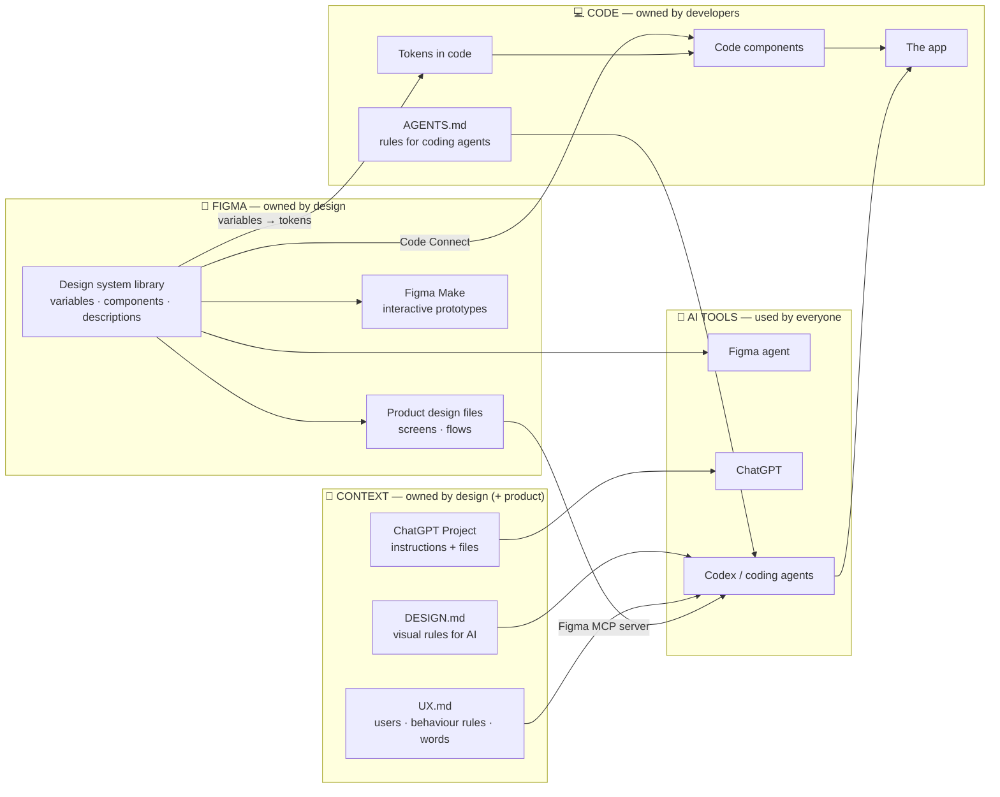
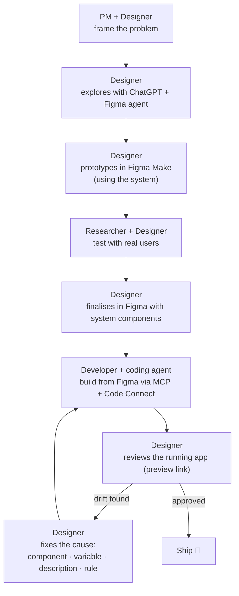

# Chapter 1: Orientation, the AI-native designer's map

> ⏱ About 25 min · You'll learn: what changes in a senior designer's work, **where everything lives**, and **who (or what) does what**.

---

## 📖 Story: your first day at Movewell

Movewell has about 25 people. The app lets people find and book local fitness and wellness classes, from yoga and pilates to spin, climbing intros and sound baths. It's been live for two years on iOS and Android.

You meet the people you'll work with most:

| Person | Role | What they care about |
|---|---|---|
| **Maya** | Product manager | Bookings per user, retention, shipping on time |
| **Jonas** | Tech lead | Code quality, not rebuilding things twice |
| **Ana** | Mobile developer | Clear specs, fewer "is this the right blue?" questions |
| **Leo** | Front-end developer who maintains the shared components | Consistency between Figma and code |
| **Priya** | Researcher (contract, 2 days/week) | Real user evidence |
| **Sam** | Junior designer | Learning, speed |

On day one, Maya shows you a screen she "designed" in ChatGPT for a new feature. Ana mentions that the developers' coding agent has been "guessing the styling" because the Figma file is "a bit of a mess". Leo says: *"Figma and the app haven't matched for a year."*

This is the reality the guide works with: **everyone is already making UI with AI**, and nothing connects their efforts.

Your job as a senior AI-native designer is to make sure everything they generate, whether a PM's mockup, a developer's agent output or Sam's explorations, comes out **on-system, on-brand and grounded in what users need**.

---

## 🧠 Concept 1: What actually changes for a senior designer

| Before AI | AI-native |
|---|---|
| You make most screens yourself | You **direct and judge**: AI drafts, you decide |
| The design system is a Figma library for designers | The design system is the **source of truth for people and AI** |
| Standards live in your head, in Slack and in decks | Standards are **written down where AI tools read them** |
| Handoff = specs and redlines | Handoff = **structured design + context**, which agents read directly |
| You check the built app at the end | You **review running UI early and often**, including AI-built UI |
| Prototypes are clickable pictures | Prototypes can be **working apps** with real data |

What does **not** change: talking to real users, judgment, taste, accessibility, clarity, and owning the quality of what ships.

> 💡 **The key mental shift:** you're no longer only designing *screens*. You're also designing the **inputs that AI uses to make screens**: the system, the rules and the context.

---

## 🧠 Concept 2: The four places where everything lives

Almost everything in AI-native product design lives in one of four places. Learn this map; the rest of the guide fills it in.

| Place | What lives there | Who owns it | Who (or what) reads it |
|---|---|---|---|
| **Figma** | The design system library (variables, components, descriptions), product files, Make prototypes | **Design** | Designers, developers, the Figma agent, Figma Make, coding agents (via the MCP server) |
| **Context files** | DESIGN.md (visual rules), UX.md (users and behaviour rules), ChatGPT Project instructions | **Design**, with input from product and research | AI tools: ChatGPT, Codex, Figma Make; also new team members |
| **Code** | Tokens in code, code components, the app, AGENTS.md (rules for coding agents) | **Developers** (design co-owns the design parts of AGENTS.md) | Developers and coding agents |
| **AI tools** | Nothing permanent. They *read* from the other three and *produce* drafts | Used by **everyone** | — |

**The golden rule:** AI tools have no memory of your product. **Everything they know comes from the other three places.** If something isn't written in Figma, a context file or the code, AI will guess, and its guess is "the average app".

---

## 🧠 Concept 3: Who does what

This is how a typical feature flows at an AI-native company. The rest of the guide teaches each step.

| Step | Human does | AI does |
|---|---|---|
| Frame | Decide the problem, success, constraints | Summarise inputs, suggest framings, pre-mortem |
| Explore | Choose directions; reject most | Generate many directions, variants, copy |
| Prototype | Decide what must work and with which data | Build the interactive prototype |
| Test | Run sessions with real users; interpret | Draft scripts, transcribe, first-pass clustering |
| Finalise | Make decisions; use the system | Busywork: states, renaming, tokenising, filling in content |
| Build | Developers own the code | The coding agent writes most of it, reading your Figma |
| Review | Judge what was built against design intent | Compare screenshots, list inconsistencies |
| Fix causes | Improve the system, descriptions and rules | — |

Notice the **last row**. When AI gets something wrong, the senior move is to **fix the cause** (a missing variable, a vague component description, a missing rule) so it doesn't happen again, rather than just fixing the screen.

---

## 🧠 Concept 4: Three kinds of "AI" you'll use

People say "AI" for very different things. Keep them apart:

| Kind | Example | Good for | Not good for |
|---|---|---|---|
| **Chat assistant** | ChatGPT (Chat) | Thinking, writing, research, critique, planning | Anything that needs your actual files unless you attach them |
| **AI inside a tool** | Figma agent, Figma Make | Working *on your designs* with your library | Work outside that tool |
| **Agent** | Codex; ChatGPT Work | Multi-step tasks: read Figma, write code, run it, fix errors | Decisions about what's right for users |

An **agent** is an AI that can take a goal, plan steps, use tools (read a file, run code, open Figma) and check its own results. That's what makes "design to code without coding" possible.

---

## 🧾 Real artifact: Maya's ChatGPT mockup, and what was wrong with it

Maya asked ChatGPT: *"Design a screen for booking a recurring weekly yoga class."* The result looked fine, but:

- It used a **purple** primary button. Movewell's brand colour is teal.
- It said **"Reserve"**. Movewell uses **"Book"** everywhere.
- It put the cancellation policy in **small grey text under the button**. Research showed users complain about surprise cancellation fees.
- It invented a **new date-picker style** that doesn't exist in the app.

None of this is Maya's fault, or ChatGPT's. **The AI had no context.** It produced the average booking screen. By the end of this guide, the same prompt from Maya will produce something on-brand and grounded in research, because the context will be there.

---

## 🧰 Helpers

**Map your current workplace (5 min).** Copy the "four places" table and fill it in for your real team: where does each thing live today, and who owns it? The empty cells are your opportunities.

**The "where does this belong?" quick test.** When you learn something important (a research finding, a rule, a decision), ask:

| If it is... | Put it in... |
|---|---|
| A visual decision (colour, spacing, type, a component) | **Figma library** (variables, components, descriptions) |
| Rules for how AI should apply visual decisions | **DESIGN.md** |
| A user insight, behaviour rule or terminology | **UX.md** |
| A rule for how code should be written | **AGENTS.md** (with the developers) |
| Context you want ChatGPT to always have | **ChatGPT Project** instructions and files |

---

## 🧪 Try it yourself (optional, 10 min)

1. Ask ChatGPT, in a fresh chat: *"Design the main screen of a fitness class booking app. Describe the layout, colours, copy and components."*
2. Read the answer and highlight everything that's **generic** (that any app could have).
3. Write down three things about *your* product that the AI couldn't possibly know. Those three things are the start of your context.

---

## ✅ Recap

1. AI-native = your **work is set up so AI amplifies it**: system + context + judgment.
2. Everything lives in **four places**: Figma, context files, code, and the AI tools that read the other three.
3. When AI gets it wrong, **fix the cause** (system, description, rule), not just the screen.

**Next → [Chapter 2: AI essentials for designers](02-ai-essentials.md)**
