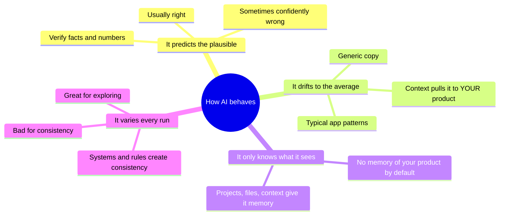
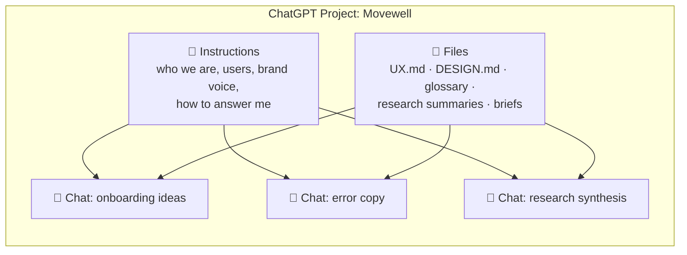

# Chapter 2: AI essentials for designers

> ⏱ About 30 min · You'll learn: the **20% of AI knowledge that explains 80% of what happens**, how to set up **ChatGPT as a product-aware partner**, and how to prompt, critique and verify like a senior designer.

---

## 📖 Story: the "average" problem

In your first week you ask ChatGPT to help with the class-details screen. It suggests a hero image, a big "Book now" button, a rating row, an instructor bio and a map. It's perfectly reasonable, and exactly what every booking app has.

Priya, the researcher, reads it and says: *"Our users care most about two things this doesn't mention: whether the class is beginner-friendly, and what happens if they cancel. That's in every interview."*

ChatGPT didn't know that. **Nothing in the chat told it.** This chapter explains why that happens and how to fix it permanently.

---

## 🧠 Concept 1: How AI models work (the useful version)

The AI behind ChatGPT, the Figma agent and Codex is a **large language model (LLM)**. It's trained on huge amounts of text, code and images to predict **plausible** next content. Four consequences matter for designers:



| Behaviour | What it means for you |
|---|---|
| **Plausible, not true** | It can invent statistics, quotes and "best practices". **Verify anything you'll rely on.** |
| **Pulls to the average** | Without context you get the most common pattern. **Context is how you get *your* product.** |
| **Only knows what it sees** | It has no idea about Movewell's users, brand or decisions unless they're in the chat, a file or a project. |
| **Different every time** | Running a prompt again gives new ideas (good for exploring). Two people get two different designs (bad for consistency), so **consistency comes from your system and rules, not from prompts.** |

### Five failure modes to recognise instantly

1. **Hallucination:** confident but false facts, sources or numbers.
2. **Sycophancy:** it agrees with you and praises your work. Ask for *critique*, not opinions.
3. **Averageness:** generic patterns and copy. Add context.
4. **Narrowness:** ask for 10 ideas and get 10 variations of one idea. Force different strategies.
5. **Drift:** in long chats it forgets earlier constraints. Restate them, or start fresh with a summary.

---

## 🧠 Concept 2: Context is the whole game

**Context** is everything the AI can see when it works: your message, attached files, project instructions, connected tools, the Figma library, and so on.

The best AI-native designers spend **more effort on context than on prompts**. Their prompts are often short and casual, because the context does the heavy lifting. NN/G's 2026 research with AI power users found exactly this: they invest in **context libraries** and dictate short prompts ([NN/G](https://www.nngroup.com/articles/context-libraries/)).

NN/G describes three kinds of context ([source](https://www.nngroup.com/articles/3-agent-context-roles/)):

| Kind | Meaning | Movewell example | Where it lives |
|---|---|---|---|
| **Global** | Rarely changes; applies to everything | Brand, design principles, users, glossary | ChatGPT Project instructions, DESIGN.md, UX.md, Figma library |
| **Local** | Specific to one task | The brief for "recurring bookings", the Figma frame | Attached files, links, the current chat |
| **Ambient** | Raw streams the AI can sift through | Slack threads, meeting notes | Connected apps (use carefully) |

> 💡 Rule of thumb: **write global context once, attach local context per task, and be careful with ambient context.**

---

## 🧠 Concept 3: Your ChatGPT setup

🔧 *As of October 2026:* ChatGPT has two modes. **Chat** is for conversation and thinking. **Work** is for research, analysis, and producing documents, presentations or spreadsheets. **Projects** group chats, files and **instructions** that apply to every chat inside the project. ChatGPT Work and Codex share the same usage allowance on paid plans ([ChatGPT docs](https://learn.chatgpt.com/codex/pricing)).

### Set up a "Movewell" project

A project is your **product-aware ChatGPT**. Every chat inside it starts already knowing your product.



### 🧾 Real artifact: Movewell project instructions (excerpt)

```text
You are a senior product design partner for Movewell, a mobile app (iOS + Android)
for discovering and booking local fitness and wellness classes.

USERS (from research, 2026):
- Primary: busy professionals 25–45 who book 1–3 classes/week, often on their commute.
  They want to book in under 30 seconds and hate surprise fees.
- Secondary: beginners trying a new activity. Their #1 worry is "will I fit in /
  is this too hard?" → beginner-friendliness must be visible.
- Studios set cancellation rules; users must see them BEFORE booking.

VOICE: warm, clear, encouraging, never pushy. Sentence case. No exclamation marks
in errors. Use our words: "book" (not reserve), "class" (not session), "studio"
(not gym), "credits" (not points).

DESIGN: we have a design system (see DESIGN.md). Always suggest existing
components first and say when something new would be needed.

HOW TO WORK WITH ME:
- Be direct. Critique honestly; no flattery.
- When unsure, say so and tell me what to verify.
- When giving options, make them genuinely different and recommend one.
- Cite sources for factual claims; flag anything uncertain.
```

Add files to the project: **UX.md**, **DESIGN.md** (both covered in Chapter 8), the glossary, and research summaries.

> ⚠️ **Data rule:** don't put personal user data, unreleased financials or passwords into AI tools your company hasn't approved. Summarise and anonymise.

---

## 🧠 Concept 4: Prompting like a senior

Prompts matter less than context, but a clear prompt still helps. A reliable structure:

| Part | Example |
|---|---|
| **Goal** | "Write empty-state copy for 'My bookings'." |
| **Context** (only what isn't already in the project) | "Shown to new users who haven't booked yet; most arrive from onboarding." |
| **Constraints** | "Headline ≤ 6 words, body ≤ 20 words, one action." |
| **Output format** | "Table with 6 options: headline, body, button, rationale." |
| **Quality bar** | "Make the options genuinely different. Recommend one and say why." |

### Diverge → converge

AI is great at **diverging** (many options) if you push against its pull to the average. You **converge** (choose, combine, justify).

```text
Give me 6 concepts for the class-details screen, each built on a DIFFERENT idea:
1) "decide in 5 seconds" (scannable facts first)
2) "reassure beginners" (difficulty + what to expect)
3) "social proof" (who goes, reviews)
4) "instructor-led" (the person matters most)
5) "logistics first" (when, where, what to bring, cancellation)
6) borrow from a non-fitness domain (airline, restaurant, cinema)
For each: one-line concept, who it's best for, biggest risk.
```

### Critique without flattery

Never ask "what do you think?". Ask for a structured review:

```text
You are a strict senior UX reviewer. Review the attached class-details screen for
a beginner deciding whether to book. List the 7 most serious issues, ranked by
severity (critical/major/minor), each with: the usability heuristic it violates,
where it is, why it matters for this user, and a concrete fix. No praise.
Say when you're unsure.
```

### Verify in proportion to risk

| Risk | Example | What to check |
|---|---|---|
| Low | Brainstorms, first drafts | Does it make sense? |
| Medium | Research summaries, competitor scans | Check the 3 claims you rely on most against sources |
| High | Shipped copy, accessibility claims, anything legal or financial | Full human review, use a real tool (for example a contrast checker), get sign-off |

---

## 🧠 Concept 5: AI inside Figma, a first look

🔧 The **Figma agent** works on your canvas: select layers and press **Cmd/Ctrl + Enter**, or open the **Agents** sidebar. It can generate and remix designs, do busywork and give feedback. Crucially, you can **connect your library** and **@-mention components, variables and styles**, so it builds with *your* system ([Figma Help](https://help.figma.com/hc/en-us/articles/37998629035799)).

You can also create **custom skills**: reusable instructions you trigger with a slash command such as `/design-crit` or `/follow-ds-guidelines`. They follow the open Agent Skills format and work in Figma Design and Figma Make ([Figma Help](https://help.figma.com/hc/en-us/articles/40283639496599)). Skills are how your best prompts become permanent tools. Chapter 10 builds several.

> ⚠️ Since June 2026, new agent chats in a shared design file are **visible by default** to people with edit access. Don't assume they're private.

---

## 🧰 Helpers

- **ChatGPT project instructions template:** [toolkit/chatgpt-project-instructions.md](../toolkit/chatgpt-project-instructions.md)
- **Prompt pack** (diverge, critique, copy, data, synthesis): [toolkit/prompt-pack.md](../toolkit/prompt-pack.md)

**Make it permanent:** any prompt you've used three times should become **project instructions** (ChatGPT) or a **custom skill** (Figma agent). Then you stop pasting it in.

---

## 🧪 Try it yourself (optional, 20 min)

1. Create a ChatGPT Project for a product you know. Paste an adapted version of the instructions above.
2. In a chat **outside** the project, ask: *"Write the empty state for a 'My bookings' screen."*
3. Ask the same question **inside** the project.
4. Compare voice, terminology and relevance. That difference is the value of context.

---

## ✅ Recap

1. AI predicts the **plausible and average**; **context** is what makes it about *your* product.
2. Set up a **ChatGPT Project** per product, with instructions and files, as your global context.
3. Use AI to **diverge** and **critique**; you **converge** and **verify** in proportion to risk.

**Next → [Chapter 3: Greenfield, the ideal setup today](03-greenfield-ideal-setup.md)**
