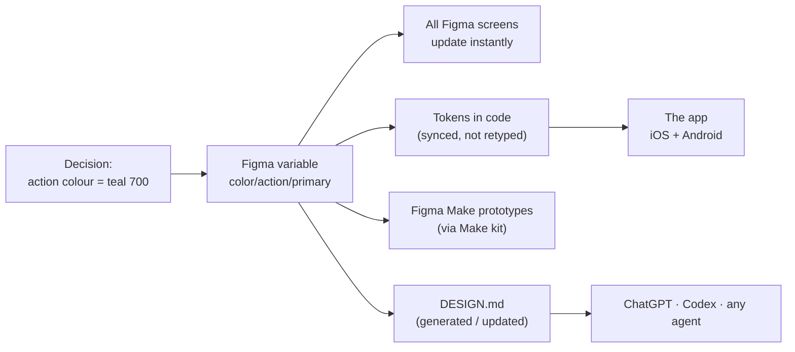
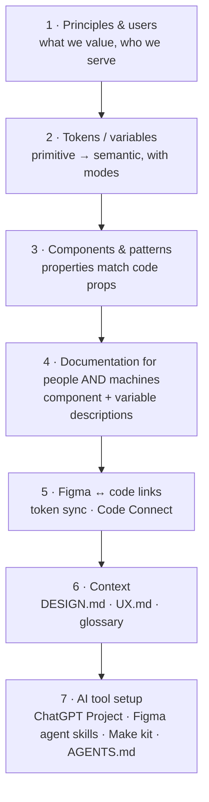
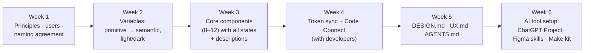
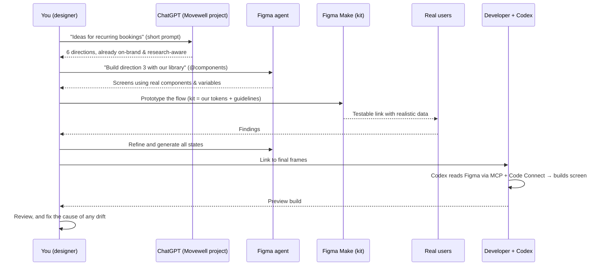

# Chapter 3: Greenfield, the ideal setup today

> ⏱ About 30 min · You'll learn: what an **AI-native design system looks like when you start from zero in 2026**: the layers, the connections, the order of setup, and what each person does. Chapter 4 then deals with reality.

---

## 📖 Story: "If we started today…"

In week two, Jonas (tech lead) asks: *"Before we fix the mess, what would you build if we started from scratch? I want to know what we're aiming for."*

This chapter is your answer: a **blueprint**. Chapter 4 shows how to move the messy reality toward it, one step at a time.

---

## 🧠 Concept 1: The principle, "one decision, one place, flows everywhere"

In an AI-native setup, every design decision is made **once**, stored in **one place**, and **flows automatically** to everything that needs it: Figma screens, the app, prototypes, and every AI tool.

Example: Movewell decides its primary action colour is a slightly darker teal for better contrast.

**Anti-pattern:** the same colour typed as a hex code in 40 Figma layers, 25 code files and a brand PDF. Then every change becomes a hunt, and AI tools pick whichever value they see first.

---

## 🧠 Concept 2: The seven layers of an AI-native design system

| Layer | What it is | Ideal state on day one | Chapter |
|---|---|---|---|
| **1. Principles and users** | What you value and who you serve | 5 principles with do/don't; research-based user models | 8, 13 |
| **2. Tokens and variables** | Named design decisions | Primitive → semantic tiers; light/dark modes; names agreed with developers | 5 |
| **3. Components and patterns** | Reusable UI | Properties named exactly like the code props; all states; accessible | 6 |
| **4. Descriptions** | Explanations people and AI read | Every component and semantic variable says *when to use / when not* | 6, 8 |
| **5. Figma ↔ code links** | Automatic connections | Variables sync to code tokens; Code Connect maps each component to its code twin | 7, 9 |
| **6. Context files** | Knowledge AI reads | DESIGN.md (visual), UX.md (users and behaviour), glossary | 8 |
| **7. AI tool setup** | Each tool pre-loaded with the above | ChatGPT Project; Figma agent skills; Figma Make kit; AGENTS.md in the code | 8–12 |

> 💡 Most companies have layers 2–3 (half-done) and nothing else. **Layers 4–7 are what make a system "AI-native"**, and they're cheap compared to layers 2–3.

---

## 🧠 Concept 3: Name things once, together

The single most valuable greenfield decision: **designers and developers agree on names before anything is built**, and use them everywhere.

### 🧾 Real artifact: Movewell's naming agreement (excerpt)

| Concept | Figma | Code (what developers see) | Notes |
|---|---|---|---|
| Primary action colour | `color/action/primary` | `color.action.primary` | Same words, different separator |
| Card background | `color/bg/surface-raised` | `color.bg.surfaceRaised` | Developers' naming style for multi-word names |
| Medium spacing | `space/md` | `space.md` | |
| Button | Component **Button** | Component `Button` | |
| Button style | Property **variant** = primary / secondary / ghost / danger | Prop `variant` with the same values | **Identical values** |
| Button size | Property **size** = sm / md / lg | Prop `size` | |
| Class card | Component **ClassCard** | Component `ClassCard` | Domain term from the glossary |

You don't need to understand code to create this table. You need **one meeting with a developer** and the habit of never renaming things alone.

Why it matters for AI: when an agent reads your Figma file through the MCP server and sees **Button / variant=primary**, and the code also has `Button` with `variant="primary"`, it connects them correctly. When Figma says **"CTA big teal"** and the code says `PrimaryButton`, it guesses, and guesses wrong.

---

## 🧠 Concept 4: The ideal setup order (about 4–6 weeks, alongside product work)

| Week | You (designer) | Developers | AI helps by... |
|---|---|---|---|
| 1 | Principles, user models, naming table | Agree on names, choose their component approach | Drafting principles from research; suggesting naming structures |
| 2 | Build variables and modes | Prepare the place tokens will live in code | Generating colour scales, checking contrast pairs, suggesting semantic names |
| 3 | Build core components, states, descriptions | Build the matching code components | The Figma agent drafts variants, states and descriptions; you review |
| 4 | Review the token sync and mappings | Set up the token sync and Code Connect | Codex helps write mapping files (developers review) |
| 5 | Write DESIGN.md and UX.md; co-write AGENTS.md | Add AGENTS.md to the code | ChatGPT drafts from your library and research; you edit |
| 6 | Set up the ChatGPT Project, Figma skills, Make kit | Connect coding agents to the Figma MCP server | — |

---

## 🧠 Concept 5: What an ideal day looks like once it's set up

Once the system and context exist, a feature such as **"recurring weekly bookings"** flows like this:

Notice what you **didn't** do: re-explain the brand, redraw buttons, write specs line by line, or answer "which blue?" questions. That time goes into **users, decisions and quality**.

---

## 🧠 Concept 6: Ideal ownership

| Thing | Owner | Contributors |
|---|---|---|
| Principles, user models, UX.md | **Design** (with research) | PM |
| Variables and components in Figma | **Design** | Developers review names |
| DESIGN.md | **Design** | — |
| Tokens and components in code | **Developers** | Design reviews |
| Token sync, Code Connect | **Developers** | Design checks mappings |
| AGENTS.md | **Developers** (code rules) + **Design** (design-system rules) | — |
| ChatGPT Project, Figma skills, Make kit | **Design** | Everyone uses them |

---

## 🧰 Helpers

**Greenfield checklist**, which also works as a target for messy systems:

- [ ] 5 design principles with do/don't
- [ ] User models from real research
- [ ] Naming agreement signed off with developers
- [ ] Primitive and semantic variables, light/dark modes, scoped
- [ ] Core components with all states, properties named like code props
- [ ] Descriptions on every component and semantic variable
- [ ] Token sync Figma → code (no retyping)
- [ ] Code Connect on core components
- [ ] DESIGN.md + UX.md + glossary
- [ ] AGENTS.md with design-system rules
- [ ] ChatGPT Project with instructions and files
- [ ] Figma agent skills (crit, design-system check, states)
- [ ] Figma Make kit using the library

---

## 🧪 Try it yourself (optional, 20 min)

Pick a product you know. Draw the seven layers on paper or in FigJam and mark each one ✅ exists, 🟡 partial or ❌ missing. Which **one** missing layer would most improve AI output? (Hint: it's usually layer 4, descriptions, or layer 6, context.)

---

## ✅ Recap

1. **One decision, one place, flows everywhere**: variables → code → prototypes → AI context.
2. A system is "AI-native" when it has **descriptions, Figma↔code links, context files and AI tool setup**, not just components.
3. The highest-leverage day-one move: **agree on names with developers.**

**Next → [Chapter 4: The inherited mess](04-the-inherited-mess.md)**
