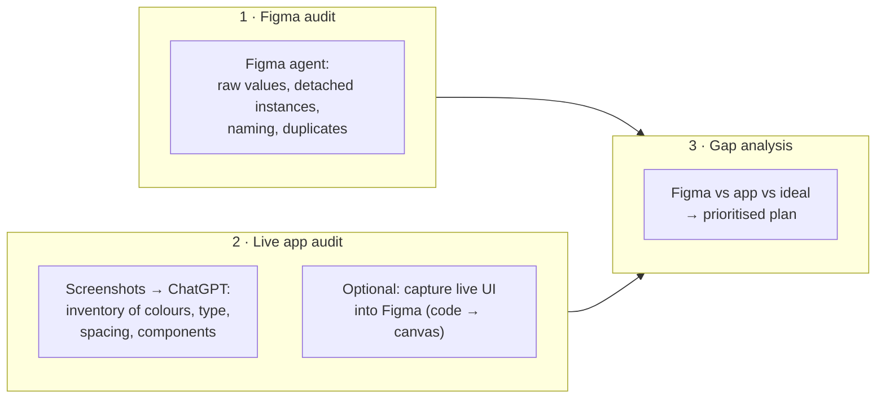
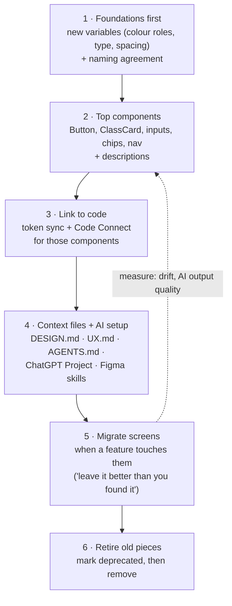

# Chapter 4: The inherited mess, auditing what exists

> ⏱ About 30 min · You'll learn: how to **audit** an existing Figma file and a live app with AI, **diagnose** why AI output goes wrong, and plan a **step-by-step migration** toward the ideal setup without stopping product work.

---

## 📖 Story: what you actually find

You open Movewell's main Figma file, "Movewell App – FINAL v3". You find:

- **14 shades of teal**, most typed as raw hex codes, a few as styles named `Teal`, `teal 2`, `Primary NEW`.
- **Three button components** (`Button`, `btn/primary`, `CTA`) plus dozens of detached copies.
- Spacing values of 7, 10, 12, 14, 15 and 16px, often random.
- Layers named `Frame 2341`, `Rectangle 18`, `Group 7 copy`.
- No dark mode, although the app has one (developers invented it).
- No descriptions anywhere.

Then you look at the **live app**. It doesn't match Figma. Developers "eyeballed" values, and lately their coding agent has been inventing styles because it couldn't make sense of the file.

This is normal. Almost every senior designer inherits something like this.

---

## 🧠 Concept 1: Why a mess hurts more in the AI era

Before AI, a messy file slowed designers down. **Now it misleads every AI tool that reads it:**

| Mess | What AI does with it |
|---|---|
| Raw hex values instead of variables | Copies the raw values into code, so colours drift and theming breaks |
| Three button components | Picks one at random, or creates a fourth |
| `Frame 2341` layer names | Can't tell what anything is, so it guesses structure |
| Detached instances | Doesn't know they were meant to be the system component |
| No descriptions | Doesn't know *when* to use what |
| Figma ≠ app | Can't tell which one is the truth |

> 💡 The good news: the same AI tools that get confused by the mess are excellent at **finding** it.

---

## 🧠 Concept 2: A three-part audit



### Part 1: Figma audit with the Figma agent

Open the file, select a page or frame, and ask the agent (🔧 prompts are examples; wording can vary):

```text
Audit this page for design-system health. List:
1) fills/strokes using raw colour values instead of variables or styles,
2) detached instances of components,
3) text not using text styles,
4) spacing/padding values not on a 4px grid,
5) layers with default names like "Frame 123",
6) duplicated components that look like the same thing.
Return a table with: issue type, count, examples (layer names), suggested fix.
Don't change anything yet.
```

Then:

```text
Group all colour values used on this page into clusters of near-identical colours.
For each cluster: the values, how often each is used, and which single value
should be the canonical one.
```

### Part 2: Live app audit with ChatGPT

Take screenshots of 10–15 key app screens (anonymise any user data). In your Movewell ChatGPT Project:

```text
Here are 12 screenshots of our live app. Build an inventory:
- every distinct colour you can identify (approximate hex), with where it's used,
- every distinct text style (size/weight estimate) and its role,
- every component type (buttons, cards, inputs, chips...) and its visual variants,
- inconsistencies between screens that look like they should be the same.
Mark estimates as estimates. Return tables.
```

> ⚠️ Screenshot estimates aren't precise. Use them to find **patterns and inconsistencies**, not exact values. Developers can export exact values later.

**Optional, more precise:** the Figma MCP server's **code to canvas** feature captures live UI from a browser into editable Figma layers ([Figma docs](https://developers.figma.com/docs/figma-mcp-server/code-to-canvas/)). It works for web views and running builds that developers can open in a browser. Ask a developer to capture key screens, or try it yourself with Codex (Chapter 12). Captured layers are **flat** (not connected to your library), so they're perfect for side-by-side comparison.

### Part 3: Gap analysis

Put the three views together (**Figma today**, **app today**, **ideal from Chapter 3**) and ask ChatGPT to help structure the gaps:

```text
Here are: (1) our Figma audit table, (2) our live app inventory, (3) our target
system blueprint. Produce a gap analysis: for each layer of the blueprint
(principles, variables, components, descriptions, Figma↔code links, context,
AI tool setup), describe current state, target, gap, effort (S/M/L), and impact
on AI output quality (low/med/high). Then propose an order of work.
```

---

## 🧾 Real artifact: Movewell audit summary

| Area | Finding | Impact on AI | Effort |
|---|---|---|---|
| Colour | 14 teals → really 3 roles (action, accent, subtle bg); 31% raw hex | High | M |
| Type | 11 sizes in use → 6 needed | Medium | S |
| Spacing | Random values → a 4px scale covers 95% of cases | Medium | S |
| Buttons | 3 components + 46 detached → one Button with 4 variants | High | M |
| Cards | 5 "class card" versions | High | M |
| Dark mode | Exists only in code, invented by developers | High | M |
| Naming | 62% default layer names on key screens | Medium | S (agent can rename) |
| Descriptions | 0 | High | S per component |
| Figma ↔ code | No sync, no Code Connect | High | M (developers) |
| Context files | None | High | S |

**Top insight:** most AI problems come from **colour roles, buttons/cards, missing descriptions, and no link to code**. Fixing those four gives about 80% of the benefit.

---

## 🧠 Concept 3: Migrate gradually, never "big bang"

Don't stop product work for three months to "fix the design system". Use a **gradual replacement** approach: build the new system next to the old one, and move screens over as you touch them.



| Step | Who | AI helps by... |
|---|---|---|
| Foundations | You + one developer | Clustering colours, proposing semantic names, checking contrast |
| Top components | You (+ Sam) | Agent drafts variants and states; you review |
| Link to code | Developers (Leo) | Codex drafts mapping files; developers review |
| Context + AI setup | You | ChatGPT drafts DESIGN.md/UX.md from the library and research |
| Migrate screens | Whoever works on the feature | Figma agent swaps raw values for variables and detached copies for instances |
| Retire old pieces | You + developers | Agent finds remaining uses of deprecated components |

### Using the Figma agent to migrate (busywork AI is great at)

```text
On this frame: replace raw colours with the closest semantic variable from our
connected library (show me a mapping table first and wait for my OK), swap
detached button copies for Button instances with the matching variant, and
rename layers semantically (e.g., "class-title", "price", "cta").
```

> ⚠️ For big changes, **duplicate the file or page first**. Ask for a **mapping table before changes**, so you approve the decisions and the AI only does the labour.

---

## 🧠 Concept 4: Mess you should tolerate

Not everything needs fixing:

- **Old screens nobody touches:** leave them until a feature touches them.
- **Exploration files:** they can be messy, just keep them out of the library.
- **Rare one-offs**, such as a marketing illustration: fine, as long as they aren't pretending to be system components.

Focus on what **AI and developers read most**: the library and the screens currently being built.

---

## 🧰 Helpers

- Audit prompts (Figma agent and ChatGPT): in the [prompt pack](../toolkit/prompt-pack.md#audit)
- **Audit-to-plan checklist:**
  - [ ] Figma audit table (agent)
  - [ ] App inventory (screenshots → ChatGPT, or code → canvas)
  - [ ] Gap analysis against the 7 layers
  - [ ] Top-4 fixes chosen by AI impact
  - [ ] Migration order agreed with developers
  - [ ] "Leave it better" rule agreed for feature work

**Make it permanent:** turn the audit prompt into a Figma agent skill called `/ds-audit` (Chapter 10).

---

## 🧪 Try it yourself (optional, 25 min)

Open any real Figma file you've worked on. Run the Figma audit prompt on one page. Count the issues. Then ask the agent to cluster the colours. How many "real" colour roles are hiding in there?

---

## ✅ Recap

1. A messy system **misleads every AI tool**, but AI is also great at **finding** the mess.
2. Audit three things: **Figma**, the **live app**, and the **gap to the ideal**.
3. Migrate gradually: **foundations → top components → code links → context → screens as touched → retire old.**

**Next → [Chapter 5: Tokens and variables, done right](05-tokens-and-variables.md)**
