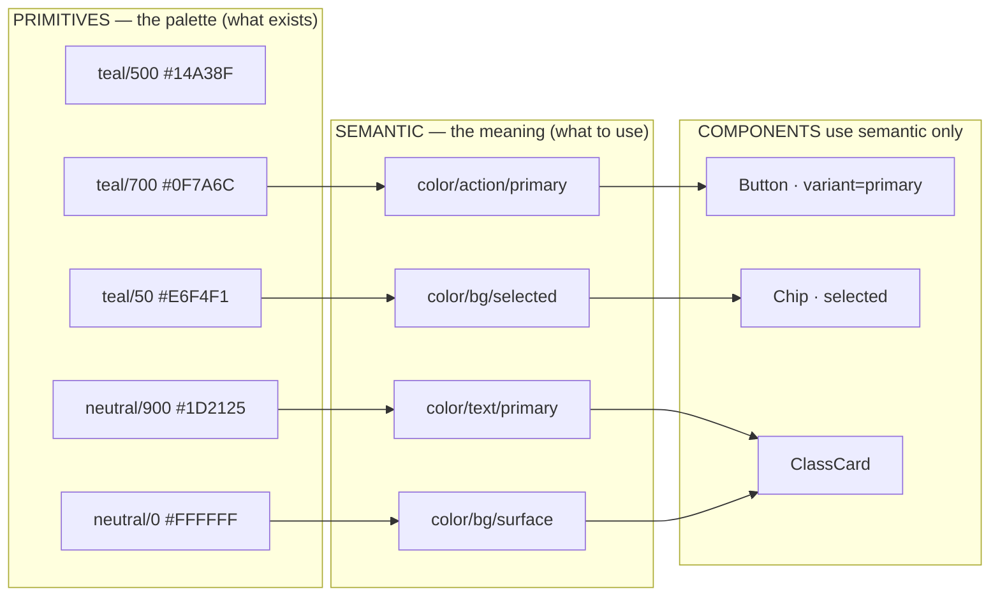
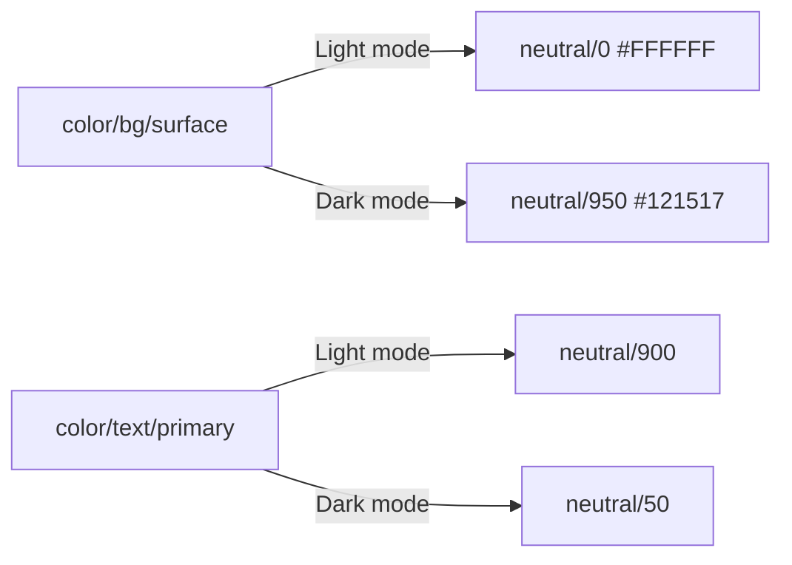

# Chapter 5: Tokens and variables, done right

> ⏱ About 35 min · You'll learn: what tokens are, the **primitive → semantic** structure, **naming** that people and AI understand, **modes** (light/dark), how Figma **variables** implement all this, and how AI helps you build them.

---

## 📖 Story: from 14 teals to 3 roles

The audit showed 14 teals. Ask *"what is each teal for?"* and the answers collapse into **three roles**:

1. The colour of **actions** (buttons, links, selected states)
2. An **accent** for highlights (a "beginner-friendly" badge)
3. A **subtle background** for selected cards and chips

Tokens are how you turn "14 colours" into "3 decisions", and how you make sure every person and every AI tool uses the right one.

---

## 🧠 Concept 1: What a token is

A **design token** is a **named design decision stored as data**:

```text
color / action / primary  =  #0F7A6C
```

The **name** says what it's *for*. The **value** says what it *is*. Everyone (Figma, code, AI) uses the **name**, so when the value changes, everything updates.

In Figma, tokens are **variables** 🔧 (organised in **collections**, with **modes**).

---

## 🧠 Concept 2: Two tiers: primitive → semantic



| Tier | Purpose | Who uses it | Example |
|---|---|---|---|
| **Primitive** | Every available raw value: the palette, the spacing scale | **Only** semantic tokens (hide these from day-to-day use) | `teal/700`, `space/4` |
| **Semantic** | Meaning: *what it's for* | Components, screens, people, **AI** | `color/action/primary`, `space/md` |
| *(Component, optional)* | Decisions for one component | That component only | `button/primary/bg` |

**Rule:** components and screens use **semantic** tokens only. This lets you:

- **Theme:** dark mode points semantic tokens at different primitives, and the components don't change.
- **Rebrand:** change a primitive or an alias, and everything follows.
- **Help AI:** `color/text/danger` tells the AI *when* to use it; `red/600` doesn't.

> 💡 Start with **two tiers**. Add component tokens only when you genuinely need them (for example, a component that must differ from the general rule).

---

## 🧠 Concept 3: Naming that people and AI understand

Use the pattern **category / property / role / state**:

```text
color/text/primary            color/bg/surface            color/border/default
color/text/secondary          color/bg/surface-raised     color/border/focus
color/text/on-action          color/bg/selected           color/action/primary
color/text/danger             color/feedback/danger-bg    color/action/primary-hover

space/xs (4) · space/sm (8) · space/md (16) · space/lg (24) · space/xl (32)
radius/sm (6) · radius/md (12) · radius/lg (20) · radius/full
```

Good names are:

- **Purposeful:** they describe intent (`action/primary`), not appearance (`teal-button`).
- **Predictable:** someone can guess a name they've never seen.
- **Shared:** identical words in Figma and code (Chapter 3's naming agreement).

---

## 🧠 Concept 4: Modes

A **mode** is an alternative set of values for the same variables. In Figma, a collection can have several modes 🔧.



Common mode types:

| Mode set | Use |
|---|---|
| **Light / Dark** | Theme |
| **Comfortable / Compact** | Density (spacing variables) |
| **Brand A / Brand B** | White-label products |
| **iOS / Android** | Platform-specific differences, only where real ones exist |

Switch a frame's mode in Figma and all bound values change. If a frame breaks in dark mode, something isn't using a semantic variable. That makes dark mode a free **health check**.

---

## 🧠 Concept 5: Scoping and descriptions

- **Scoping** 🔧 limits where a variable appears. For example, text colours appear only in text-fill pickers, and spacing only in gap and padding fields. Fewer wrong choices for people and for the Figma agent.
- **Descriptions:** every **semantic** variable gets one line on when to use it and when not to:

```text
color/text/secondary — Supporting text: metadata, helper text, timestamps.
Not for disabled text (use color/text/disabled). Contrast ≥ 4.5:1 on bg/surface.
```

These descriptions travel to developers and AI tools. They're one of the cheapest, highest-impact things you can write.

---

## 🧠 Concept 6: Typography, spacing, radius, elevation

| Category | Recommendation |
|---|---|
| **Typography** | Text styles with **role names**: `heading/lg`, `heading/md`, `body/md`, `body/sm`, `label/md`, `caption`. 6–8 is usually enough. Bind sizes and line heights to number variables if your setup supports it. |
| **Spacing** | A 4px-based scale with semantic names (`xs`–`xl`). Bind auto-layout gaps and padding to variables. |
| **Radius** | 3–4 values plus `full`. |
| **Elevation** | 2–3 shadow styles max (`shadow/sm`, `shadow/md`). Keep dark mode in mind. |
| **Motion** | Durations and easings as variables or a documented table, such as `motion/fast` = 120ms. |

---

## 🧠 Concept 7: The standard behind it (DTCG)

The W3C **Design Tokens Community Group** published the **first stable Design Tokens specification (2025.10)**. It's a shared format so tokens can move between tools (Figma, code tools, documentation) without retyping. Figma, Penpot, Sketch, Framer, Style Dictionary, Tokens Studio, Supernova, zeroheight and others are listed as adopters or participants ([designtokens.org](https://www.designtokens.org/)).

You don't need to read the spec. Just know that **a standard exists**, so your variables can be **exported and synced** to code reliably (Chapter 7).

---

## 🧾 Real artifact: Movewell's colour roles (light / dark)

| Semantic variable | Light | Dark | Description |
|---|---|---|---|
| `color/bg/surface` | neutral/0 | neutral/950 | Main background |
| `color/bg/surface-raised` | neutral/50 | neutral/900 | Cards, sheets |
| `color/bg/selected` | teal/50 | teal/950 | Selected chip or card background |
| `color/text/primary` | neutral/900 | neutral/50 | Main text |
| `color/text/secondary` | neutral/600 | neutral/300 | Supporting text |
| `color/action/primary` | teal/700 | teal/300 | Main actions, links |
| `color/text/on-action` | neutral/0 | neutral/950 | Text on action colour |
| `color/accent/beginner` | amber/600 | amber/300 | "Beginner-friendly" badge only |
| `color/feedback/danger` | red/700 | red/300 | Errors, destructive actions (always with icon or text) |
| `color/border/focus` | teal/700 | teal/300 | Focus ring on every interactive element |

---

## 🧠 Concept 8: How AI helps build tokens

| Task | Tool | Prompt idea |
|---|---|---|
| Generate a colour scale | ChatGPT | "Create a 50–950 scale for teal around #14A38F, perceptually even, with contrast notes against white and near-black." |
| Propose semantic names | ChatGPT | "Here are our colour usages from the audit. Propose semantic variable names using category/property/role/state." |
| Check contrast pairs | ChatGPT (then verify with a real checker) | "List all text/background pairs from this table for light and dark, and estimate WCAG contrast." |
| Create variables in Figma | Figma agent | "Create a 'Semantic colour' collection with Light and Dark modes using this table; alias to the primitives in 'Primitives'." |
| Bind existing designs | Figma agent | "Replace raw colours on this page with the closest semantic variable; show me the mapping first." |

> ⚠️ **Always verify contrast with a real contrast checker.** AI estimates are a starting point, not proof.

---

## 🧰 Helpers

**Variables checklist**

- [ ] Primitive collection (hidden from publishing where possible)
- [ ] Semantic collection(s) with Light/Dark modes
- [ ] Names follow category/property/role/state and match code
- [ ] Scoping set on every semantic variable
- [ ] One-line description on every semantic variable
- [ ] Contrast verified for every text/background pair, in both modes
- [ ] Spacing and radius scales bound in auto layout
- [ ] Every screen passes the "switch to dark mode" test

**Naming cheat sheet:** see [checklists.md](../toolkit/checklists.md#token-naming-cheat-sheet).

---

## 🧪 Try it yourself (optional, 30 min)

1. In a draft file, create a **Primitives** collection with a 50–950 scale for one colour (ask ChatGPT for the values).
2. Create a **Semantic** collection with **Light** and **Dark** modes and 6 semantic colours that alias to primitives.
3. Design one card using only semantic variables. Switch the frame to Dark. Does everything work?

---

## ✅ Recap

1. Tokens are **named decisions**; use **semantic** tokens in components, with primitives behind them.
2. **Modes** give theming for free, and the dark-mode switch is a health check.
3. **Descriptions and scoping** are what make variables understandable to AI.

**Next → [Chapter 6: Components that people and machines understand](06-components.md)**
