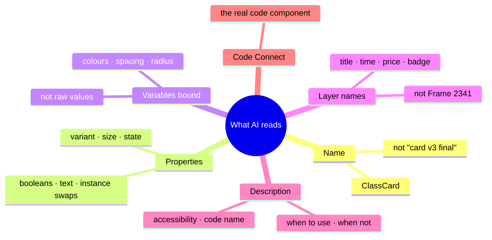
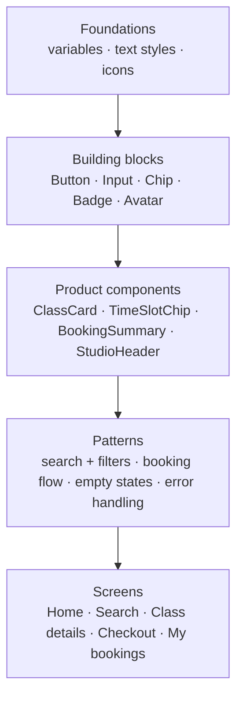

# Chapter 6: Components that people and machines understand

> ⏱ About 35 min · You'll learn: how to build components with **clean properties, all states, accessibility and descriptions**, so that designers, developers and AI tools all use them correctly. Plus how AI speeds up the boring parts.

---

## 📖 Story: one ClassCard to rule them all

Movewell had five versions of the "class card" (the card showing a class in search results). Each designer made their own. The coding agent built a sixth.

You'll replace them with **one `ClassCard` component**: well-structured, documented and connected to code. Here's how to make it something AI can't misuse.

---

## 🧠 Concept 1: What an agent "sees" in your component

When an AI tool (the Figma agent, Figma Make, or a coding agent through the MCP server) looks at a component instance, it reads **structure, not pixels**:



If these are clean, AI uses your component correctly. If they're messy, AI guesses.

---

## 🧠 Concept 2: Properties, the component's "controls"

🔧 Figma components have **properties**:

| Property type | Use for | ClassCard example |
|---|---|---|
| **Variant** | Real structural or visual differences | `layout` = list / compact / featured |
| **Boolean** | Show/hide a part | `showBeginnerBadge`, `showPrice` |
| **Text** | Editable text content | `title`, `studioName` |
| **Instance swap** | Swap a nested component | `leadingImage` (photo / instructor avatar) |

**Avoid "variant explosion."** If you multiply layout × size × state × badge × image, you get hundreds of variants. Use **booleans and instance swaps** for optional parts, and keep variants for real differences.

**Name properties like the code props.** If developers' code has `layout="compact"`, your Figma property is **layout = compact**, not "Type = Small card". (Chapter 3's naming agreement.)

---

## 🧠 Concept 3: States: the part AI most often forgets

Every interactive component needs its states designed. AI-generated UI notoriously skips them.

| Component | States to design |
|---|---|
| **Button** | default, hover/pressed, **focus**, disabled, **loading** |
| **Input** | empty, filled, **focus**, **error** (+ message), disabled, read-only |
| **ClassCard** | default, pressed, **full** (waitlist), **booked**, **cancelled**, **loading skeleton** |
| **Lists and screens** | **empty**, loading, partial, **error**, offline, very long content |

Make states **variants** (`state` = default / booked / full / loading) or documented patterns, so they exist in the system and AI can find them.

---

## 🧠 Concept 4: Structure: auto layout and layer names

- **Auto layout everywhere**, with gaps and padding bound to spacing variables.
- **Content-driven sizing** (hug or fill), so long titles and translations don't break things.
- **Semantic layer names:** `title`, `meta`, `time`, `price`, `badge`, `cta`. The Figma agent can rename layers for you.
- **No hidden junk:** remove invisible layers and old leftovers.

---

## 🧠 Concept 5: Accessibility built into components

Bake accessibility into the component, and every screen (and every AI generation) inherits it:

- **Contrast:** text ≥ 4.5:1; large text and essential UI parts ≥ 3:1 (WCAG 2.2 AA).
- **Visible focus** using `color/border/focus`.
- **Touch targets:** at least 44×44pt on iOS and 48×48dp on Android are common platform guidelines (WCAG 2.2's AA minimum is 24×24 CSS px).
- **Don't rely on colour alone:** "Full" isn't just grey; it has a label.
- **Labels:** inputs always have a visible label. Icon-only buttons have an accessible name in the description.
- **Text scaling:** check the component with larger text (Dynamic Type / font scaling).

---

## 🧠 Concept 6: The description is a mini-spec for people and AI

🔧 Every component has a **description** field. AI-native designers treat it as a compact spec:

### 🧾 Real artifact: ClassCard description

```text
PURPOSE: Shows one bookable class in lists (search results, studio pages, "For you").
USE WHEN: Listing classes the user can book or has booked.
DON'T USE: For studios (use StudioCard) or instructors (use InstructorRow).
PROPERTIES:
  layout = list | compact | featured   (featured only on Home "For you", max 1 per screen)
  state  = default | booked | full | cancelled | loading
  showBeginnerBadge (bool) — true only if studio marked class as beginner-friendly
  showPrice (bool) — false for members with unlimited plans
CONTENT: title ≤ 40 chars (truncate with …), studio name, time "Tue 18:30 · 45 min",
  price "€14" or "2 credits". Use glossary terms (class, studio, credits, book).
BEHAVIOUR: Whole card is tappable → Class details. "full" shows "Join waitlist".
A11Y: Card announces "title, studio, time, price, state". Badge is text, not colour only.
  Min height 72pt (list).
CODE: ClassCard in the app component library (see Code Connect).
RELATED: StudioCard, TimeSlotChip, BookingSummary.
```

It takes about 10 minutes. It saves hours of questions and prevents AI misuse. **The Figma agent can draft it; you correct it.**

---

## 🧠 Concept 7: Building blocks vs. product components vs. patterns



| Level | Who builds | Example |
|---|---|---|
| **Building blocks** | Design system (you) | Button, Input, Chip |
| **Product components** | You, with feature designers | ClassCard, TimeSlotChip |
| **Patterns** | You; documented as example frames and guidance | "How we do filters", "How we do empty states" |

Patterns are often just **documented example frames plus guidance text**. They're very valuable to AI because they show *how pieces combine*.

---

## 🧠 Concept 8: Let AI do the component busywork

| Task | Tool | Prompt idea |
|---|---|---|
| Generate state variants | Figma agent | "Create state variants for this ClassCard: booked, full, cancelled, loading. Use our variables; follow the description." |
| Rename layers | Figma agent | "Rename layers in this component semantically." |
| Draft description | Figma agent / ChatGPT | "Draft a component description using PURPOSE / USE WHEN / DON'T USE / PROPERTIES / CONTENT / BEHAVIOUR / A11Y / CODE / RELATED." |
| Stress-test content | Figma agent | "Fill 6 instances with realistic edge-case content: very long titles, German translations, missing images, free classes." |
| Accessibility pre-check | Figma agent / ChatGPT | "Check this component for contrast, focus visibility, target size, colour-only meaning. Mark what needs tool verification." |
| Find inconsistencies | Figma agent | "Compare these 5 card designs and list every difference in spacing, type, radius, colour." |

---

## 🧰 Helpers

**Component readiness checklist (AI-ready)**

- [ ] Clear name (domain words from the glossary)
- [ ] Properties named like the code props; no variant explosion
- [ ] All states designed (including focus, error, loading, empty)
- [ ] Auto layout; spacing and radius bound to variables; no raw colours
- [ ] Semantic layer names
- [ ] Accessibility: contrast, focus, targets, labels, text scaling
- [ ] Description (PURPOSE / USE WHEN / DON'T USE / PROPERTIES / CONTENT / BEHAVIOUR / A11Y / CODE / RELATED)
- [ ] Stress-tested with edge-case content
- [ ] Code Connect mapped (Chapter 9)

**Template:** [component-description-template.md](../toolkit/component-description-template.md)

---

## 🧪 Try it yourself (optional, 30 min)

Pick one component from your own work. Write its description with the template, then ask the Figma agent to generate any **missing states** and fill it with **edge-case content**. What broke?

---

## ✅ Recap

1. AI reads **names, properties, variables, layer names and descriptions**, so make them clean.
2. Design **all states**; they're what AI most often skips.
3. The **description** is a mini-spec for people and AI. Let AI draft it, and you correct it.

**Next → [Chapter 7: Figma ↔ code, explained without code](07-figma-and-code.md)**
