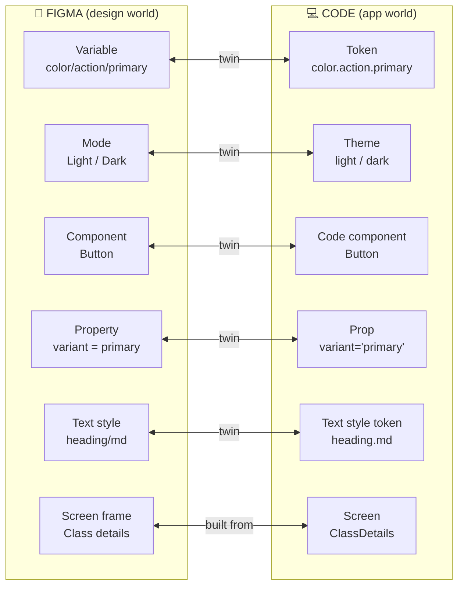
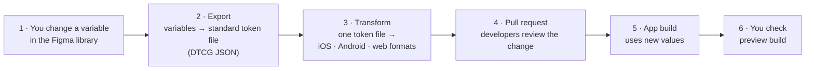
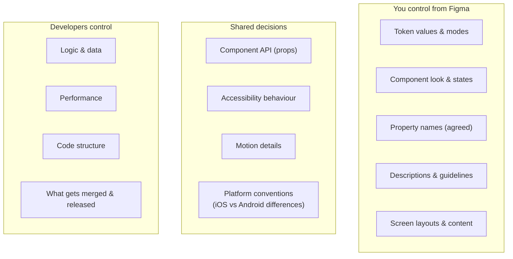

# Chapter 7: Figma ↔ code, explained without code

> ⏱ About 35 min · You'll learn: how your Figma work **becomes the real app**, what the **"twins"** between Figma and code are, how tokens **flow** from Figma to the app, what you **control from Figma** (and what you don't), and the developer vocabulary you need. No code reading required.

---

## 📖 Story: "Why doesn't the app match Figma?"

Maya asks why the app's buttons are slightly different from Figma. Leo (the developer who maintains the components) explains: *"Figma and code are two separate worlds. Nothing connects them, so we copy values by hand, and copies drift."*

To fix that, you need to understand how the two worlds relate. You don't need to read code. You need a **mental model**.

---

## 🧠 Concept 1: Two worlds, with twins

Figma and the app's code are **two separate places**. Each important design thing has a **twin** on the other side:

| Figma (you) | Code (developers) | How they stay in sync |
|---|---|---|
| **Variable** | **Token** | Token sync: exported and converted automatically, not retyped |
| **Mode** | **Theme** | Exported with the variables |
| **Component** | **Code component** | Built by developers; linked with **Code Connect** |
| **Property** | **Prop** | Same names and values (naming agreement) |
| **Text style** | **Typography token** | Token sync |
| **Screen frame** | **Screen** | Built by developers or coding agents, *from* components |

> 💡 **Twins only stay identical if they're linked or share names.** Anything copied by hand drifts.

---

## 🧠 Concept 2: Which side is the source of truth?

Each kind of thing has **one** source of truth:

| Thing | Source of truth | Why |
|---|---|---|
| Colour, type, spacing, radius values | **Figma variables** | Design decides; code receives |
| Component **appearance** (look, states, layout) | **Figma** | Design decides |
| Component **behaviour** (logic, data, performance, accessibility implementation) | **Code** | Engineering decides, with design input |
| Component **API** (names of props and values) | **Agreed together**, then fixed | Both sides must match |
| What's **actually shipped** | **The app** | Reality wins; review it (Chapter 12) |

When you hear "Figma is the source of truth", it means **for design decisions**. The app is the truth for **what users actually get**. An AI-native designer looks at both.

---

## 🧠 Concept 3: How tokens travel from Figma to the app

You don't build this, but you should understand it, because **you'll design the inputs and check the outputs**.

| Step | What happens | Who | Tools developers often use 🔧 |
|---|---|---|---|
| 1 | You change or publish variables | You | Figma |
| 2 | Variables exported to a standard file | Automated or a developer | Figma's API, export plugins, token tools |
| 3 | One file converted into each platform's format | Automated | Token transformers such as Style Dictionary |
| 4 | The change is proposed for review as a **pull request** | Developer (or automation) | GitHub or similar |
| 5 | The app is built with the new values | Automated | The build pipeline |
| 6 | You review the result on a **preview build** | You | Test app, simulator, preview link |

**Why the standard (DTCG) matters:** tools can understand one shared token format, so the chain doesn't need custom glue at every step ([designtokens.org](https://www.designtokens.org/)).

**Mobile note:** iOS and Android use different formats and conventions, but they can come from the **same** token source. One decision becomes two platform outputs. Developers handle the conversion; you keep one source.

---

## 🧠 Concept 4: Developer vocabulary in plain words

| Term | Plain meaning | Design analogy |
|---|---|---|
| **Repository (repo)** | The project's code folder, with full history | A Figma project with version history |
| **Branch** | A safe copy to work on without affecting the main version | Duplicating a page to explore |
| **Pull request (PR)** | A proposal to merge a branch, with review and comments | A design review before publishing the library |
| **Merge** | Accepting the PR into the main version | Publishing library changes |
| **Build** | Turning code into a runnable app | Exporting a prototype |
| **Preview build / test build** | A version of the app you can try before release | A share link to a prototype |
| **Component library (code)** | Developers' reusable UI pieces | Your Figma library |
| **Props** | Settings passed to a code component | Component properties |
| **Theme** | A set of token values (light/dark) | Variable modes |
| **CI** | Automatic checks on every change | A pre-publish checklist that runs itself |
| **Release** | Publishing to the App Store / Google Play | Shipping |

You can now follow developer conversations and **ask the right questions**.

---

## 🧠 Concept 5: What you control from Figma, and what you don't

**Practical consequences**

- Want the app's action colour to change? **Change the variable**; the pipeline does the rest.
- Want a new **ClassCard state**? Design it **and** ask for the code twin. A Figma-only state doesn't exist in the app.
- Want different behaviour (for example "show waitlist position")? That's a **product + engineering** decision, not a Figma change.

---

## 🧠 Concept 6: Where drift comes from

**Drift** = differences between design intent and the shipped app.

| Cause | Example | Prevention |
|---|---|---|
| Hand-copied values | Developer types `#0F7A6B` (one digit off) | Token sync |
| Missing twin | Figma has a "full" card state, code doesn't | Design + code twin in the same task |
| Different names | Figma "Type=Big", code `size="lg"` | Naming agreement |
| Agent guessing | Coding agent creates a new card | Code Connect + rules (Chapters 8–9) |
| Undocumented intent | "This only shows for beginners" isn't written anywhere | Descriptions |
| Platform differences | Android ripple vs iOS highlight | Documented in the description, agreed upfront |

---

## 🧾 Real artifact: the journey of one change at Movewell

> **Monday:** Priya's research shows that beginners miss the "Beginner-friendly" badge. You raise its contrast by changing `color/accent/beginner` from amber/500 to amber/600 in light mode, and check contrast (now 4.8:1).
>
> **Monday afternoon:** you publish the library. The token export runs and opens a pull request titled *"Update tokens: color.accent.beginner"*. Leo reviews it (a one-line value change) and merges it.
>
> **Tuesday:** you open the test build on your phone. Every ClassCard badge across Home, Search and Studio pages is updated. You change nothing else. **One decision, one place, flows everywhere.**

---

## 🧰 Helpers

**Questions to ask developers in your first week**

1. "Where do our design tokens live in code, and how do they get there today?"
2. "Is there a code component library? Which components exist?"
3. "Do component props match our Figma properties? Can we compare them together?"
4. "How do I get a preview or test build to review?"
5. "What would it take to sync Figma variables to code automatically?"
6. "Do your coding agents read our Figma (MCP)? What do they get wrong?"

**Twins checklist** (per component): Figma component ✅ · code component ✅ · same name ✅ · props match ✅ · states exist on both sides ✅ · Code Connect ✅

---

## 🧪 Try it yourself (optional, 20 min)

Ask a developer you work with for 20 minutes to show you **one component in code and its Figma twin**, side by side. Compare names, props and states. Write down every mismatch. That list is your first "twins backlog".

---

## ✅ Recap

1. Figma and code are **two worlds with twins**: variable↔token, component↔component, property↔prop, mode↔theme.
2. Tokens should **flow automatically**: Figma → standard file → platform formats → PR → build → your review.
3. You control **decisions and appearance** from Figma; developers control **logic and code**. Drift comes from anything **copied by hand or left unwritten**.

**Next → [Chapter 8: Giving the system to AI](08-giving-the-system-to-ai.md)**
