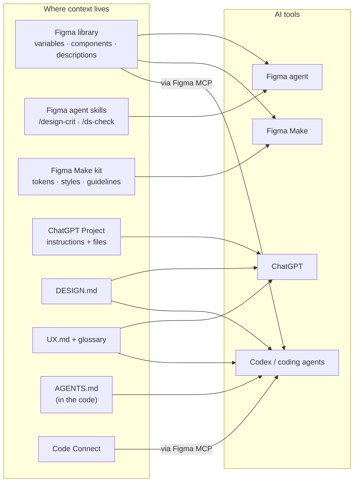
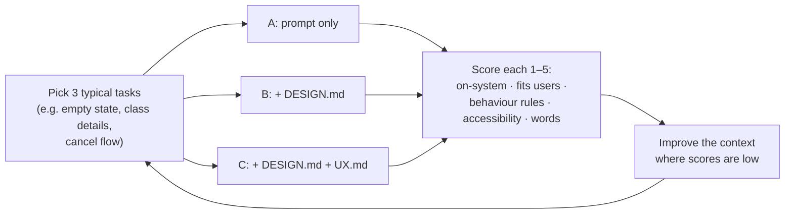

# Chapter 8: Giving the system to AI

> ⏱ About 40 min · You'll learn: **which AI tool reads what**, how to write the context files that make AI output on-brand and research-aware (**DESIGN.md, UX.md, AGENTS.md** design rules, the **Make kit**, **Figma skills**), how to **test** that they actually help, and how to keep them alive.

---

## 📖 Story: Maya's prompt, take two

Remember Maya's first-week mockup (purple button, "Reserve", hidden cancellation policy)? After this chapter, Maya opens the **Movewell ChatGPT Project** and types the same casual prompt, *"Design a screen for booking a recurring weekly yoga class."* The result uses teal, says **"Book"**, shows the cancellation rule **before** the button, and lists which existing components it needs.

Nothing about Maya's prompt changed. **The context did.**

---

## 🧠 Concept 1: Who reads what

Each AI tool reads context from **different places**. This map is the heart of the chapter:



| AI tool | Reads | You set up |
|---|---|---|
| **Figma agent** | The connected library (components, variables, styles), @-mentions, attached files, **custom skills** | Clean library + descriptions; skills (Chapter 10) |
| **Figma Make** | Attached designs, the **Make kit** (imported variables and styles, guidelines, optional code packages), templates | A Make kit for Movewell (Chapter 11) |
| **ChatGPT** | **Project instructions + files**, attached files, the chat | The Movewell Project (Chapter 2) + DESIGN.md + UX.md as files |
| **Codex / coding agents** | **AGENTS.md** and files in the code; **Figma via MCP** (design context, variables, screenshots); **Code Connect** mappings | Co-write AGENTS.md; provide DESIGN.md/UX.md; ensure Code Connect (Chapter 9) |

> 💡 **Write once, place in several spots.** DESIGN.md and UX.md are the same files whether they're uploaded to ChatGPT, stored in the code for Codex, or pasted into Make guidelines.

---

## 🧠 Concept 2: DESIGN.md, visual rules for AI

**DESIGN.md** is an open format from **Google Labs (April 2026, still a draft "alpha" spec)** for describing a product's visual identity to AI coding tools ([GitHub](https://github.com/google-labs-code/design.md); [NN/G coverage](https://www.nngroup.com/articles/ux-context-design/)). It has two parts:

1. **Exact values (tokens)** at the top, in a structured block: colours, typography, radius, spacing.
2. **Plain-language rules**: what values are for, how to apply them, do's and don'ts.

> *"Tokens give agents exact values. Prose tells them why those values exist and how to apply them."* (DESIGN.md README)

### 🧾 Real artifact: Movewell DESIGN.md (excerpt)

```markdown
---
name: Movewell
colors:
  action-primary: "#0F7A6C"
  text-primary: "#1D2125"
  text-secondary: "#5D6670"
  surface: "#FFFFFF"
  surface-raised: "#F6F5F2"
  accent-beginner: "#B45309"
  danger: "#B42318"
typography:
  heading-lg: { fontFamily: Inter, fontSize: 28px, fontWeight: 700 }
  body-md:    { fontFamily: Inter, fontSize: 16px, lineHeight: 1.5 }
rounded: { sm: 6px, md: 12px, lg: 20px }
spacing: { xs: 4px, sm: 8px, md: 16px, lg: 24px }
---

## Overview
Warm, energetic but calm. Feels like a friendly front desk, not a sales funnel.

## Colors
- action-primary is the ONLY colour for primary actions and links.
- accent-beginner is ONLY for the "Beginner-friendly" badge. Never decorative.
- danger only for errors/destructive actions, always with icon or text.

## Components
- Always use existing components (Button, ClassCard, TimeSlotChip, BookingSummary...).
- One primary button per screen section.

## Do / Don't
- Do: show cancellation rules before the Book button.
- Don't: use gradients, more than one shadow level, or emoji in UI text.
```

Full template: [toolkit/DESIGN.md](../toolkit/DESIGN.md). The project also offers a checker that validates the file and its **contrast** (`npx @google/design.md lint DESIGN.md`). A developer can run it for you, or Codex can (Chapter 12).

> **Keep DESIGN.md in sync with Figma.** Figma variables are the truth, and DESIGN.md is a *published view* of them. Update it whenever you publish meaningful variable changes. ChatGPT or Codex can regenerate the token block from an export.

---

## 🧠 Concept 3: UX.md, users and behaviour rules for AI

DESIGN.md covers **how it looks**. **UX.md** covers **who it's for and how it behaves**. NN/G proposes UX.md as a companion to DESIGN.md, holding research insights, interaction standards, a glossary, user models and world models ([NN/G](https://www.nngroup.com/articles/ux-context-design/)).

The key technique: **write research findings as constraints** the AI can follow.

### 🧾 Real artifact: Movewell UX.md (excerpt)

```markdown
## Users
- Busy professionals (25–45): book 1–3 classes/week, often on their commute,
  one-handed. Want to book in < 30 s. Hate surprise fees.
- Beginners: worry "is this too hard / will I fit in?"

## Insights → constraints
| Insight (evidence)                                        | Constraint for anything we generate              |
|-----------------------------------------------------------|--------------------------------------------------|
| Users feel tricked by late-cancel fees (14/18 interviews) | Show the cancellation rule BEFORE the Book button |
| Beginners skip classes that look intense (9/12)           | Show difficulty + "Beginner-friendly" when true   |
| Most bookings happen one-handed on the move (analytics)   | Primary actions in thumb zone; ≤ 3 taps to book   |

## Interaction standards
- Booking: confirm with a summary sheet, then success with "Add to calendar".
- Cancel: allowed with undo for 10 s if free; confirmation dialog if a fee applies.
- Errors: what happened + what to do next; never blame the user.

## Words (glossary)
book (not reserve) · class (not session) · studio (not gym) · credits (not points)
```

Full template: [toolkit/UX.md](../toolkit/UX.md).

---

## 🧠 Concept 4: AGENTS.md, rules for coding agents

**AGENTS.md** lives **in the code** and tells coding agents (Codex and others) how to behave in this project. Developers write the code rules. **You co-write the design-system rules.** Figma's own recommended rules are a good base ([Figma docs](https://developers.figma.com/docs/figma-mcp-server/add-custom-rules/)).

### 🧾 Real artifact: the design section of Movewell's AGENTS.md

```markdown
## Design system rules (owned by Design)
- IMPORTANT: Always use components from the app component library.
  Never create a new Button, Card, Chip, Sheet, etc. if one exists.
- IMPORTANT: If a needed component or state doesn't exist, STOP and list what's
  missing. Don't invent UI.
- Never hardcode colours, spacing, radius or font sizes. Use tokens.
- Read DESIGN.md and UX.md before any UI work.
- Use glossary words exactly (book, class, studio, credits).
- Accessibility: labels on inputs, visible focus, contrast ≥ 4.5:1,
  touch targets ≥ 44pt (iOS) / 48dp (Android).

## Figma MCP flow
1. Get design context for the exact Figma node linked.
2. Get a screenshot of it for visual reference.
3. Treat Figma MCP output as design intent; build with OUR components and tokens.
4. Compare against the screenshot before finishing.
```

That **"stop and list what's missing"** rule is one of the most valuable lines you can add. It turns agent guesswork into a visible list of design-system gaps.

Full template: [toolkit/AGENTS.md](../toolkit/AGENTS.md).

---

## 🧠 Concept 5: Context in Figma itself (descriptions, skills, Make kit)

- **Descriptions** on components and variables (Chapters 5–6) are context the Figma agent and the MCP server pass along.
- **Custom skills** for the Figma agent turn your standards into reusable commands, for example `/ds-check` ("check this frame follows our design system"). They work in Figma Design and Figma Make ([Figma Help](https://help.figma.com/hc/en-us/articles/40283639496599)).
- **Make kit:** in Figma Make, a kit can **import variables and styles from your library**, include code packages for components and tokens, and add **guidelines** on how to use them ([Figma Help](https://help.figma.com/hc/en-us/articles/31304412302231)). Your DESIGN.md "Do / Don't" section makes good kit guidelines.

---

## 🧠 Concept 6: Test that your context actually helps

Context is a design artifact. **Test it**, like you'd test a design.



### 🧾 Real artifact: Movewell context test *(illustrative results)*

| Task | A: prompt only | B: + DESIGN.md | C: + DESIGN.md + UX.md |
|---|---|---|---|
| Class details screen | 2.0 | 3.2 | **4.3** |
| Cancel booking flow | 1.8 | 2.4 | **4.1** (cancellation rules followed) |
| Empty "My bookings" | 2.6 | 3.4 | **4.0** (voice and words right) |

**What you learn:** DESIGN.md fixes *looks*; UX.md fixes *behaviour and words*. The weakest remaining area pointed to a missing rule ("show waitlist position"), which you then added to UX.md.

---

## 🧠 Concept 7: Keep context alive (and avoid a "big ball of mud")

NN/G found that even AI power users let context files go stale, rarely check what AI changed in them, and grow messy, fragile setups piece by piece, which NN/G calls a "big ball of mud" ([context libraries](https://www.nngroup.com/articles/context-libraries/); [big ball of mud](https://www.nngroup.com/articles/big-ball-of-mud-ai/)).

Simple habits:

- **Few files, clear names:** DESIGN.md, UX.md, glossary, AGENTS.md (design section). Resist creating 20 files.
- **Update from failures:** when AI gets something wrong, ask *"which line of context would have prevented this?"* and add it.
- **Let AI edit, then you review:** "Update UX.md with today's research findings as constraints; show me the diff."
- **Date and source** every research insight.
- **Remove stale rules.** Old rules confuse AI as much as missing ones.
- **No personal data or secrets** in any context file.

---

## 🧰 Helpers

- Templates: [DESIGN.md](../toolkit/DESIGN.md) · [UX.md](../toolkit/UX.md) · [AGENTS.md](../toolkit/AGENTS.md) · [ChatGPT Project instructions](../toolkit/chatgpt-project-instructions.md)
- **"Who reads what" setup checklist:**
  - [ ] Library clean + descriptions → **Figma agent, Make, MCP**
  - [ ] Figma skills created → **Figma agent, Make**
  - [ ] Make kit with variables, styles and guidelines → **Figma Make**
  - [ ] ChatGPT Project with DESIGN.md, UX.md, glossary → **ChatGPT**
  - [ ] DESIGN.md + UX.md in the code; AGENTS.md design section → **Codex**
  - [ ] Code Connect on core components → **Codex via MCP**

---

## 🧪 Try it yourself (optional, 45 min)

1. Write a one-page DESIGN.md and a one-page UX.md for a product you know (use the templates).
2. Run the **A/B/C context test** in ChatGPT on 2 tasks: a fresh chat without files, then with DESIGN.md, then with both.
3. Score the results. Which file moved which score?

---

## ✅ Recap

1. Each AI tool reads context from **specific places**. Know the "who reads what" map.
2. **DESIGN.md** = how it looks; **UX.md** = who it's for and how it behaves; **AGENTS.md** = rules for coding agents.
3. **Test** context like a design, and **update it from failures**.

**Next → [Chapter 9: Code Connect and the Figma MCP server](09-code-connect-and-mcp.md)**
