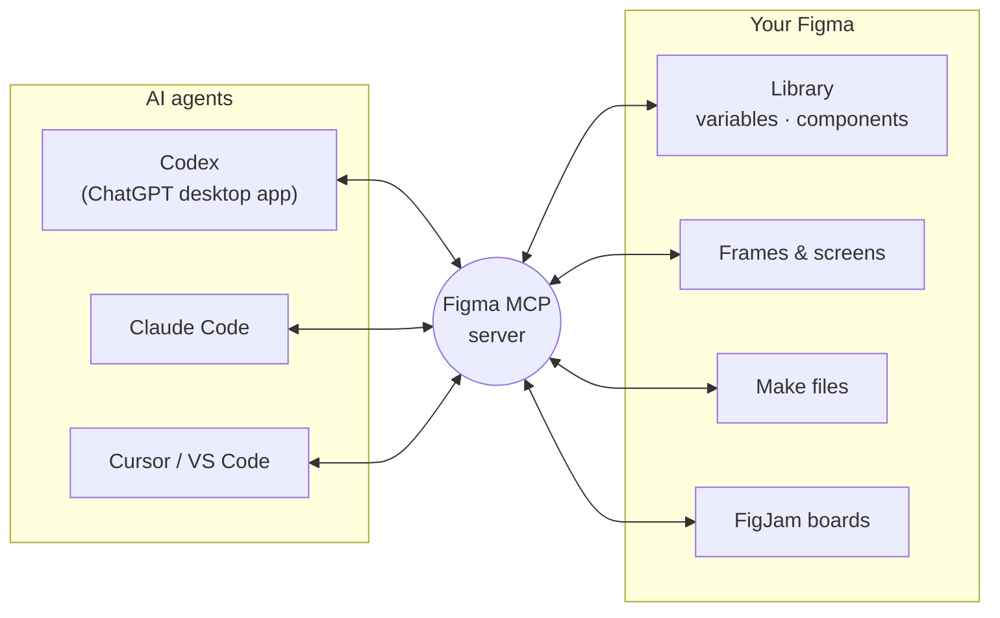
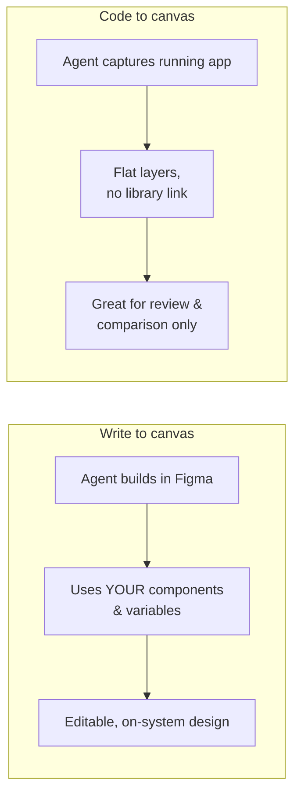
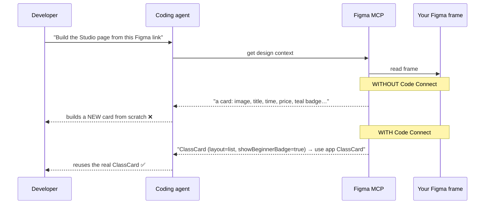

# Chapter 9: Code Connect and the Figma MCP server, explained

> ⏱ About 35 min · You'll learn: what the **Figma MCP server** is and what it lets AI agents do with your files (**read, write and capture**), what **Code Connect** is and why it's the strongest Figma↔code link, and **what you set up vs. what you ask developers for**.

---

## 📖 Story: the agent that kept inventing cards

Ana (mobile developer) shows you what happens when she asks her coding agent to build the "Studio page" from your Figma frame. The agent **reads the frame** correctly: layout, text, colours. But it **builds new cards from scratch** instead of using the existing `ClassCard` component. Each time, slightly differently.

Leo explains: *"The agent can see your design, but it doesn't know which code component each Figma component corresponds to. Code Connect tells it."*

---

## 🧠 Concept 1: MCP in one paragraph

**MCP (Model Context Protocol)** is an open standard that lets AI tools connect to other apps and data. Think of it as a universal adapter: an AI tool that "speaks MCP" can plug into any app that offers an **MCP server**.

The **Figma MCP server** is Figma's adapter. It lets AI agents (Codex, Claude Code, Cursor, VS Code, and others) **read** your Figma files and **write** into them ([Figma docs](https://developers.figma.com/docs/figma-mcp-server/)).

🔧 **Two ways to connect.** The **remote server** (recommended; Figma's hosted service, no desktop app needed) and a **desktop server** (via the Figma desktop app, for specific organisation needs). For **Codex**, Figma recommends installing the **Figma plugin in the Codex app**: open **Plugins**, add Figma, and allow access ([Figma setup docs](https://developers.figma.com/docs/figma-mcp-server/remote-server-installation/)).

---

## 🧠 Concept 2: What agents can do with your Figma (October 2026)

| Capability | What it means | Who typically uses it |
|---|---|---|
| **Read design context** | The agent gets structured info about a frame: layout, components, variables, text | Developers' agents building screens |
| **Read variables** | The agent gets your tokens | Building or syncing tokens |
| **Screenshots** | The agent gets an image of the frame to compare its work against | All design-to-code work |
| **Write to canvas** (beta) | The agent **creates and edits real Figma content** (frames, components, variables, auto layout) **using your library** | You, for bulk design work |
| **Code to canvas** | Captures **live UI** from a browser into **flat** Figma layers (not linked to your library) | Reviewing what was built (Chapter 4, 12) |
| **Make resources** | The agent pulls code and behaviour from a Figma Make prototype into the real app | Prototype → production |
| **FigJam resources** | Diagrams and flows become context for the agent | Early ideas into development |
| **Code Connect** | The agent learns **which code component** matches each Figma component | Consistent code |
| **Figma Specs** (open beta) | Agents read and update requirement specs | Requirements ↔ build |

🔧 **Plan notes:** writing to the canvas needs the remote server and a **Full seat** to write outside your drafts. It's **free during beta** and will become **usage-based**. Figma advises testing it on a **duplicate file** first ([docs](https://developers.figma.com/docs/figma-mcp-server/write-to-canvas/)). Rate limits apply by plan.

### Write to canvas vs. code to canvas (people mix these up)

---

## 🧠 Concept 3: Code Connect: telling agents "this is that"

**Code Connect** links each Figma component to its **real code twin**. Once linked ([Figma docs](https://developers.figma.com/docs/code-connect/)):

- **Dev Mode** shows developers the *real* code snippet for your component, not auto-generated guesses.
- The **Figma MCP server** passes that link to agents, so they **reuse the existing component** with the right settings.

### What you need to know (and what you don't)

You **don't** write Code Connect files. Developers (or their agents) do. Figma offers:

| Option | What it is | Who |
|---|---|---|
| **Code Connect UI** | Connect components **inside Figma**, with GitHub access; supports linking one Figma component to several platforms (e.g., iOS + Android) | Design + developers together |
| **Code Connect CLI** | Mapping files kept in the code | Developers |

🔧 On **Professional** plans you can have **one active framework** at a time. **Organization** and **Enterprise** can have several, which matters for separate iOS and Android code.

### Your part as a designer

1. **Prioritise** which components to connect first. Start with the most used: Button, ClassCard, TimeSlotChip, Input, Sheet, Tabs.
2. **Align properties with props** before mapping (naming agreement, Chapter 3).
3. **Verify** in Dev Mode: inspect an instance and check that the snippet shows the real component with matching settings.
4. **Don't rename** components or properties without telling developers. Mappings depend on the names.
5. **Track coverage:** "12 of 30 components connected" is a great health metric.

---

## 🧠 Concept 4: What makes MCP output good (or bad)

The agent's result can only be as good as what MCP gives it. MCP gives exactly what your file contains:

| In your file | Agent result |
|---|---|
| Components + variables + descriptions + Code Connect | Accurate, on-system code |
| Components + variables, no Code Connect | Right look, but **new** components instead of reused ones |
| Raw values, detached instances | Hardcoded values, inconsistent UI |
| Frames named "Frame 2341", groups instead of auto layout | Confused structure |
| Huge frame with 40 screens | Too much at once; worse results. **Link one screen or component at a time** |

> 💡 **Chapters 5–6 were MCP preparation all along.** Clean variables, components and descriptions = better agent output.

---

## 🧾 Real artifact: Movewell "MCP readiness" review

| Check | Before | After 3 weeks |
|---|---|---|
| Core screens use components (not detached) | 54% | 93% |
| Colours via variables | 69% | 98% |
| Components with descriptions | 0 | 22 / 30 |
| Code Connect coverage | 0 | 12 / 30 (all top-used) |
| Agent "invented a component" incidents per week | ~6 | ~1 (and it now *lists* what's missing) |

*(Illustrative numbers from the story.)*

---

## 🧰 Helpers

**MCP-readiness checklist (designer side)**

- [ ] Frames you hand off use library components, not detached copies
- [ ] All colours, spacing and type via variables and styles
- [ ] Component and variable descriptions written
- [ ] Layers semantically named; auto layout used
- [ ] One screen per link when handing to agents
- [ ] Top components Code-Connected; verified in Dev Mode
- [ ] Developers' agents have AGENTS.md with the Figma MCP flow

**Ask developers:**

1. "Are your agents connected to the Figma MCP server (remote)?"
2. "Can we set up Code Connect for our top 10 components? Which plan limits apply?"
3. "Can I sit with you once while your agent builds from my frame?"

---

## 🧪 Try it yourself (optional, 20 min, read-only)

If you have the ChatGPT desktop app with Codex:

1. Install the **Figma plugin** in the Codex app (Plugins → Figma → Allow access).
2. Copy a link to **one frame** (right-click → *Copy link to selection*).
3. Ask Codex: *"Using the Figma plugin, describe this frame: which components and variables it uses, any raw values, and anything that looks detached or inconsistent. Don't write code."*

You'll see your file **through an agent's eyes**. It's the fastest way to understand why Chapters 5–6 matter.

---

## ✅ Recap

1. The **Figma MCP server** lets agents **read** your designs, **write** to your canvas (beta) and **capture** live UI.
2. **Code Connect** tells agents **which real code component** each Figma component is, so they reuse rather than reinvent.
3. Your job: **clean files, aligned names, prioritised mappings, verified in Dev Mode.**

**Next → [Chapter 10: Designing with your system and AI](10-designing-with-system-and-ai.md)**
