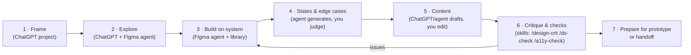
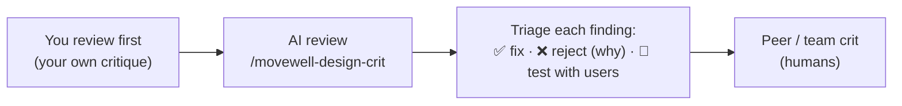

# Chapter 10: Designing with your system and AI

> ⏱ About 35 min · You'll learn: the **day-to-day design workflow** of an AI-native designer in Figma, how to direct the **Figma agent** with your library, how to turn your standards into **custom skills** (slash commands), and how to use AI for **critique** without lowering your bar.

---

## 📖 Story: designing "Recurring bookings"

Maya's top request is **recurring bookings**: "Book this class every Tuesday." It's your first feature on the newly cleaned-up system. Here's how a senior AI-native designer works through it in Figma, step by step.

---

## 🧠 Concept 1: The daily design loop



| Step | You decide | AI does |
|---|---|---|
| 1. Frame | Problem, users, success, constraints | Summarises the brief, suggests risks |
| 2. Explore | Which directions are worth pursuing | Generates genuinely different directions |
| 3. Build | Layout, hierarchy, which components | Assembles screens from your library |
| 4. States | Which states matter and how they behave | Generates all states and edge-case content |
| 5. Content | Final wording | Drafts copy in your voice with your glossary |
| 6. Critique | Accept, reject or test each finding | Structured review against heuristics, the system and accessibility |
| 7. Prepare | What goes to testing or build | Annotations, a summary of decisions |

---

## 🧠 Concept 2: Framing and exploring with ChatGPT

In the **Movewell project** (Chapter 2), short prompts are enough because the context is already there:

```text
Feature: recurring bookings ("book this class every week").
Give me the 5 biggest user risks and 5 business risks, based on what you know
about our users (UX.md). Then 4 genuinely different interaction concepts
(e.g., "toggle on booking sheet", "subscribe to class series", "smart rebook
suggestion after attending", "calendar-first"). For each: who it suits,
biggest risk, which existing components it would use, what's missing.
```

### 🧾 Real artifact: what came back (abridged)

> **Biggest user risk:** being charged for classes they forgot about, linked to the "surprise fees" insight in UX.md.
> **Concept C, "smart rebook after attending":** suits habit-builders; low commitment; uses BookingSummary + Toast; *missing:* a "series" state for ClassCard.

You pick **Concept A + C**: a toggle on the booking sheet, plus a gentle rebook suggestion after attending. **Your decision, with reasons.** That rationale goes into the brief (local context).

---

## 🧠 Concept 3: Building on-system with the Figma agent

🔧 Select a frame, press **Cmd/Ctrl + Enter** (or open the Agents sidebar), and **connect the Movewell library** first ([Figma Help](https://help.figma.com/hc/en-us/articles/37998629035799)).

```text
Using our connected library, build the booking sheet for a weekly recurring
class. Use @BookingSummary, @Toggle, @Button (variant=primary), and show the
cancellation rule above the button (see @color/text/secondary for the rule
text). Mobile, 390pt wide. Auto layout throughout.
```

**Senior habits with the agent**

1. **Connect the library before prompting.** Every time.
2. **@-mention** components and variables by name. Don't describe them.
3. **Small steps:** one screen or section per prompt, then refine.
4. **Run prompts in parallel** on different frames (the agent supports this) while you review others.
5. **Inspect the structure**, not just the look: are those real instances? Are variables bound?
6. **Duplicate before big changes** if you want a before/after comparison.

---

## 🧠 Concept 4: States and edge cases (AI's best busywork)

```text
For this booking sheet, create frames for every state: default, recurring ON,
no payment method, class full (waitlist), studio forbids recurring,
loading, network error, success. Use existing components and states only.
If a needed state doesn't exist in the library, list it instead of inventing.
```

Then stress-test the content:

```text
Duplicate the default state 4 times and fill with edge cases: a 60-character
class name, German UI text, a free class, and a price in credits.
```

> 💡 The "list it instead of inventing" line works in Figma too. You get a **system backlog**, not ad-hoc UI.

---

## 🧠 Concept 5: Content in your voice

Because voice and glossary live in the ChatGPT Project (and UX.md), copy prompts stay short:

```text
Write copy for the recurring toggle, helper text, the success toast, and the
"studio doesn't allow recurring" message. 3 options each, our voice, our words.
Recommend one per item.
```

Then **you edit**. AI drafts are usually 80% there, and the last 20% is your craft.

---

## 🧠 Concept 6: Custom skills: your standards as slash commands

**Custom skills** package a repeatable workflow into reusable instructions for the Figma agent. You trigger them with a slash command such as `/ds-check`. They're Markdown files following the open **Agent Skills** format, available across your files, in Figma Design and Figma Make ([Figma Help](https://help.figma.com/hc/en-us/articles/40283639496599)). You can:

- **Ask the agent to write one:** *"Turn this conversation into a skill."*
- **Upload** a Markdown skill file
- **Write** one manually

### 🧾 Real artifact: Movewell's `/movewell-ds-check` skill

```markdown
---
name: movewell-ds-check
description: Use this skill whenever the user asks to check, review or QA a frame
  against the Movewell design system before handoff or prototyping.
---

# Movewell design-system check

Check the selected frame(s) and report a table: issue · where · severity · fix.

1. Colours, spacing, radius, type: every value must come from Movewell library
   variables/styles. Flag raw values.
2. Components: flag detached instances and any UI that looks like an existing
   component (Button, ClassCard, TimeSlotChip, BookingSummary, Sheet) but isn't one.
3. States: list missing states (loading, empty, error, disabled, focus).
4. Words: flag non-glossary terms (reserve→book, session→class, gym→studio,
   points→credits).
5. Behaviour rules: cancellation rule must appear before any Book button.
6. Accessibility: contrast risks, missing labels, targets < 44pt, colour-only meaning.
   Mark contrast as "verify with a checker".

Do not change anything. End with the 3 most important fixes.
```

Name skills specifically (`movewell-…`), as Figma recommends, to avoid clashes with others' skills.

**Useful skills to create**

| Skill | Does |
|---|---|
| `/movewell-ds-check` | System, words, behaviour rules, accessibility (above) |
| `/movewell-design-crit` | Strict heuristic critique for a named user and task |
| `/movewell-states` | Generates all states and edge-case content for a selection |
| `/movewell-handoff-notes` | Writes annotations: behaviour, states, components used, open questions |

Copy-ready versions: [toolkit/figma-agent-skills.md](../toolkit/figma-agent-skills.md).

---

## 🧠 Concept 7: Critique, AI as second reviewer



- **Review it yourself first**, so AI doesn't anchor your thinking.
- Treat AI findings as **hypotheses**. Some will be generic or wrong.
- **"Test with users"** is a valid outcome. Some questions can't be settled by opinion, AI's or yours.

---

## 🧠 Concept 8: Bulk work with write to canvas (optional, more advanced)

For **bulk** tasks across many frames, such as "convert all raw values in this file to variables" or "create the 12 empty states from this list", an external agent like **Codex** can **write to the canvas** through the Figma MCP server, using your components and variables ([Figma docs](https://developers.figma.com/docs/figma-mcp-server/write-to-canvas/)). 🔧 It's in beta: test on a **duplicate**, and expect it to become a paid, usage-based feature.

For everyday single-frame work, the **in-Figma agent** is simpler.

---

## 🧰 Helpers

- [Figma agent skills (copy-ready)](../toolkit/figma-agent-skills.md)
- [Prompt pack: explore, states, content, critique](../toolkit/prompt-pack.md)
- **Before-handoff mini checklist:** `/movewell-ds-check` clean · all states present · edge-case content tested · copy final · decisions annotated

---

## 🧪 Try it yourself (optional, 30 min)

1. In Figma, open the agent and ask: *"Turn the following into a skill"*, then paste the `/ds-check` skill above, adapted to your product.
2. Run it on a real frame. How many issues did it find that you'd have missed? How many were wrong?
3. Improve one line of the skill based on what you saw.

---

## ✅ Recap

1. The loop: **frame → explore → build on-system → states → content → critique → prepare.**
2. Direct the Figma agent with a **connected library and @-mentions**, in small steps.
3. Turn your standards into **custom skills**, and use AI as a **second reviewer**, not the first.

**Next → [Chapter 11: Prototyping with Figma Make and friends](11-prototyping.md)**
