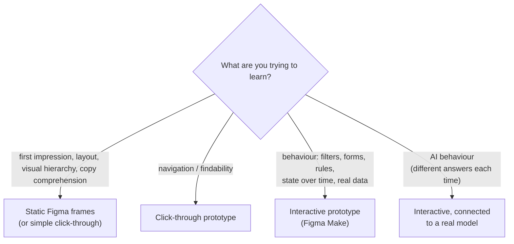
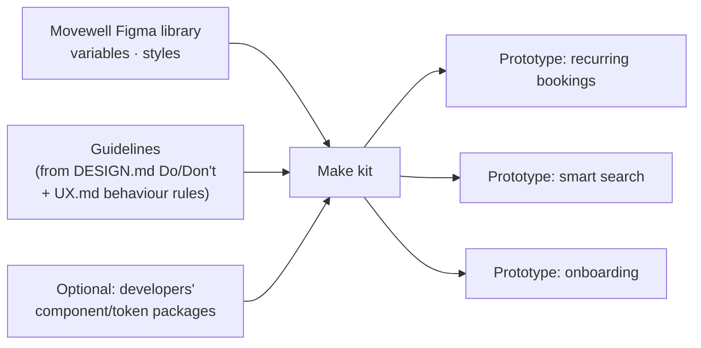
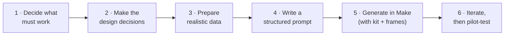
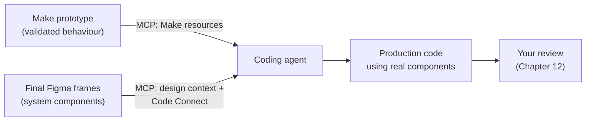

# Chapter 11: Prototyping with Figma Make and friends

> ⏱ About 35 min · You'll learn: when you need an **interactive** prototype, how to build one in **Figma Make on top of your design system**, how to give it **realistic data**, how to **test** it with real users, and how a prototype can feed **production** without becoming it.

---

## 📖 Story: does "repeat weekly" actually make sense?

Your recurring-bookings design looks clean in static frames. But the real questions are about **behaviour**: What happens when the studio cancels one week? Does the user understand they'll be charged weekly? Can they skip one week easily?

Static screens can't answer these. You need something people can **use**.

---

## 🧠 Concept 1: Static or interactive?



**Rule of thumb:** build the **lowest fidelity that answers the question**. AI makes high fidelity *cheap to create*, but not free: it slows iteration and invites "can we ship this?".

### Real-world evidence

NN/G's 2026 article on AI prototyping describes two real cases ([NN/G](https://www.nngroup.com/articles/test-earlier-with-ai/)):

- **Ramp:** a designer used an AI coding tool (Cursor) to prototype a complex policy editor. Participants tested it **with their own sanitised data**, and the team found a usability problem they *"couldn't have found… without an interactive prototype"*. Concept to demo took about **three weeks**.
- **Purdue University:** a traffic-data filter interface rebuilt as an interactive prototype (with v0 and Bolt) got **more specific feedback** than static wireframes. Participants treated static screens as "too early" to critique in depth.

---

## 🧠 Concept 2: Figma Make in a nutshell

🔧 **Figma Make** is Figma's AI prompt-to-app tool, available for **Full seats on paid plans** ([Figma Help](https://help.figma.com/hc/en-us/articles/31304412302231)). You can:

- **Attach your Figma designs** (and images or files) as context, or paste frames into the chat
- Iterate by **chatting**, or by pointing at parts of the preview with the **edit tool**, the **draw tool** and **annotations**
- Use **version history** to go back
- **Search the web** or fetch a URL to ground the app in real data
- **Add a backend** when you need saved data or logins
- **Share previews** with permissions, or **publish** to a URL
- **Copy a preview back into Figma Design as layers** to keep iterating on canvas
- Build **templates** and **Make kits** for your team

### Make kits: prototypes on your system

A **Make kit** can **import variables and styles from your design library**, include code packages for components and tokens, and add **guidelines** on how to use them. With a kit, Make prototypes look and behave like Movewell rather than "average app".



> 💡 Setting up the kit once means **every** prototype (yours, Sam's, Maya's) starts on-brand.

---

## 🧠 Concept 3: A reliable process for AI prototypes

Adapted from NN/G's six steps ([source](https://www.nngroup.com/articles/test-earlier-with-ai/)):



1. **Decide what must work** to answer your research questions, and what doesn't need to.
2. **Make the design decisions first.** If you leave decisions to the AI, it fills gaps with average choices.
3. **Prepare realistic data:** real exports (anonymised, if allowed) or synthetic data from ChatGPT.
4. **Write a structured prompt** (markdown works well).
5. **Generate**, attaching your frames and using your kit.
6. **Iterate one change at a time**, then pilot-test with a colleague before real sessions.

---

## 🧾 Real artifact: the recurring-bookings Make prompt

```markdown
# Prototype: Recurring bookings (research prototype)

## Research questions
1. Do users understand they'll be booked AND charged every week?
2. Can users skip a single week without cancelling the series?
3. What do users expect when the studio cancels one week?

## Must work
- Class details → booking sheet with "Repeat weekly" toggle
- Booking summary showing next 4 dates + price per class + cancellation rule
- "My bookings" showing the series; skip one date; cancel series
- Studio-cancelled week shows a notice and auto-refund of credits

## Doesn't need to work
Login, payment entry, search, profile.

## Data
Use attached classes.json (12 classes, 3 studios, credits + euro prices,
one studio that forbids recurring, one class cancelled on week 3).

## Design
Use the attached Figma frames and the Movewell kit. Mobile 390×844.
Follow our guidelines: cancellation rule BEFORE the Book button; glossary words.
```

### Realistic data from ChatGPT

```text
Generate classes.json: 12 realistic fitness/wellness classes in Vilnius across
3 studios. Fields: id, title, studio, instructor, weekday, time, durationMin,
difficulty (beginner/intermediate/advanced), beginnerFriendly (bool),
priceEUR, priceCredits, spotsLeft, cancellationRule, allowsRecurring (bool).
Include edge cases: a 60-character title, a free class, a full class,
one studio with allowsRecurring=false. Valid JSON only.
```

> ⚠️ Never put real users' personal data into prototypes or AI tools without approval. Synthetic data is usually enough.

---

## 🧠 Concept 4: Testing with real users

- **Moderated sessions**, 5 participants per round: enough to find most major issues.
- Share the **preview link**, and test it yourself first in a private window.
- **Reset** the prototype between participants.
- Tell participants **it's a prototype**.
- Analyse with AI help (Chapter 13), but **you** interpret.

### 🧾 Real artifact: Movewell findings (round 1)

| # | Finding | Severity | Change |
|---|---|---|---|
| 1 | 4/5 didn't realise "Repeat weekly" also meant **weekly charges** | Critical | Show "€14 every Tuesday" next to the toggle |
| 2 | 3/5 looked for "skip a week" inside the class, not in My bookings | Major | Add "Skip this week" on the class-details page for series |
| 3 | Studio-cancelled week: all 5 expected a push notification | Major | Add a notification pattern (new component request) |

None of these would have shown up in static screens.

---

## 🧠 Concept 5: The fidelity trap

A polished prototype prompts *"looks great, can we just ship it?"*. NN/G warns that AI prototypes can look complete while containing wrong patterns, confusing hierarchy and repeated elements. A strong designer should review before anything goes toward production ([NN/G](https://www.nngroup.com/articles/test-earlier-with-ai/)). From the engineering side, a prototype also lacks real security, performance, error handling and tests.

**How to handle it**

- Label links: **"Prototype — for research"**.
- Present **what you learned**, not the prototype itself.
- Offer the **path to production**: validated design → built with system components (Chapter 12).

---

## 🧠 Concept 6: From prototype to production, the right way

Make prototypes aren't thrown away entirely. Through the **Figma MCP server**, a coding agent can pull **code and behaviour from a Make file** and reimplement it **using the app's real components** ([Figma docs](https://developers.figma.com/docs/figma-mcp-server/bringing-make-context-to-your-agent/)). Figma's tip: **name the existing component** the agent should use, so it extends what exists instead of creating something new.



---

## 🧠 Concept 7: Other prototyping tools AI-native designers use

| Tool | When it's worth it |
|---|---|
| **Figma Make** | Default: closest to your files, library and kit |
| **v0, Lovable, Bolt** | Very fast standalone web prototypes; good hosted links; less tied to your system |
| **Coding agents (Codex, Cursor, Claude Code)** | Maximum control and realism, e.g., connecting to a real AI model (Chapter 14) or using the app's real components |

You don't need them all. **Make + Codex** covers almost everything with the tools you have.

---

## 🧰 Helpers

- Make prompt template and dataset prompt: [prompt pack](../toolkit/prompt-pack.md#prototyping)
- **Prototype checklist:**
  - [ ] Research questions written
  - [ ] "Must work / doesn't need to work" defined
  - [ ] Design decisions made in Figma first
  - [ ] Realistic data with edge cases
  - [ ] Make kit / frames attached
  - [ ] Pilot-tested; reset plan between sessions
  - [ ] Labelled "Prototype — for research"

---

## 🧪 Try it yourself (optional, 45 min)

Take one interaction from your own work that's hard to judge statically (a filter, a multi-step form). In Figma Make, attach your frames and use the structured prompt format. Generate realistic data with ChatGPT. Try it with one colleague. What did they do that you didn't expect?

---

## ✅ Recap

1. Prototype at the **lowest fidelity that answers the question**. Go interactive for **behaviour**.
2. **Make kits** put prototypes on your system. **Decide first, prompt second**, and use **realistic data**.
3. Test with **real users**, avoid the **fidelity trap**, and let agents carry validated behaviour into production with **real components**.

**Next → [Chapter 12: Design to code with Codex, as a designer](12-design-to-code-with-codex.md)**
