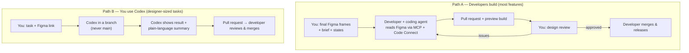
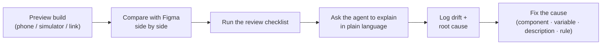
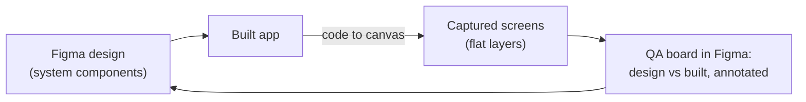

# Chapter 12: Design to code with Codex, as a designer

> ⏱ About 40 min · You'll learn: how design becomes code in an AI-native team, **how to review built UI without reading code**, how to **use Codex yourself** for safe, designer-sized tasks, and how to find and fix **drift** at its cause.

> You won't read or write code in this chapter. **Codex does the code; you direct and judge the result.**

---

## 📖 Story: the first agent-built screen

The recurring-bookings design is validated. Ana (mobile developer) builds it with her coding agent, reading your Figma frames through the MCP server, with Code Connect on the main components. Two days later she sends you a **preview build**.

It's 90% right. The remaining 10% is where your senior judgment matters.

---

## 🧠 Concept 1: Two ways design becomes code



| | Path A: developers build | Path B: you use Codex |
|---|---|---|
| **When** | Real features, anything with logic or data | Small UI fixes, copy and token tweaks, coded prototypes on real components, reports and checks |
| **Who writes code** | Developer's agent; developer owns it | Codex; **a developer still reviews and merges** |
| **Your role** | Design review of the running app | Directing Codex, judging the visual result |

> ⚠️ **Golden rule:** you never merge to the main version or release. Codex works in a **branch**, and developers review the **pull request**. Agree on this with your tech lead first.

---

## 🧠 Concept 2: Setting up Codex (once)

🔧 *As of October 2026* (check the current docs):

1. **ChatGPT desktop app**: Codex is part of paid ChatGPT plans (Plus and above), and ChatGPT Work and Codex share usage ([ChatGPT docs](https://learn.chatgpt.com/codex/pricing)).
2. **Figma plugin:** in the Codex app, open **Plugins**, add **Figma** and **Allow access** ([Figma docs](https://developers.figma.com/docs/figma-mcp-server/remote-server-installation/)).
3. **Code access:** ask your tech lead for access to the app's repository (usually via GitHub), and agree how you'll work: **branches only, PRs reviewed by developers.**
4. **Know AGENTS.md is there:** Codex reads it automatically, so your design-system rules (Chapter 8) guide it.

---

## 🧠 Concept 3: Reviewing built UI without reading code

You don't need code to judge whether the UI is right. You need **the running app, your Figma frames and a checklist**.



### The design review checklist (built UI)

**Look:** colours, type, spacing and radius match the system · light **and** dark mode · large text setting · long and translated content

**Components:** the right components are used (no look-alikes) · correct variants and states

**States:** empty · loading · error · disabled · offline · full / waitlist · success

**Behaviour:** taps and gestures · transitions · keyboard handling · back navigation · undo where promised

**Words:** glossary terms · voice · the cancellation rule before Book

**Accessibility:** contrast (check with a tool) · screen reader labels (VoiceOver / TalkBack quick pass) · touch targets · focus order

### Ask the agent to explain, in plain language

On the pull request, or in Codex with access to the branch:

```text
Explain this change to me as a designer, without code:
1) Which screens and components changed?
2) Which existing design-system components were used, and were any NEW
   components or styles created?
3) Were any colours, spacing or font sizes hardcoded instead of using tokens?
4) Which states are implemented (loading, empty, error, disabled, offline)?
5) Anything that differs from the Figma frame <link>, and why?
```

### 🧾 Real artifact: Codex's plain-language answer *(abridged)*

> **Screens changed:** Booking sheet, My bookings.
> **Components used:** BookingSummary, Toggle, Button (primary), ClassCard (state=series).
> **New things created:** ⚠️ a new "SeriesBadge" style, because no badge for "weekly" existed in the library.
> **Hardcoded values:** ⚠️ one spacing value (14) in the series list.
> **States:** default, loading, error ✓; ⚠️ offline not implemented.
> **Differences from Figma:** the "Skip this week" button uses secondary instead of ghost.

Without reading a line of code, you now have **four precise review comments**.

---

## 🧠 Concept 4: Drift, and fixing it at the cause

**Drift** is any difference between design intent and what was built. Senior designers fix the **cause**, so it doesn't happen again.

| Drift | Root cause type | Fix the screen | **Fix the cause** |
|---|---|---|---|
| New "SeriesBadge" invented | **System gap**: no badge for series | Use Badge | Add `Badge` variant `series` in Figma + code; describe it |
| Spacing 14 hardcoded | **Rule gap** | Use `space.md` | AGENTS.md already says "never hardcode": ask the developer to add an automatic check |
| Offline state missing | **Design gap**: offline wasn't designed | Design it | Add "offline" to the states checklist and the `/movewell-states` skill |
| Secondary vs ghost button | **Ambiguous description** | Change to ghost | Button description: *"Use ghost for low-emphasis actions inside sheets"* |
| "Reserve" instead of "Book" | **Context gap** | Change copy | Glossary present? Check that AGENTS.md references UX.md |

### Keep a drift log

| Date | What drifted | Where | Cause type | Fix | Cause fixed? |
|---|---|---|---|---|---|
| | | | system / rule / context / design / Figma hygiene / model | | |

After a month, **count the cause types**. That tells you where to invest: more components? Better descriptions? More Code Connect?

---

## 🧠 Concept 5: Designer-sized Codex tasks (Path B)

Things AI-native designers do themselves with Codex, always in a **branch** and through a **PR**:

| Task | Example prompt |
|---|---|
| **Copy fix** | "In a new branch, change 'Reserve' to 'Book' everywhere in the app's UI text. List every file changed in plain language and open a PR for review." |
| **Token tweak** | "Our Figma variable color/accent/beginner changed to amber/600 (link). Update the token, show me before/after screenshots, open a PR." |
| **Design-system report** | "Without changing anything, list every place in the app where colours or spacing are hardcoded instead of using tokens. Give me a table: screen, what, suggested token." |
| **DESIGN.md check** | "Run the DESIGN.md linter on our DESIGN.md and explain the results in plain language." |
| **Coded prototype on real components** | "In a new branch, build a throwaway prototype screen for 'Smart search' from this Figma frame using ONLY existing app components. Don't connect real data. Give me a way to run it in the simulator." |
| **Capture for review** | "Capture the booking flow from the running app into this Figma file (code to canvas) so I can compare it with the designs." |

> 💡 Start with **reports** (read-only), then **copy fixes**, then **token tweaks**. Build trust with developers step by step.

---

## 🧠 Concept 6: Close the loop on canvas

The MCP server's **code to canvas** captures the running UI as **flat** Figma layers ([Figma docs](https://developers.figma.com/docs/figma-mcp-server/code-to-canvas/)). Put captured screens **next to** your designs and annotate the differences. That's a design QA board everyone can see.



---

## 🧰 Helpers

- Review checklist and drift log: [checklists.md](../toolkit/checklists.md#built-ui-review)
- Codex prompts: [prompt pack](../toolkit/prompt-pack.md#codex)
- **Agreement to make with your tech lead (one paragraph):** *"I'll use Codex for copy fixes, token updates, read-only reports and throwaway prototypes, always in branches with PRs reviewed by a developer. I won't merge or release. Design-system rules in AGENTS.md are co-owned."*

---

## 🧪 Try it yourself (optional, 30 min, read-only)

If you have access to any codebase (even an open-source app), ask Codex for the **design-system report** prompt above. You'll get a picture of how consistent the UI really is, without reading a line of code.

---

## ✅ Recap

1. **Developers build features; you review the running app.** Codex lets you do designer-sized tasks safely in **branches with PRs**.
2. Review without code: **preview + Figma + checklist + "explain in plain language"**.
3. Log drift and **fix its cause** (system, rule, context, design, Figma hygiene).

**Next → [Chapter 13: Research in an AI-native workflow](13-research.md)**
