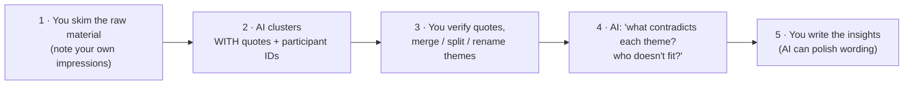
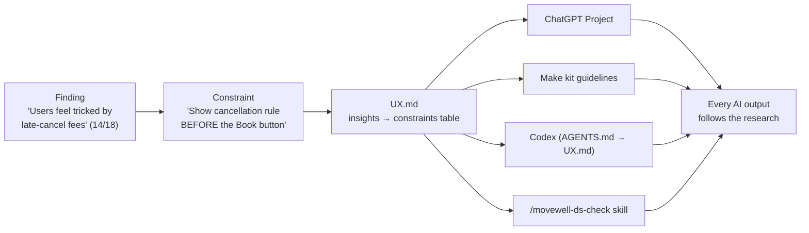

# Chapter 13: Research in an AI-native workflow

> ⏱ About 25 min · You'll learn: where AI genuinely helps research and where it misleads, a **safe synthesis workflow**, why **synthetic users** aren't users, and how to turn findings into **context** that improves every AI output.

---

## 📖 Story: "Can't we just ask ChatGPT what users want?"

Maya, half-joking: *"Could we skip interviews and ask ChatGPT to role-play our users?"* Priya, not joking: *"Then we'd be designing for the average user of every app ever, not ours."*

Both have a point. AI makes research **faster and cheaper**, but it can't **replace contact with real people**.

---

## 🧠 Concept 1: Where AI helps, and where it doesn't

| Research activity | AI role | Watch out for |
|---|---|---|
| Desk research, competitor scans | ✅ Strong: use ChatGPT **Work** mode or search, and open the sources | Invented or outdated facts; verify key claims |
| Interview guides, screeners, surveys | ✅ Strong: drafting and reviewing for bias | Leading questions it introduces itself |
| Transcription and note-taking | ✅ Strong (approved tools, consent) | Personal data handling |
| First-pass clustering of notes | ⚠️ Helpful | Wrong focus; invented or merged quotes; minority findings averaged away |
| Interpretation and insights | ⚠️ Assistant only | It sounds confident; **you** own the conclusions |
| Talking to and observing users | ❌ Not replaceable | — |
| Synthetic users | ⚠️ For rehearsing and pilot-testing materials only | Not evidence (see below) |

This matches practice. NN/G's 2026 survey of 521 UX practitioners found AI is used **most for desk work** and **least when real users are involved** ([NN/G](https://www.nngroup.com/articles/ai-in-ux-survey-26/)).

---

## 🧠 Concept 2: Synthetic users are not users

NN/G compared **120 AI-generated respondents** with **604 real humans** on the same open question. Both datasets reached the **same broad conclusion**, but the synthetic answers had **far less variety** ("mode collapse"), and the platform sometimes **reworded the question**, a methodological risk ([NN/G](https://www.nngroup.com/articles/synthetic-users-vs-human-respondents/)).

**What that means for you:**

- ✅ Use synthetic users to **rehearse** an interview or **pilot-test** a survey's wording.
- ✅ Use them to **generate hypotheses** you then test.
- ❌ Don't use them as **evidence** for decisions.
- ❌ Don't let them replace **usability testing**.

---

## 🧠 Concept 3: A safe synthesis workflow



### The clustering prompt (anonymised notes only)

```text
Here are anonymised notes from 8 interviews (P1–P8) about booking classes.
Cluster them into themes. For each theme: name, one-sentence insight, supporting
quotes WITH participant ID and line reference, number of participants.
Then list: evidence that contradicts each theme, and participants who don't fit
any theme. Do not invent or merge quotes.
```

### The verification habit

- Pick the **3 themes your decisions depend on most** and check every quote against the source.
- If any quote is invented or misattributed, **redo** the synthesis. Don't patch it.

---

## 🧠 Concept 4: From finding to constraint to context

Research only changes AI output if it reaches the **context**. This is the AI-native research loop:



### 🧾 Real artifact: one finding, end to end

| Stage | Content |
|---|---|
| **Raw** | P3: *"I didn't even see the 12-hour rule until they charged me."* (and 13 similar) |
| **Insight** | Users feel tricked by late-cancellation fees, mainly because the rule isn't visible at booking time. (14/18 interviews, Sept 2026) |
| **Constraint** | Show the cancellation rule **before** the Book button, in plain words, with the fee amount. |
| **Where it went** | UX.md table → ChatGPT Project file → Make kit guideline → `/movewell-ds-check` rule #5 |
| **Effect** | Maya's casual "booking screen" prompt now puts the rule in the right place automatically |

That's what NN/G calls **UX-context design**: research output becomes context that guides every AI tool, *"no matter who prompts it"* ([NN/G](https://www.nngroup.com/articles/ux-context-design/)).

---

## 🧠 Concept 5: Research with your real tools

| Task | Tool |
|---|---|
| Desk research, competitor scan with sources | ChatGPT **Work** mode (or Chat with search) |
| Guide / survey drafting and bias review | ChatGPT (Movewell project) |
| Synthesis first pass | ChatGPT (approved workspace, anonymised notes) |
| Mapping themes visually | FigJam (the agent can help organise sticky notes) |
| Turning insights into constraints | ChatGPT → you edit → UX.md |
| Testing behaviour | Figma Make prototypes with real users (Chapter 11) |

---

## 🧰 Helpers

- Research prompts (desk research, guide review, clustering, contradiction check): [prompt pack](../toolkit/prompt-pack.md#research)
- **Research integrity checklist:**
  - [ ] Real users involved for every decision-critical question
  - [ ] Notes anonymised before any AI tool
  - [ ] Quotes traceable to participant and source
  - [ ] Contradicting evidence and outliers checked
  - [ ] Insights written as constraints, dated, with evidence strength
  - [ ] UX.md updated

---

## 🧪 Try it yourself (optional, 30 min)

Take notes from any past interview round (anonymised). Run the clustering prompt, then verify 5 quotes against your notes. How many were exact? Write your top 2 insights as **constraints** in UX.md format.

---

## ✅ Recap

1. AI speeds up **desk work and first-pass synthesis**; it **can't replace** real users.
2. Use the **safe synthesis workflow**: you skim → AI clusters with quotes → you verify → AI challenges → you conclude.
3. Turn findings into **constraints in UX.md**, so research shapes every AI output.

**Next → [Chapter 14: Designing the AI feature, "Find me a class"](14-designing-the-ai-feature.md)**
