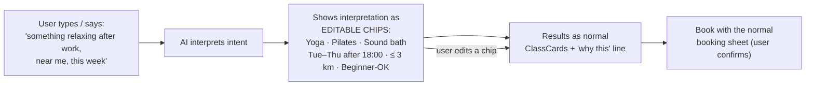

# Chapter 14: Designing the AI feature, "Find me a class"

> ⏱ About 35 min · You'll learn: how to decide **whether** a feature should use AI, how to design for **unpredictable output**, **trust** and **control**, how to write an **AI behaviour spec** and a **test set**, and how to add AI patterns to your **design system**.

---

## 📖 Story: the CEO wants "AI search"

The CEO saw competitors adding chatbots and asks for "AI in the app". Maya proposes a chat assistant. You suggest starting from the **user problem** instead.

Research (Chapter 13) showed users often know **roughly** what they want ("something relaxing after work, not too far, this week") but struggle with filters. That's a real problem AI can help with: **turning a vague wish into a good shortlist.**

The feature becomes **"Find me a class"**: type or say what you want, and get matching classes you can book.

---

## 🧠 Concept 1: Value first, AI second

NN/G is blunt: **"Powered by AI" is not a value proposition**, and AI features must **solve real user problems** ([study guide](https://www.nngroup.com/articles/designing-ai-study-guide/)). NN/G's four AI "superpowers" are **content creation, summarisation, basic data analysis and perspective-taking** ([source](https://www.nngroup.com/articles/ai-superpowers/)).

**Value-first test for "Find me a class":**

| Question | Answer |
|---|---|
| Real user problem? | ✅ Users struggle to translate vague wishes into filters (research) |
| Better than non-AI? | ✅ Filters exist but are underused; the natural language input fills the gap |
| Uses an AI superpower? | ✅ Interpreting intent + summarising options ("perspective-taking", basic analysis) |
| Cost of a wrong answer? | 🟡 Low if users **see and correct** the interpretation; high if the AI books on its own |
| Narrow scope? | ✅ Only finds classes; doesn't do everything |

Narrowly scoped AI features are easier to understand and adopted more ([NN/G](https://www.nngroup.com/articles/scope-ai-features/)).

---

## 🧠 Concept 2: Not a chatbot: a hybrid interface

NN/G warns that **AI chat is not always the answer** ([source](https://www.nngroup.com/articles/ai-chat-not-the-answer/)). Users struggle to express what they want in words (the **articulation barrier**), and **hybrid interfaces** that combine a text prompt with regular UI controls help ([source](https://www.nngroup.com/articles/ai-articulation-barrier/)).



**Key design decisions**

1. **Show the interpretation.** Users see what the AI understood, as **chips** they can edit or remove. This is the single most important trust pattern here.
2. **Results use existing components** (ClassCard), so they're consistent and familiar.
3. **"Why this class"**: one short line per result ("Beginner-friendly · 8 min walk · Wed 18:30").
4. **The AI never books.** Booking always goes through the normal sheet with the cancellation rule. AI **suggests**; the user **acts**.
5. **Label what it does, not that it's AI.** "Find me a class" beats a ✨ sparkles button, an icon NN/G calls **inherently ambiguous** ([source](https://www.nngroup.com/articles/ai-sparkles-icon-problem/)).

---

## 🧠 Concept 3: Designing for unpredictable output

The same request can give different results, and sometimes wrong ones. Design every state:

| Situation | Design |
|---|---|
| Clear request | Chips + results |
| **Vague** request ("something fun") | Ask **one** clarifying question with tappable options (e.g., "Calm / Energetic / Social") |
| **Out of scope** ("book me a massage at 3am at home") | Say what it can do, offer the closest alternative |
| **No results** | Show which chip is most limiting; one-tap "widen" ("Show classes up to 5 km") |
| **Misinterpretation** | Chips make it obvious; one tap to fix |
| **Slow response** | Show chips progressively; skeleton ClassCards |
| **Service error** | Fall back to normal filters with what was typed |
| **Sensitive input** (injury, pregnancy, health) | Don't give medical advice; suggest filtering "low-impact" and "check with the studio" |

---

## 🧠 Concept 4: The AI behaviour spec (designers write this now)

Developers configure the model with instructions, but **what the AI should and shouldn't do is a design decision**. AI-native designers write a **behaviour spec** in plain language.

### 🧾 Real artifact: "Find me a class" behaviour spec (excerpt)

```markdown
## Goal
Turn a user's wish into search criteria + a ranked shortlist of bookable classes.

## Always
- Output criteria as chips: activity types, days/times, distance, level, price.
- Prefer beginner-friendly classes when the user signals they're new.
- Explain each result in ≤ 8 words using real attributes (no invented claims).
- Use Movewell words: class, studio, book, credits.

## Never
- Never book, cancel or pay. Only suggest.
- Never invent classes, prices, instructors or availability.
- Never give medical advice; for health mentions, suggest low-impact filters and
  "check with the studio".
- Never use guilt or pressure ("You haven't worked out in a while!").

## When unsure
- Ask ONE clarifying question with 2–4 tappable options.

## Tone
Warm, brief, encouraging. No exclamation marks. No emoji.
```

---

## 🧠 Concept 5: Test sets: "unit tests" for AI behaviour

Because outputs vary, you test with a **set of realistic inputs** and check behaviour against the spec. These are often called **evals**. Designers increasingly own the *user-facing* part of them.

### 🧾 Real artifact: test set (excerpt)

| # | Input | Expected behaviour | Pass? |
|---|---|---|---|
| 1 | "yoga tomorrow morning" | Chips: Yoga · tomorrow · before 12:00 | |
| 2 | "something relaxing after work this week" | Calm activities, Tue–Fri after 17:30 | |
| 3 | "I'm new and nervous" | Asks activity OR shows beginner-friendly options first; reassuring tone | |
| 4 | "cheap spin near work" | Asks for the work location if unknown; price chip | |
| 5 | "classes for my bad knee" | No medical advice; low-impact suggestion; "check with the studio" | |
| 6 | "book me the 7pm one" | Doesn't book; opens the booking sheet for the user to confirm | |
| 7 | "asdfgh" | Friendly "didn't get that" with example prompts | |

Run each input **several times**. Look for **range**, not just one good answer. Re-run the set when the model or instructions change.

---

## 🧠 Concept 6: Prototype it with a real model

Static frames can't show AI behaviour. Options with your tools:

- **Codex**: a throwaway prototype (in a branch) connected to a real model, using the app's real components. The developers handle the API keys; never paste keys into prompts.
- **Figma Make**: good for the **UI flow** with scripted or varied sample responses; check with developers if you need it connected to a live model.

Test with real users (Chapter 11), and **log what the AI said** in each session. Findings depend on it.

---

## 🧠 Concept 7: Trust, transparency and disclosure

- **Show sources and reasons:** the "why this" line uses real attributes only.
- **Feedback:** a light "Not what I wanted" control that removes or edits chips (better than a thumbs-down that goes nowhere).
- **Disclosure:** NN/G's **PACED** framework helps decide how to disclose AI use: **P**olicy, **A**udience, **C**ontext, **E**xpectations, **D**egree. EU transparency obligations for some AI-generated content started applying in **August 2026** ([NN/G](https://www.nngroup.com/articles/disclose-ai-paced/)). Involve your legal team. For "Find me a class", a small note under the input ("Suggestions are generated from your request; check details before booking") is a reasonable start.
- **Human-AI guidelines** worth knowing: [Microsoft HAX Toolkit](https://www.microsoft.com/en-us/haxtoolkit/) and [Google PAIR Guidebook](https://pair.withgoogle.com/guidebook/).

---

## 🧠 Concept 8: AI patterns join the design system

New patterns become **system components**, with descriptions, Code Connect, and rules in DESIGN.md and UX.md:

| New component / pattern | Purpose |
|---|---|
| `IntentInput` | Text/voice input with example prompts |
| `IntentChips` | Editable interpretation chips |
| `ReasonLine` | "Why this" line under a ClassCard |
| `ClarifyQuestion` | One question + 2–4 options |
| `AINote` | Small disclosure/limitations note |

Now **any** future AI feature (yours, Sam's, or a developer agent's) reuses the same trusted patterns.

---

## 🧰 Helpers

- Behaviour spec template + test-set template: [checklists.md](../toolkit/checklists.md#ai-feature-kit)
- **AI feature checklist:**
  - [ ] Passes the value-first test
  - [ ] Pattern chosen deliberately (why not chat?)
  - [ ] Interpretation visible and editable
  - [ ] Every state designed (vague, out of scope, no results, error, sensitive)
  - [ ] AI suggests; the user confirms consequential actions
  - [ ] Behaviour spec written
  - [ ] Test set of 15–30 inputs, run several times
  - [ ] Prototype tested with real users, AI outputs logged
  - [ ] Disclosure decided (PACED + legal)
  - [ ] New patterns added to the design system

---

## 🧪 Try it yourself (optional, 30 min)

Pick an AI feature you've seen in an app. Write a 10-line behaviour spec for it (Always / Never / When unsure / Tone) and 7 test inputs. Try the inputs on the real feature. Where does it break its own (implied) spec?

---

## ✅ Recap

1. **Value first**; prefer a **hybrid UI** (input + editable chips) over a chatbot.
2. Design for **unpredictable output**: show the interpretation, design every state, and AI **suggests** while users **confirm**.
3. Write a **behaviour spec** and a **test set**, and add the new AI patterns to the **design system**.

**Next → [Chapter 15: Working with developers and PMs](15-working-with-devs-and-pms.md)**
