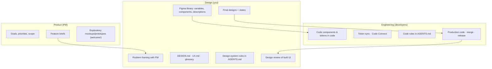
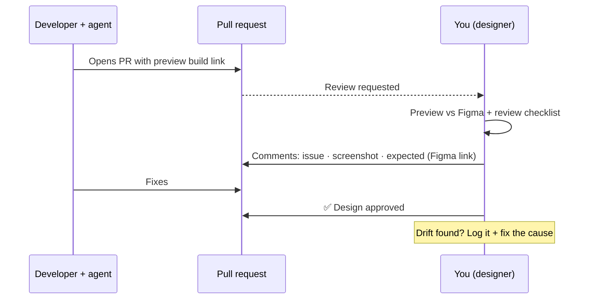

# Chapter 15: Working with developers and PMs

> ⏱ About 30 min · You'll learn: **who owns what** in an AI-native product team, what a **modern handoff** looks like, how to respond when **PMs and developers generate UI with AI**, and the light routines that keep design and code in sync.

---

## 📖 Story: everyone is designing now

Three things happen in one week:

1. Maya (PM) shares a Make prototype she built for "gift a class". It looks good, but uses non-system components.
2. Ana (developer) asks whether she can let her agent "just fill in the empty states", since they weren't designed.
3. Leo (developer) proposes adding a `variant="soft"` Button because "the agent kept needing it".

Each is a chance to either **fight about turf** or **strengthen the system**. Senior AI-native designers choose the second.

---

## 🧠 Concept 1: Who owns what



| Thing | Owner | Others |
|---|---|---|
| What problem, why now | **PM** | Design |
| How it works for users, how it looks | **Design** | PM, developers |
| How it's built, code quality | **Developers** | Design reviews the result |
| Design system in Figma + context files | **Design** | Developers review names |
| Design system in code + sync | **Developers** | Design reviews |
| AGENTS.md | **Shared**: design-system rules (design), code rules (developers) | |
| What ships | **Developers** merge; **design** approves UI; **PM** approves scope | |

**Key principle:** anyone can *explore* with AI. **Design owns the experience; developers own the code.**

---

## 🧠 Concept 2: When PMs and developers generate UI

NN/G's view: in many organisations designers are no longer the only ones producing designs, and **gatekeeping is counterproductive**. The goal is to ensure **everything AI generates, no matter who prompts it, is informed by the organisation's user knowledge and design standards** ([NN/G](https://www.nngroup.com/articles/ux-context-design/)).

| Situation | ❌ Turf response | ✅ AI-native response |
|---|---|---|
| PM shares an AI prototype | "Please leave design to designers." | "Great for exploring the idea! Let's use the Movewell Make kit so it's on-system, then I'll take it from here." |
| Developer's agent fills undesigned states | "Don't do that." | "Let's design them together now (20 min), and I'll add them to the component so the agent finds them next time." |
| Developer wants a new Button variant | "No new variants." | "What's the use case? If it's real, we add it to Figma and code together, with a description. If not, which existing variant fits?" |
| Agent output is off-brand | "The AI is bad." | "Which context was missing? Let's add it to UX.md / AGENTS.md." |

### Give everyone the context

The most effective move: **share your AI setup**.

- Invite the PM and developers to use the **Movewell ChatGPT Project** (or share its instructions and files).
- Make the **Make kit** the default for anyone prototyping.
- Keep **DESIGN.md and UX.md in the code**, where developers' agents read them.

Then *their* AI output improves without you reviewing every mockup.

---

## 🧠 Concept 3: The modern handoff package

Redlines and long specs are mostly gone. Agents read structure directly from Figma. What developers (and their agents) need now:

### 🧾 Real artifact: Movewell handoff note (recurring bookings)

```markdown
# Handoff: Recurring bookings

**Figma:** [Booking sheet](link) · [My bookings – series](link) · [All states](link)
  (one link per screen — agents work best with one screen at a time)
**Prototype + test findings:** [Make prototype](link) · [Findings](link)

## What & why
Users can repeat a class weekly. Research: users must see weekly charges clearly
(4/5 missed it in round 1 → "€14 every Tuesday" next to the toggle).

## Components
Uses: BookingSummary, Toggle, Button (primary/ghost), ClassCard (state=series — NEW),
Badge (variant=series — NEW). New ones are in the library with descriptions;
please add code twins + Code Connect.

## States (all designed)
default · recurring on · studio forbids recurring · class full · loading ·
network error · offline · success · skip-a-week · cancel-series (fee / no fee)

## Behaviour rules
- Cancellation rule above the Book button (UX.md).
- Skip one week: undo for 10 s; no fee if > 12 h before.
- Studio cancels a week: notify + refund credits automatically.

## Open questions
- Push notification copy needs legal check (Maya).
```

---

## 🧠 Concept 4: Reviewing built UI as a routine



**Good review comments** are specific and linked:

> *"Skip-week button should be **ghost**, not secondary (see Button description: 'ghost for low-emphasis actions in sheets'). [Figma link] [screenshot]"*

---

## 🧠 Concept 5: Light routines that keep everything in sync

| Routine | Cadence | Why |
|---|---|---|
| **Pairing with a developer** | Weekly, 1 h | Resolve system gaps live; learn each other's tools |
| **Design review on PRs** | Every UI change | Catch drift early |
| **Drift review** | Monthly, 30 min | Count causes; decide fixes (components, descriptions, rules) |
| **Context check** | After each research round | Update UX.md; remove stale rules |

### Definition of done for UI (agree it once)

- [ ] Built from system components (new ones added on both sides)
- [ ] No hardcoded design values
- [ ] All designed states implemented
- [ ] Accessibility basics checked
- [ ] Words match the glossary
- [ ] Design review approved on the preview build

---

## 🧰 Helpers

- Handoff note template and review comment format: [checklists.md](../toolkit/checklists.md#handoff-note)
- **Phrases that work:**
  - "Which context was missing?" (instead of "the AI is bad")
  - "Let's add it to the system so the agent finds it next time."
  - "Great exploration. Let's put it on the kit so it's on-system."
  - "Prototype for research; here's the path to production."

---

## 🧪 Try it yourself (optional, 20 min)

Take your last handoff. Rewrite it in the format above: **links per screen, what and why, components (new marked), all states, behaviour rules, open questions**. What did you previously leave implicit that an agent would have had to guess?

---

## ✅ Recap

1. **Anyone can explore with AI. Design owns the experience; developers own the code.**
2. Share your **context and kits** so everyone's AI output is on-system, rather than gatekeeping.
3. Modern handoff = **structured Figma + brief + all states + behaviour rules**, then **design review on preview builds**.

**Next → [Chapter 16: Your senior AI-native toolkit](16-toolkit.md)**
