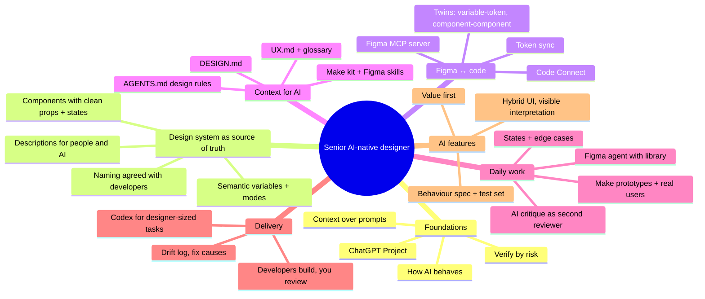
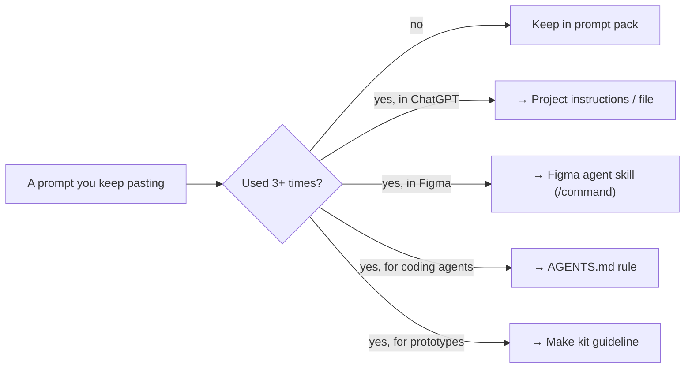

# Chapter 16: Your senior AI-native toolkit

> ⏱ About 25 min · Everything in one place: the **master map**, your **daily and weekly routines**, all **helpers**, a **skills self-check** from mid to senior AI-native, and **other tools** worth knowing.

---

## 🗺️ The master map

---

## 🧰 All helpers

| Helper | What it is | File |
|---|---|---|
| ChatGPT Project instructions | Your product-aware ChatGPT setup | [toolkit/chatgpt-project-instructions.md](../toolkit/chatgpt-project-instructions.md) |
| Figma agent skills | `/ds-check`, `/design-crit`, `/states`, `/handoff-notes`, `/ds-audit` | [toolkit/figma-agent-skills.md](../toolkit/figma-agent-skills.md) |
| Prompt pack | Explore, audit, tokens, states, copy, prototyping, research, Codex | [toolkit/prompt-pack.md](../toolkit/prompt-pack.md) |
| Checklists | Tokens, components, MCP-readiness, built-UI review, drift log, AI feature kit, handoff | [toolkit/checklists.md](../toolkit/checklists.md) |
| DESIGN.md template | Visual rules for AI | [toolkit/DESIGN.md](../toolkit/DESIGN.md) |
| UX.md template | Users, insights → constraints, behaviour, words | [toolkit/UX.md](../toolkit/UX.md) |
| AGENTS.md design section | Rules for coding agents | [toolkit/AGENTS.md](../toolkit/AGENTS.md) |
| Component description template | Mini-spec for people and AI | [toolkit/component-description-template.md](../toolkit/component-description-template.md) |

### Make helpers permanent

---

## 🔁 Routines of an AI-native designer

### Daily (built into your work)

- Start design work in the **ChatGPT Project** (frame, explore) or the **Figma agent with the library connected**.
- Let AI do **states, edge-case content, renaming, tokenising**; you do decisions.
- Run **`/ds-check`** before sharing anything.
- Review **preview builds** the same day they arrive.

### Weekly

- 1 h **pairing** with a developer.
- 15 min: update **UX.md / DESIGN.md** with anything learned ("which context was missing?").
- 15 min: turn one repeated prompt into a **skill or rule**.

### Monthly

- **Drift review**: count causes and pick the top fix.
- **Context test**: re-run 2–3 prompts with and without context; still improving?
- Try **one** new AI capability on a real task, and keep it only if it earns its place.

---

## 📈 Skills self-check: mid → senior AI-native

Rate yourself 1–4 (1 = new to it, 2 = tried it, 3 = do it routinely, 4 = could teach it).

| Skill | Chapter | Mid-level typically | Senior AI-native |
|---|---|---|---|
| Explain AI behaviour and failure modes | 2 | 1–2 | 3 |
| Use a ChatGPT Project as product context | 2 | 1 | 3 |
| Design semantic variables with modes | 5 | 2 | 4 |
| Build components with clean props, states, descriptions | 6 | 2–3 | 4 |
| Explain Figma ↔ code twins and token flow | 7 | 1 | 3 |
| Write DESIGN.md / UX.md and test them | 8 | 1 | 3 |
| Prepare files for MCP; prioritise Code Connect | 9 | 1 | 3 |
| Direct the Figma agent; build custom skills | 10 | 1–2 | 3–4 |
| Prototype behaviour in Make with realistic data; test it | 11 | 2 | 3–4 |
| Review built UI without code; use Codex safely | 12 | 1 | 3 |
| Research with AI without losing integrity | 13 | 2 | 3 |
| Design an AI feature with spec + test set | 14 | 1 | 3 |
| Collaborate with devs/PMs using shared context | 15 | 2 | 3–4 |

**You're a senior AI-native designer** when most rows are at **3**, and you can show **evidence**: a system with descriptions and Code Connect, context files that measurably improve output, a drift log with causes fixed, and a tested AI feature.

---

## 🧩 Other tools worth knowing

You can do everything in this guide with **Figma + ChatGPT/Codex**. These are worth knowing about because many AI-native designers use them, but **adopt one only when it solves a problem you actually have**.

| Tool | What it is | When it's worth it |
|---|---|---|
| **Claude / Claude Code** (Anthropic) | General assistant + coding agent; strong Figma MCP support (Figma plugin) | If your developers use it, or you prefer its writing and critique |
| **GitHub Copilot** | Coding agent in VS Code, the CLI and GitHub | If your company standardises on it; works with the Figma MCP server |
| **Cursor** | AI code editor | Popular with design engineers for coded prototypes |
| **v0, Lovable, Bolt** | Prompt-to-web-app builders | Very fast standalone web prototypes with hosted links |
| **Google Stitch** | Google's AI design tool (where DESIGN.md originated) | Exploring alternative AI design workflows |
| **Tokens Studio, Style Dictionary** | Token management / transformation | Your developers will likely choose these for token sync |
| **zeroheight, Supernova** | Design system documentation platforms | When docs outgrow Figma descriptions |
| **FigJam (with AI)** | Whiteboarding | Research mapping, flows, workshops |

🔧 Check plans, pricing and data policies before adopting any tool at work.

---

## 📚 Keep learning (trusted sources)

- **NN/G AI articles:** research-based, updated weekly: [nngroup.com/topic/ai](https://www.nngroup.com/topic/ai/)
- **Figma Help, "Use AI in your design workflows":** [collection](https://help.figma.com/hc/en-us/sections/41296947580311-Use-AI-in-your-design-workflows)
- **Figma MCP server docs:** [developers.figma.com](https://developers.figma.com/docs/figma-mcp-server/)
- **ChatGPT / Codex docs:** [learn.chatgpt.com](https://learn.chatgpt.com/codex)
- **Design tokens standard:** [designtokens.org](https://www.designtokens.org/)
- **DESIGN.md:** [github.com/google-labs-code/design.md](https://github.com/google-labs-code/design.md)
- **Paid, if you want to go deeper:** [AI & Design Systems (Brad Frost et al.)](https://aianddesign.systems/) and the [AI Design Systems & Prototyping intensive (Christine Vallaure)](https://maven.com/moonlearning/ai-design-systems)

### Next step: leading

When you're ready to lead AI adoption for a team (policy, pilots, training), see the earlier course: [AI-Native Design Lead](https://vygantas-meskauskis.github.io/learning-library/courses/ai-native-design-lead-course/).

---

## ✅ Final recap

1. **Your system is AI's source of truth.** Clean variables, components and descriptions, linked to code.
2. **Context makes AI yours.** DESIGN.md, UX.md, AGENTS.md, a ChatGPT Project, Figma skills and a Make kit.
3. **You direct and judge.** AI drafts, explores and builds; you decide, test with real users, review what ships, and fix causes rather than symptoms.

**→ Back to [Start](../README.md)**
